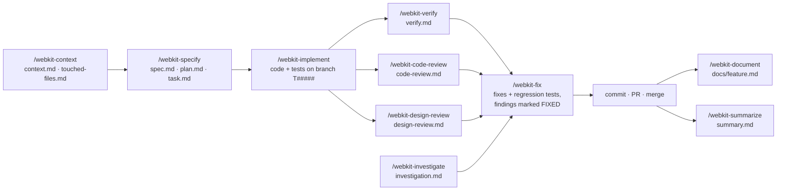

# .agents — the AI agent kit

Rules, workflow commands, and document templates that make AI coding agents (Claude Code first, plus Antigravity/Gemini, Cursor, and Copilot) work on our Laravel + Vue / React projects the same way every time. It is one git repository, cloned into each project as `.agents/` and kept out of the project's own history.

## What it is

Three things, used together:

- **Rules** ([rules/](./rules/)): what is always true in our codebases and how code must be written there. A small **core** set is loaded on every turn ([rules/core/](./rules/core/): the project gate, authority boundary, git workflow, security baseline), plus the [context budget](./rules/context-budget.md) and the [rule router](./rules/rule-router.md); everything else lives in [rules/conditional/](./rules/conditional/) (backend, database, frontend, mobile, realtime, payroll, testing, …) and is read only when the router says the task needs it.
- **Skills** ([skills/](./skills/)): twelve `/webkit-*` commands, one per stage of the work: context, specify, implement, verify, code-review, design-review, fix, investigate, refactor, document, migrate, summarize. Each one is a written procedure the agent follows step by step; the steps they all share are written once in [skill-protocol.md](./rules/conditional/skill-protocol.md).
- **Templates** ([template/](./template/)): the fixed format of every document a skill writes (spec, plan, task tracker, reports, summaries), so every ticket's documents look the same and a later skill knows where to find each fact.

The skills write their documents into a **ticket folder** (`specs/<project>/T00001/`). Everything a later session needs is on disk there, not in someone's chat history.

## Why it exists

Left to itself, an agent working on these repos made the same mistakes again and again:

- **It applied the wrong project's conventions.** The codebases share a backend pattern but have opposite database rules (one indexes `id`-prefixed columns and has no foreign keys; the other uses real foreign keys and `<parent>_id` columns). Code written to the other project's rules looks right and is wrong. The kit makes the agent identify the project before it writes anything.
- **It invented things.** Columns, routes, models, and env keys that do not exist. The rules make it check `app/Models/`, the migrations, and `routes/api/` first, and reuse what is there.
- **It built what it guessed, not what was asked.** Features drifted from the request and were redesigned after every review. Now a spec is written and approved before any code, the code is built from it, and the verify skill checks the result against it.
- **Work did not survive the session.** A new chat had no memory of what was decided, built, or still broken. Now each ticket folder holds the spec, the plan, the reports, and `task.md` (what is done and what is open).
- **It cost tokens.** Re-reading everything and re-running reviews just to confirm fixes was expensive. Skills now update the ticket's documents themselves, so a review is not re-run only to record that a fix landed; they load only the rules the router picks, find code through Graphify before searching, and start from a ticket's `summary.md` / `task.md` / `context.md` instead of its whole history. See [docs/token-optimization.md](./docs/token-optimization.md).

## Set it up

From the project root:

```bash
git clone https://github.com/ZentreLinkCore/agent-skills.git .agents
bash .agents/setup.sh             # wire it into this project
bash .agents/setup.sh --global    # optional: /webkit-* commands in every project on this machine
```

`setup.sh` does three things, and never deletes a file that exists only outside `.agents/`:

1. Links `.claude/skills` to `.agents/skills`, so Claude Code finds the `/webkit-*` commands.
2. Links the always-on rules into `.claude/rules/` (`rules/core/*.md`, `rule-router.md`, `context-budget.md`). Claude Code loads these on every turn. It also retires files older versions put there (moving real files to `.claude-rules-backup/`, which it hides from `git status` through `.git/info/exclude`).
3. Copies `claude-adapter/AGENTS.md` to the project root as the entry point for other agents, when there is none. An existing root `AGENTS.md` is never overwritten (it may hold project-specific sections, such as the dev login the browser checks use); `setup.sh` says what to point it at.

Get updates with `git -C .agents pull`. The links mean a changed file applies at once. Where symlinks are unavailable (Git Bash on Windows), `setup.sh` copies instead and says so: re-run it after each pull.

With `--global`, each project still needs its own `.agents/` clone, because the skills read `.agents/rules/` and `.agents/template/` from the project they run in.

## How it works

### What the agent reads, and when

| When | What | From |
| :--- | :--- | :--- |
| Every turn (Claude Code) | The always-on rules | `.claude/rules/*.md` → [rules/core/](./rules/core/), [rule-router.md](./rules/rule-router.md), [context-budget.md](./rules/context-budget.md) |
| When a task touches a layer | The rules the router picks | [rules/conditional/](./rules/conditional/) |
| When you run a command | That skill's procedure and the shared protocol | [skills/webkit.\<name\>/SKILL.md](./skills/), [skill-protocol.md](./rules/conditional/skill-protocol.md) |
| When a skill writes a document | Its template, the project's config | [template/](./template/), [config/](./config/) |
| Other agents | The portable entry point, then the always-on rules, then a skill's `SKILL.md` read directly | `AGENTS.md` at the project root |

Every rule has exactly one copy, in [rules/](./rules/).

### Which project am I in?

The kit serves more than one codebase. Every skill first reads `package.json` and states which one it is in before it does anything else:

| Dependencies | Codebase | Frontend |
| :--- | :--- | :--- |
| `vue`, `pinia`, `vue-router` | `<source-path>` (Vue) | Vue 3, Composition API |
| `react`, `react-dom`, `react-router-dom` | `<source-path>` (React) | React 19, hooks and Context |

The detection and the differences that matter are in [rules/core/project-gate.md](./rules/core/project-gate.md); each codebase's verified facts are split by topic: [backend](./rules/conditional/backend.md), [database](./rules/conditional/database.md), [frontend (Vue)](./rules/conditional/frontend-vue.md), [frontend (React)](./rules/conditional/frontend-react.md), [mobile](./rules/conditional/mobile.md), [realtime](./rules/conditional/realtime.md).

### Tickets

Every piece of work is a ticket: a number, a folder, and a branch with the same name. Numbers are per project, so each project has its own `T00001`.

```text
specs/<project>/T00012/
├── context.md         what the work touches, reuses, and must not touch (+ dependency-map.md, touched-files.md)   (/webkit-context)
├── spec.md            WHAT to build: requirements, API contracts, acceptance criteria   (/webkit-specify)
├── plan.md            HOW and in what order: file-by-file tasks, each with its test     (/webkit-specify, ticked by /webkit-implement)
├── task.md            WHAT IS DONE: tasks, open findings, what it waits on, a run log   (created by /webkit-specify, updated by every skill)
├── verify.md          does the code match the spec?                                     (/webkit-verify)
├── code-review.md     is the code any good?                                             (/webkit-code-review)
├── design-review.md   does the UI fit the design system?                                (/webkit-design-review)
├── investigation.md   root cause of a bug and its fix plan                              (/webkit-investigate)
├── refactor.md        what was restructured, with before/after evidence                 (/webkit-refactor)
└── summary.md         the whole history compressed; later sessions read it first          (/webkit-summarize)
```

A ticket only has the files its work produced. The branch is the bare ticket number (`T00012`), so any skill run on that branch finds the right folder by itself. Full rules: [rules/conditional/ticket-numbering.md](./rules/conditional/ticket-numbering.md).

### The flow



### Guarantees every skill keeps

- **One stage each.** A review skill never fixes code; the fix skill never re-reviews or adds findings. Work outside a skill's stage is reported and handed to the skill that owns it ([rules/core/authority-boundary.md](./rules/core/authority-boundary.md)).
- **Never on `main` or `master`.** A skill that writes code first creates or switches to the ticket's branch ([rules/core/git-workflow.md](./rules/core/git-workflow.md)).
- **Reuse before create.** It searches (Graphify first) for an existing model, table, route, component, or helper before making a new one.
- **Every code change ships with a test that has run**: unit tests for pure logic, feature tests on a throwaway `*_test` database for endpoints and handlers, a schema test for each migration, a regression test for each fix, and unit and component tests on the frontend. A frontend app with no test runner gets one set up the first time it is needed ([rules/conditional/testing.md](./rules/conditional/testing.md)).
- **Versions follow the change.** Implement and fix bump the app version and write the CHANGELOG, or only recommend it, per [config/](./config/) ([rules/conditional/versioning.md](./rules/conditional/versioning.md)).
- **You stay in control.** No skill commits, pushes, merges, or runs migrations against a real database. Those are listed for you to run.

## How to use it

Run the commands in Claude Code. In another agent, ask it to follow `.agents/skills/webkit.<name>/SKILL.md`.

### Build a feature

0. **Map (recommended).** `/webkit-context Managers can approve requests from their team`
   You get a ticket (say `T00012`) with `context.md`, `dependency-map.md`, and `touched-files.md`: what the work touches, what to reuse, what not to touch.
1. **Specify.** `/webkit-specify T00012 Managers can approve requests from their team`
   You get a new ticket (say `T00012`) with `spec.md`, `plan.md`, and `task.md`. Read the spec, answer its Open Questions (§15) in the file, and set its Status to `Approved`.
2. **Implement.** `/webkit-implement T00012`
   It creates branch `T00012` and works through the plan: backend first, then frontend, each task with its test, ticking `plan.md` and `task.md` as it goes. Run any migrations it lists under Commands for the User.
3. **Check.** `/webkit-verify T00012`, then `/webkit-code-review T00012`, plus `/webkit-design-review T00012` when the change has UI.
   Each writes its report into the ticket folder. If verify proves the spec itself was wrong, it corrects the spec and the plan in place.
4. **Fix.** `/webkit-fix T00012 --verify`, then `/webkit-fix T00012 --code-review`
   Each required finding gets a regression test and the smallest fix. The fix skill then marks the findings `✅ FIXED` in the report, recomputes its status (e.g. `❌ FAILED` → `✅ PASS (after fix pass v1.1)`), and updates the plan, the spec's §14, and `task.md`. **You do not need to re-run the review**, unless its Fix Summary says so.
5. **Ship.** Commit (each skill suggests a Conventional Commit message) and open a PR titled `T00012 — <feature>`.
6. **Document.** `/webkit-document <page or feature>` writes the plain-language guide to `docs/<feature>.md`.
7. **Summarize.** `/webkit-summarize T00012` compresses the ticket into `summary.md`; the next session that touches this area reads that one page instead of every report.

### Fix a bug

1. `/webkit-investigate The summary totals are wrong after an edit`
   It reproduces the bug, proves the root cause with `file:line` evidence, and writes `investigation.md` with a fix plan. It never changes code.
2. `/webkit-fix T00013 --investigation`
   It applies the fix plan on branch `T00013`, adds a regression test, and fills the report's Resolution.

### All commands

| Command | Use it to | Writes |
| :--- | :--- | :--- |
| `/webkit-context <request>` · `T#####` | Map what a feature touches, reuses, and must not touch, before the spec | `context.md`, `dependency-map.md`, `touched-files.md` |
| `/webkit-specify <request>` · `T##### <request>` · `T##### --plan` | Pin down a new feature or a change before coding; `--plan` adds a plan to an older spec | `spec.md`, `plan.md`, `task.md` |
| `/webkit-implement [T#####]` | Build an approved ticket from its plan | code, tests, version bump |
| `/webkit-verify [T#####]` | Check the code against the spec, adversarially | `verify.md` |
| `/webkit-code-review [T#####] [path]` | Review a diff for bugs, security, performance, duplication, missing tests | `code-review.md` |
| `/webkit-design-review [T#####] [path]` | Review the visual layer against the design system | `design-review.md` |
| `/webkit-fix T##### --verify` · `--code-review` · `--design-review` · `--investigation` · `--refactor` | Apply one report's required findings; add `Finding #n` to include an optional one | code, tests, updated report |
| `/webkit-investigate [path] <symptom>` | Find and prove a bug's root cause | `investigation.md` |
| `/webkit-refactor <path> <goal>` · `T##### --code-review Finding #n` | Restructure working code without changing behavior | code, tests, `refactor.md` |
| `/webkit-document <page, feature, or T#####>` | Write the guide for a shipped feature | `docs/<feature>.md` |
| `/webkit-migrate <source_path> [target_path]` | Rebuild a feature in a sibling project on another stack | target code, `migrations/…` |
| `/webkit-summarize [T#####]` | Compress a ticket's history for later sessions | `summary.md` |

Without a ticket argument, the skills use the ticket named by the current branch.

### See what is done: `task.md`

Open `specs/<project>/T#####/task.md` at any time. It shows:

- each stage's last run and result (spec version, tasks done, verify and review status),
- every plan task with its checkbox,
- every required finding, open or fixed,
- what the ticket is waiting on (open questions, manual checks, commands for you to run), and
- the next command to run, plus a log of every skill run.

When verify passes, no required review finding is open, every task is ticked, and the spec is approved with no open questions, the skill that got it there marks the spec and plan `Done`.

### Tips

- **Pass the ticket number** (`T00012`) or work on the ticket's branch. A fresh session then finds the spec, plan, and reports by itself.
- **Write decisions into the files, not the chat.** An answer to an Open Question belongs in the spec; the next session never sees this chat.
- **A requirement change goes through `/webkit-specify`.** Bug fixes never change the spec; a stakeholder's new requirement creates a new spec version.
- **One ticket, one branch.** Fixes for a ticket's findings go on that ticket's branch.

## Configure a project

Per-project settings live in `config/<project>.yml`, named after the project's folder under `specs/`. Today they control versioning:

```yaml
versioning:
  mode: recommend   # auto: edit version files and CHANGELOG · recommend: report only · off: skip
```

A project with no file runs in `recommend` mode. The version files, build numbers, and CHANGELOG path are declared per app; see the existing files in [config/](./config/) and [rules/conditional/versioning.md](./rules/conditional/versioning.md).

## Code graph (recommended)

[graphify](https://github.com/Graphify-Labs/graphify) builds a local map of a project's code: which class, method, composable, or component calls or imports which. With it, an agent answers "who uses this?" with one command instead of a dozen greps. It is recommended, not required: a project without a graph falls back to targeted search.

### Set it up

Once per machine:

```bash
brew install uv
uv tool install graphifyy     # the package has two y's; the command is `graphify`
uv tool update-shell          # puts ~/.local/bin on PATH; open a new terminal afterwards
```

Once per project, from its root:

```bash
printf '/graphify-out/\n/.graphifyignore\n' >> .git/info/exclude   # local only: the graph is never committed
printf 'public/\nstorage/\n' > .graphifyignore                       # skip static assets
graphify extract . --code-only    # ~40 s; reads code only, needs no API key, nothing leaves the machine
graphify hook install             # optional: rebuilds in the background after each commit, checkout, and merge
```

`graphify hook install` also appends `graphify-out/graph.json merge=graphify` to `.gitattributes`. The graph is never committed, so delete that line again: `git diff .gitattributes` must come back empty.

### What the skills do with it

Nothing to type. When `graphify-out/graph.json` exists, the skills use it on their own, and fall back to grep when it does not:

| Skill | Uses the graph to |
| :--- | :--- |
| `/webkit-context` | Map the affected, reusable, and do-not-touch files before the spec |
| `/webkit-specify` | Fill the plan's Reuse Map |
| `/webkit-implement` | Search before creating anything (the Reuse Ledger); refreshes the graph at the end |
| `/webkit-fix` | List a method's callers before changing it; refreshes the graph at the end |
| `/webkit-code-review` | Find callers outside the diff that a change could break |
| `/webkit-investigate` | Trace callers and call chains from the root cause |
| `/webkit-refactor` | Find every caller before moving code; refreshes the graph at the end |
| `/webkit-verify` | Find where each spec rule's code would live (the absence sweep) |

The rule behind it is [code-search.md](./rules/conditional/code-search.md), part of the always-on set every agent loads. To make sure an agent uses it outside a skill, say so: "use graphify to find who calls `X` first".

### Use it yourself

```bash
graphify explain "rawTimesheetPeriods" --all              # every caller and callee
graphify path "TimesheetController" "rawTimesheetPeriods"  # how two things connect
graphify update .                                          # refresh after big changes (~30 s)
open graphify-out/graph.html                               # visual map (heavy on a large project)
```

### Limits

- **Exact names only.** A vague name lands on the wrong node (`"Employee"` finds a test method). Prose `graphify query "…"` is fuzzy and truncates.
- **It finds; the file proves.** Read the file before relying on a result.
- **Blind spots:** route → controller method, a frontend `api/...` URL → its backend route, table columns, and globally-registered components. Use grep for those.
- **It is only as fresh as its last build.** Something missing from a stale graph may still exist.

To remove it: `graphify hook uninstall`, `graphify uninstall --purge`, then delete `.graphifyignore` and the two lines added to `.git/info/exclude`.

## Change the kit

- **A rule:** edit its one copy in [rules/core/](./rules/core/) or [rules/conditional/](./rules/conditional/). There is nothing to copy: installed files are symlinks (re-run `setup.sh` where they are copies). When the code changes in a way that makes a recorded fact wrong (backend, database, frontend, mobile, realtime), fix that file.
- **The always-on set** is paid for on every turn: add to [rules/core/](./rules/core/) only what every turn needs; anything else is a conditional rule plus a [router](./rules/rule-router.md) row. See [docs/token-optimization.md](./docs/token-optimization.md).
- **A skill:** edit `skills/webkit.<name>/SKILL.md`. Keep its `description:` short; it is loaded on every turn so Claude Code can match commands. Steps every skill shares go in [skill-protocol.md](./rules/conditional/skill-protocol.md), not into each skill; every skill keeps a **Context Loading Priority** section.
- **A template:** change the template and the skill that fills it together. Skills follow their template's structure exactly.
- **Lint** what you changed: `npx markdownlint-cli2 --config .markdownlint.json <files>`.
- **Commit here**, in the `.agents` repository. The project repository ignores `.agents/`.

## Folder map

| Path | Holds |
| :--- | :--- |
| [AGENTS.md](./AGENTS.md) | Index of every rule and skill |
| [claude-adapter/](./claude-adapter/) | The portable `AGENTS.md` that `setup.sh` copies to the project root (no rules) |
| [rules/](./rules/) | The rules: [core/](./rules/core/) (always on), [conditional/](./rules/conditional/) (routed), the [router](./rules/rule-router.md), the [context budget](./rules/context-budget.md) |
| [skills/](./skills/) | The twelve `/webkit-*` commands |
| [template/](./template/) | The format of every document the skills write |
| [specs/](./specs/) | One ticket folder per piece of work, per project; older specs sit in portal folders beside them |
| [config/](./config/) | Per-project settings (versioning) |
| [docs/](./docs/) | Feature guides written by `/webkit-document`, and kit docs such as [token-optimization.md](./docs/token-optimization.md) |
| [reports/](./reports/) | Reports written before ticket folders existed, and reports for work with no ticket |
| [blueprint/](./blueprint/) | Product blueprints: where one exists, the source of truth for that product's behavior |
| [definition/](./definition/) | Free-form feature write-ups kept as reference |
| [setup.sh](./setup.sh) | Wires the kit into a project |
