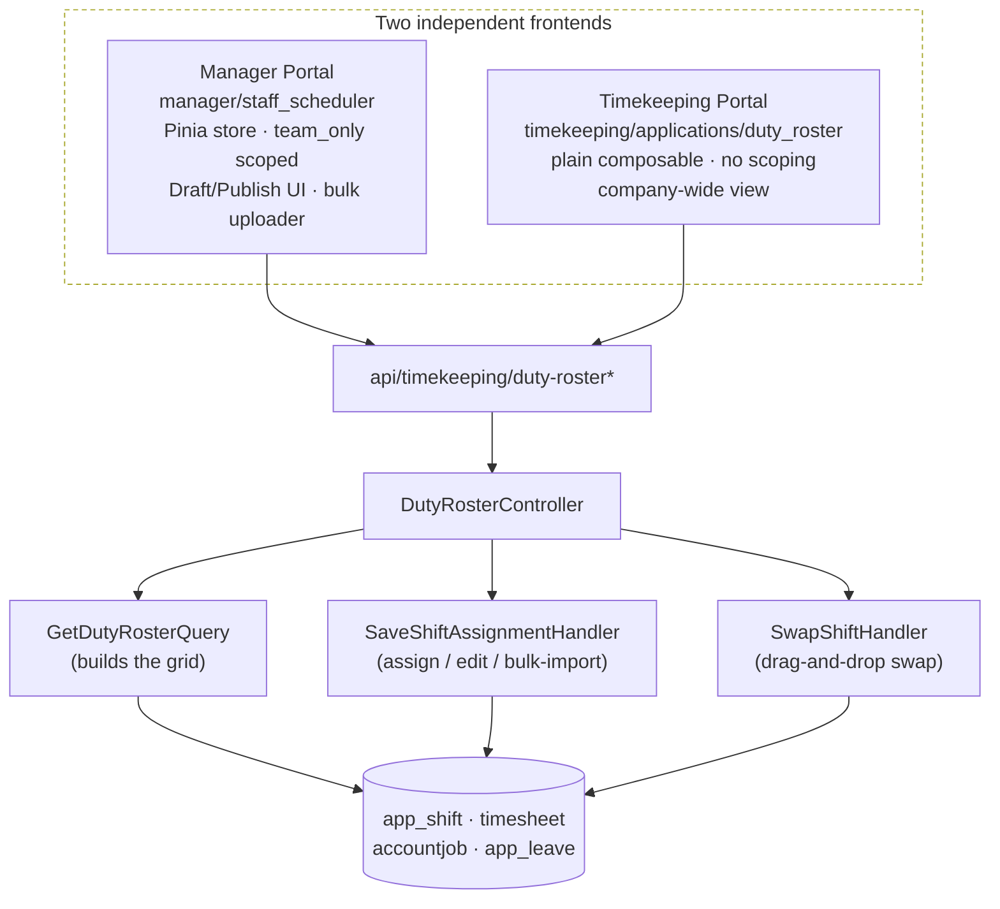
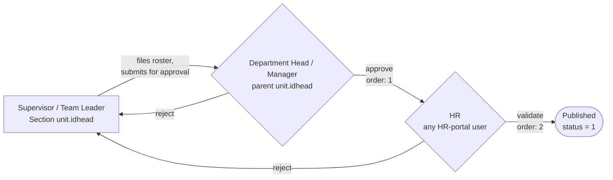

# Duty Roster

## What is it

Duty Roster is the schedule grid that shows, for a set of employees and a date range, what shift each employee is on each day — morning/evening/night, rest day, work-from-home, or on leave — along with the location and any handover notes. It's a manager-facing tool for assigning and adjusting shifts, not a form employees fill out (compare: "Change Shift" under Timekeeping → Applications is the employee-facing *request* for a shift change; Duty Roster is where a manager builds and edits the schedule directly).

## Where to find it

| Portal | Route | Page |
|---|---|---|
| Manager Portal → Staff Scheduler | `/manager/staff-scheduler/duty-roster` | [manager/staff_scheduler/pages/duty_roster/DutyRoster.vue](../../resources/views/web/src/module/manager/staff_scheduler/pages/duty_roster/DutyRoster.vue) |
| Manager Portal → Staff Scheduler | `/manager/staff-scheduler/assign` (Assign Shifts wizard) | [manager/staff_scheduler/pages/duty_roster_schedule/DutyRosterSchedule.vue](../../resources/views/web/src/module/manager/staff_scheduler/pages/duty_roster_schedule/DutyRosterSchedule.vue) |
| Manager Portal → Staff Scheduler | Bulk Roster Uploader | [manager/staff_scheduler/pages/scheduler_uploader/SchedulerUploader.vue](../../resources/views/web/src/module/manager/staff_scheduler/pages/scheduler_uploader/SchedulerUploader.vue) |
| Timekeeping Portal → Applications | `/timekeeping/applications/duty-roster` | [timekeeping/applications/pages/duty_roster/DutyRoster.vue](../../resources/views/web/src/module/timekeeping/applications/pages/duty_roster/DutyRoster.vue) |

> [!IMPORTANT]
> Both routes above render **separately-built pages that call the same backend** (see [Two frontends, one backend](#two-frontends-one-backend-current-limitation) below). This is a known duplication, not two different features.

## How it works end-to-end

### 1. The data behind a roster cell

Everything on the grid is computed on the fly by `GetDutyRosterQuery` — there is no single "duty roster" table. Each employee/day cell is resolved from up to four different sources, checked in priority order:

| Priority | Source | Table / Model | What it means on the grid |
|---|---|---|---|
| 1 (highest) | Leave request | `AppLeave` | Employee is on leave that day (`Approved`, `Pending`, or `Disapproved` depending on the leave's own status) |
| 2 | Shift-change override | `AppChangeShift` (table `app_shift`) | A specific date has a manager- or employee-initiated override to a different shift (`Approved`, `Pending`, or `Disapproved` depending on `status`) |
| 3 | Actual timesheet record | `Timesheet` | The employee already has a timesheet row for that date carrying a shift ID (e.g. from clocking in) |
| 4 (fallback) | Weekly default template | `AccountJob` (`shiftmon`, `shifttue`, … `shiftsun` columns) | The employee's standing weekly schedule, used when nothing more specific exists for that date |
| — | Nothing found | — | Cell renders empty ("No Shift" / missing schedule) |

This cascade lives in [`GetDutyRosterQuery::execute()`](../../app/Queries/Shift/GetDutyRosterQuery.php#L139-L198), and the same priority order is duplicated in [`DutyRosterController::metrics()`](../../app/Http/Controllers/tk/DutyRosterController.php#L104-L155) for the single-day summary counts.

### 2. Backend

One controller, one query, and two handlers do all the work — both frontend pages below call these same routes.

**`GET/POST /api/timekeeping/duty-roster*`** → [`App\Http\Controllers\tk\DutyRosterController`](../../app/Http/Controllers/tk/DutyRosterController.php)

| Method | Route | Action | Purpose |
|---|---|---|---|
| GET | `/duty-roster` | `index` → `GetDutyRosterQuery` | Paginated employees + resolved roster grid for a date range |
| GET | `/duty-roster/metrics` | `metrics` | Single-day summary counts (working, on leave, rest day, missing, etc.) |
| GET | `/duty-roster/shifts` | `getShifts` | Shift catalog for dropdowns (from `Shift` model) |
| GET | `/duty-roster/locations` | `getLocations` | Site list for dropdowns (`vw_site`) |
| POST | `/duty-roster/save` | `store` → `SaveShiftAssignmentHandler` | Create/overwrite one employee's shift for one date |
| POST | `/duty-roster/swap` | `swap` → `SwapShiftHandler` | Swap two employees' shifts between two dates (drag-and-drop) |
| POST | `/duty-roster/delete` | `destroy` | Remove an override for one employee/date |
| POST | `/duty-roster/publish` | `publish` | *Intended* to bulk-activate draft schedules — see [Known Issues](#known-issues-and-limitations) |
| POST | `/duty-roster/upload` | `upload` | Parse an uploaded roster file (currently mocked — see below) |
| POST | `/duty-roster/save-bulk` | `storeBulk` | Persist rows from the bulk uploader via `SaveShiftAssignmentHandler` |

`SaveShiftAssignmentHandler::execute()` ([app/Handlers/Shift/SaveShiftAssignmentHandler.php](../../app/Handlers/Shift/SaveShiftAssignmentHandler.php)) is the single write path for every assignment, edit, swap, and bulk-import row: it deletes any existing `app_shift` override for that employee/date, inserts a new one, and upserts the matching `Timesheet` row so the schedule and the timesheet stay in sync.

`Route::get('team_only', …)` scoping: when the request includes `team_only=1`, the query restricts employees to the units the logged-in manager heads (`units.idhead = Auth::id()`). Only the Manager Portal sends this — see below.

### 3. Frontend

There are two independent Vue implementations of this screen:

- **Manager Portal (`manager/staff_scheduler`)** — the more complete one. Uses a Pinia store ([`staff_scheduler.store.ts`](../../resources/views/web/src/module/manager/staff_scheduler/store/staff_scheduler.store.ts)), scopes the roster to the manager's own team (`team_only: 1`), and includes the drag-to-swap grid, a details/edit side panel, an "Assign Shifts" wizard page, a bulk roster uploader, and a header "Publish" action.
- **Timekeeping Portal (`timekeeping/applications/duty_roster`)** — a separate, simpler implementation using a plain composable ([`useDutyRoster.ts`](../../resources/views/web/src/module/timekeeping/applications/pages/duty_roster/composables/useDutyRoster.ts)) with its own API wrapper and types. It sends no `team_only` scoping, so it shows every employee company-wide, and it has no Draft/Publish concept or bulk uploader.

Both call the exact same `api/timekeeping/duty-roster*` endpoints described above — they are two front doors onto identical backend data, not two different systems.

*One backend, two unrelated front doors — this is the duplication called out in [Known Issues](#known-issues-and-limitations) item 3.*

## Approval workflow (decided design — not yet implemented)

> [!NOTE]
> This section documents a **decision**, not current behavior. As of this writing nothing below is built — see [Known Issues](#known-issues-and-limitations) item 1 for what actually happens today (every roster change self-approves instantly).

The business has decided on a 3-tier approval chain for Duty Roster:

**Supervisor/Team Leader files → Department Head/Manager approves → HR validates → Published**

| Tier | Role | Maps to | Action |
|---|---|---|---|
| 1 | Supervisor / Team Leader | `idhead` of the employee's immediate (Section-level) `unit` — today's Manager Portal user; unchanged from current access | Creates/edits the roster, assigns shifts and dates, submits for approval |
| 2 | Department Head / Manager | `idhead` of the *parent* unit (`unit.idunder` → parent `unit.idhead`) — a different person than tier 1 whenever the org chart is 2+ levels deep | Approves or rejects |
| 3 | HR | Any HR-portal user (company-wide, not tied to a specific unit) | Validates before publishing — not necessarily the filer |

*Rejection at either tier sends the roster back to the filer — the design does not currently specify whether a rejected roster restarts from tier 1 or resumes at the rejecting tier once resubmitted; confirm this during implementation.*

The design deliberately reuses infrastructure that's already built and proven elsewhere in the app, instead of a roster-specific workflow engine:

- **The unit hierarchy already exists.** `units.idhead`, `units.idunder`, and `units.unittype` (Division / Department / Section) are already live and walked recursively by the HR portal's org chart ([`OrgStructureController`](../../app/Http/Controllers/hr/OrgStructureController.php#L127)). Tiers 1 and 2 need no new schema — just a lookup through `idunder`.
- **The ordered, multi-approver chain already exists.** `AppChangeShift.approvers` (and the equivalent on leaves/OT/OBT/adjustments) is already a JSON array of `{approver, status, order, sub_approver}`, already consumed in `order` sequence by [`HandleChangeShiftQuery::pendingApproval()`](../../app/Queries/ChangeShift/HandleChangeShiftQuery.php#L140-L179). Duty Roster should reuse this exact shape (`order: 1` = Dept Head, `order: 2` = HR) rather than a new status column.
- **"Published" replaces the current broken Draft/Published toggle** — once every tier in the chain has approved, the record's `status` flips to `1` (Approved), matching the 0/1/2 convention used everywhere else in the app.

**Open items to resolve during implementation:**
- What happens when a unit has no parent (`idunder` is null/0 — a top-level unit)? Needs a fallback approver.
- Is HR validation a shared queue (any HR user can act), or a specific assigned reviewer per department? No existing field models the latter today.
- `units.scheduler`, `deputy1`, and `deputy2` exist as columns but are **read nowhere in the codebase** — don't assume they already implement part of this chain without confirming with the team first.

Full decision trail and evidence: [`.agents/reports/manager-staff_scheduler-duty-roster-missing-approval-workflow-20260824.md`](../reports/manager-staff_scheduler-duty-roster-missing-approval-workflow-20260824.md) (Addendum 2).

## Shift codes & status labels

| Shift code | Meaning |
|---|---|
| `MORN` | Morning shift |
| `EVEN` | Evening shift |
| `NGHT` / `NIGH` | Night shift |
| `REST` | Rest day (shift ID `1`) |
| `LEAV` | On leave |
| `WFH` | Work from home |

| Status label | Meaning |
|---|---|
| `Approved` | Shift/override is active and in effect |
| `Pending` | A shift-change or leave request is awaiting a decision |
| `Disapproved` | A shift-change or leave request was declined |
| `Rest Day` | Weekly rest day |
| `Leave` | Approved leave |
| `Draft` / `Published` | Manager Portal–only UI toggle — see limitation below; not a real persisted state today |

## Actions available

- **Assign a shift**: click an empty cell (or use the "Assign Shifts" wizard for multiple employees/dates at once).
- **Edit a shift**: click an existing shift card → "Edit Schedule" in the side panel.
- **Delete a shift**: side panel → "Delete Assignment".
- **Swap shifts**: drag one employee's shift card onto another cell.
- **Publish**: header button intended to activate draft schedules — see limitation below.
- **Bulk import**: Roster Uploader page (Manager Portal only) — CSV/Excel upload with row-level validation feedback.
- **Export**: header button — see limitation below.

None of these currently route through a review step — see [Approval workflow](#approval-workflow-decided-design--not-yet-implemented) for the Submit / Approve / Reject / Validate actions that are designed but not yet built.

## Known issues and limitations

These are current, verified behaviors — not proposals. Full evidence, root-cause detail, and a fix plan are in the investigation report: [`.agents/reports/manager-staff_scheduler-duty-roster-missing-approval-workflow-20260824.md`](../reports/manager-staff_scheduler-duty-roster-missing-approval-workflow-20260824.md).

1. **No real approval step.** Every assignment, edit, and swap made through Duty Roster is written as immediately `Approved` (`SaveShiftAssignmentHandler` hardcodes `status = 1`), with no reviewer and an always-empty `approvers` field. Genuine pending shift-change/leave requests *are* shown on the grid (as `Pending`/`Disapproved`), but there is no Approve/Reject control on this screen — that only exists on the separate Manager Dashboard approvals widget (`GET/POST /api/manager/getApprovalRequest`, `/approveRequest`). A 3-tier replacement (Supervisor files → Dept Head approves → HR validates) has been decided — see [Approval workflow](#approval-workflow-decided-design--not-yet-implemented) — but is not yet implemented.
2. **Draft/Publish doesn't actually work.** The Manager Portal's Draft/Published toggle and the "Publish" button assume a `status = 0` (Draft) state exists to be activated, but nothing ever writes it — every save is born `Approved`. Clicking Publish reliably reports "0 draft schedules activated." This will be superseded by the decided workflow's final "Published" state once the full chain has approved.
3. **Two duplicate frontends, one backend** (see [Frontend](#3-frontend) above) — built independently, with different team-scoping and different feature sets, and not cross-linked or documented anywhere prior to this doc.
4. **Export and file upload are non-functional stubs.** `exportRoster()` only shows a success toast without generating a file; `DutyRosterController::upload()` returns a fixed, hardcoded set of "parsed" rows regardless of the file actually uploaded.

## Related features

- **Change Shift** (Timekeeping → Applications → Change Shift) — the employee-facing report/request flow over the same `app_shift` table Duty Roster edits directly.
- **Manager Dashboard → Approvals widget** — the one place in the app where shift-change/leave/OT/OBT/adjustment requests are genuinely approved or declined (`App\Http\Controllers\manager\ApprovalRequestController`).
