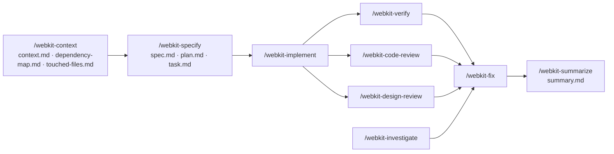

# Token Optimization of the Agent Kit

An optimization pass on `.agents/`: the same workflow (specification first, implementation from an approved plan, separate verify / review / fix stages, ticket-based memory) loaded with far less context. Nothing a skill does was removed; what changed is **where each instruction lives** and **what an agent reads, in what order**.

Sizes are measured from git (`origin/main` before, this branch after), line endings normalized, at **≈ 4 bytes per token** (the same estimate `setup.sh` prints). Treat token figures as estimates; byte figures are exact.

## 1. What changed

| Area | Before | After |
| :--- | :--- | :--- |
| **Always-on rules** (Claude Code, every turn) | `claude-adapter/rules/` held a second, full copy of the rule library (22 files). A fresh install loaded all of it on every turn. | Six files, **symlinked** from their single canonical copy: [rules/core/](../rules/core/) (project gate, authority boundary, git workflow, security baseline), [context-budget.md](../rules/context-budget.md), [rule-router.md](../rules/rule-router.md). The adapter holds no rules. |
| **Rule layout** | 22 flat files, each in a six-heading template (Purpose / Scope / Responsibilities / Rules / Best Practices / AI Behavior) that restated itself; "search before create" in four files; one 27 KB profile covering every project. | [core/](../rules/core/) (always on) and [conditional/](../rules/conditional/) (loaded by the router): overlapping rules merged, the profile split by topic, boilerplate dropped. Old paths are one-line redirects. |
| **Rule routing** | Each skill carried its own "load these rules" table. | One [rule router](../rules/rule-router.md): by task, and by the paths in a diff. |
| **Shared skill steps** | Every skill restated the authority boundary, a workflow diagram, the project gate, the branch gate, ticket resolution (one copied the allocation script verbatim), template fill rules, report persistence with run history, `task.md` upkeep, and versioning. | Written once in [skill-protocol.md](../rules/conditional/skill-protocol.md); each skill keeps only what is specific to its stage. |
| **Context priority** | Implicit; skills read the spec, plan, and reports in full. | Every `SKILL.md` has a **Context Loading Priority** section: `task.md` (and `summary.md` first) → `context.md` → only the spec / plan sections the step needs → only the source files named. |
| **Finding code** | Graphify was optional (a root `AGENTS.md` section and a line in six skills); otherwise agents grepped and listed directories. | **Graphify recommended first**: `explain --all` / `path` / `affected` on exact names → the exact file at its line → verify in source; `query` only to discover a label; the graph's blind spots (route → method, API strings, columns, global components) stay on grep; skills that edit code refresh it with `graphify update .`. Then targeted search in a fixed order ([context-budget.md §2](../rules/context-budget.md#2-find-code-graphify-first-then-targeted-search)). |
| **Ticket memory** | Reports accumulated; a later session re-read them. | New [/webkit-summarize](../skills/webkit.summarize/SKILL.md) compresses a ticket into `summary.md`, which later sessions read **instead of** the old reports. |
| **Before the spec** | `/webkit-specify` scanned the codebase itself, and `/webkit-implement` re-scanned it. | New [/webkit-context](../skills/webkit.context/SKILL.md) writes `context.md`, `dependency-map.md`, and `touched-files.md` (modify / create / reuse / **do not touch**) once; specify and implement start from it. |
| **Templates** | All 13 headers repeated the same generic fill rules, and several repeated their skill's scope rules. | Generic rules live in protocol §3; each template keeps only its own field rules. Four new templates for the new ticket files. |
| **AGENTS.md** | A 19 KB documentation dump that restated every skill. | An index: what to load when, the skill table, one flow diagram, where things live. The root entry ([claude-adapter/AGENTS.md](../claude-adapter/AGENTS.md)) is a 2 KB pointer. |
| **setup.sh** | Linked the adapter copies; left an existing root `AGENTS.md` untouched. | Links the six always-on files, warns when Windows falls back to copies, and retires older installs (real files go to `.claude-rules-backup/`). An existing root `AGENTS.md` is never overwritten: it may hold project-specific sections, such as the dev login the browser checks use. |

### Where each old rule went

| Old file (now a redirect) | Canonical home |
| :--- | :--- |
| `authority-boundary.md`, `git-workflow.md` | `core/` (same names) |
| `security.md` | `core/security-baseline.md` |
| `project-profile.md` | `core/project-gate.md` (detection, differences) · `conditional/backend.md` (Query / Handler / Action, controllers, routes, portals, (React) known drift) · `conditional/database.md` · `conditional/frontend-vue.md` · `conditional/frontend-react.md` |
| `context-loading.md`, `execution-strategy.md` | `context-budget.md` |
| `system-awareness.md`, `anti-hallucination.md`, `duplicate-prevention.md` | `conditional/system-awareness.md` |
| `coding-standards.md`, `naming-convention.md`, `incremental-generation.md`, `project-structure.md`, `documentation.md` | `conditional/code-quality.md` |
| `laravel-standards.md` | `conditional/backend.md` + `conditional/database.md` |
| `vue-standards.md` | `conditional/frontend-vue.md` (shared rules in `conditional/frontend.md`) |
| `hrms-rules.md` | `conditional/payroll.md` |
| `ui-design.md`, `testing.md`, `performance.md`, `ticket-numbering.md`, `versioning.md` | `conditional/` (same names; testing and ticket-numbering anchors unchanged) |
| (new) | `conditional/mobile.md`, `conditional/realtime.md`, `conditional/frontend.md`, `conditional/skill-protocol.md`, `rule-router.md` |

The redirects exist because hundreds of historical specs and reports, and older installs, link to the old paths. Nothing loads them automatically; delete them once every installed copy is refreshed and no document you still use links to them.

### Merged with `main`

`main` gained two features during this pass; both are kept, in their new homes:

- **Changed-files build check** (`scripts/check-changed.mjs`; never the full `npm run build` as a routine check): [testing.md](../rules/conditional/testing.md#frontend-build-check-changed-files-only), the always-on [project gate §4](../rules/core/project-gate.md#4-working-discipline), protocol §6, the implementation-plan template, and each skill's check step.
- **Graphify guidance from use** (exact names, `explain --all`, blind spots, staleness, `graphify update .`, never commit `graphify-out/`): moved from the root `AGENTS.md` into [context-budget.md §2](../rules/context-budget.md#2-find-code-graphify-first-then-targeted-search) and [system-awareness.md §2](../rules/conditional/system-awareness.md#2-the-scan), plus the caller and blast-radius steps in code-review, fix, implement, investigate, refactor, and specify. Prose `query` is demoted to discovering a label, as that guidance found.
- **Browser checks** (Playwright or any browser tool) in verify and design-review, using the dev login documented in the project's own root `AGENTS.md`.

### Corrections made while consolidating

Merging files surfaced facts that had drifted from the code. Each was checked against the source before changing it:

- The profile's Query example declared `namespace App\Queries\tk;`, contradicting its own rule that `tk/` was folded into domain folders. The class lives at `app/Queries/Leave/`; [backend.md](../rules/conditional/backend.md) now shows `App\Queries\Leave`.
- The profile said the (Vue) project's Expo app had no test runner. `resources/views/mobapp/package.json` configures jest-expo (`npm test`, tests in `tests/**`); [mobile.md](../rules/conditional/mobile.md) records it.
- Realtime had no rule. [realtime.md](../rules/conditional/realtime.md) records the verified setups: (Vue) Reverb + Pusher behind a `BROADCAST_CONNECTION` kill switch with web and mobile Echo clients; (Expo) Reverb; (React) none.
- The verification-report template said a Case 1 spec correction goes through `/webkit-specify`; the skill and the authority table have `/webkit-verify` apply it. The template now agrees.

## 2. Workflow, before and after

The stages and their order are unchanged. What an agent loads at each step is not.

**Before**, a typical skill run:

```text
every turn:  full rule library (fresh install)  or  pointer stubs (older install)
skill run:   SKILL.md (15–33 KB) → project-profile.md (27 KB, both projects) → ticket-numbering.md (28 KB)
             → the skill's own rule table (3–7 files) → template → grep / directory listings to find code
resume:      re-read spec, plan, and every report in the ticket folder
```

**After**:

```text
every turn:  always-on set (6 files, ~6.1k tokens): gate · authority · git · security · budget · router
skill run:   SKILL.md (shared steps removed) + skill-protocol.md
             → ticket memory: summary.md (if any) → task.md → context.md / touched-files.md
             → only the spec / plan sections the step needs
             → Graphify: explain --all / path / affected on exact names → exact file at its line → verify in source
             → only the router's rows for the paths touched → template at write time
resume:      summary.md, then task.md; an original report only for a detail the summary does not carry
```



## 3. Expected token savings

### Measured: what is loaded

**Per turn** (Claude Code loads these on every request):

| What is loaded every turn | Before | After |
| :--- | :--- | :--- |
| Rules, fresh install of `main` (the full copy in `claude-adapter/rules/`) | 136,659 B ≈ 34,200 tokens | 24,230 B ≈ **6,100 tokens** (−82%) |
| Rules, the older pointer-stub install hrms runs today | 10,953 B ≈ 2,700 tokens | 24,230 B ≈ 6,100 tokens (+3,400: core rules are now global by design, see §5) |
| Skill `description:` frontmatter (command discovery) | 6,008 B ≈ 1,500 tokens | 7,330 B ≈ 1,800 tokens (two new skills) |

**Per skill run.** Files the skill directs the agent to read, on top of the always-on set. Before = the `SKILL.md`, `project-profile.md` and `ticket-numbering.md` it pointed to, its template, and its rule table's picks. After = the `SKILL.md`, `skill-protocol.md`, the ticket-numbering sections it names, its template, and the router's picks:

| Run | Before | After | Change |
| :--- | :--- | :--- | :--- |
| `/webkit-code-review T#####`, (Vue) full-stack diff | 111,414 B ≈ 27,900 tokens | 66,422 B ≈ 16,600 tokens | −40% |
| `/webkit-implement T#####`, (Vue) full-stack ticket | 135,586 B ≈ 33,900 tokens | 93,112 B ≈ 23,300 tokens | −31% |
| `/webkit-fix T##### --code-review`, (Vue) backend finding | 122,319 B ≈ 30,600 tokens | 83,737 B ≈ 20,900 tokens | −32% |

The saving comes mostly from what a run no longer has to open: the 27 KB two-project profile is now five topic files the router picks from, and the shared steps a run needs from the 30 KB ticket rule are in the 9.5 KB protocol, with the rest read by section.

**Duplication removed.** The rule text in the kit went from 273,930 B (the library plus its adapter copy) to 130,650 B of canonical rules plus 8,372 B of redirects. The 13 existing templates went from 87,870 B to 81,904 B.

**Skill audit.** Each `SKILL.md` was checked for boilerplate that belongs in a shared file, prose that is really a checklist, and what it loads:

| Skill | Bytes before → after | Finding |
| :--- | :--- | :--- |
| code-review | 19,989 → 13,186 (−34%) | Heavy boilerplate. Authority section, workflow diagram, rule table, report persistence, and a duplicate "rules after review" moved to the protocol and router; review dimensions kept as checklists. |
| refactor | 15,326 → 13,246 (−14%) | Allocation script and gate text to the protocol; four restrictions that repeated its own core rules merged. |
| verify | 23,691 → 21,982 (−7%) | Persistence and gates to the protocol; adversarial checks turned into checklists. It reads the whole spec by design: the spec is its yardstick. |
| implement | 29,400 → 27,341 (−7%) | Project table, branch gate, Q/H/A table, and versioning steps to core and conditional rules. Added: a stop when a task needs a do-not-touch file. |
| investigate | 16,727 → 15,700 (−6%) | Little boilerplate; Graphify `path` / `affected` added for tracing. |
| design-review | 25,489 → 24,229 (−5%) | Persistence and duplicate anti-patterns removed; the two-half review is skill-specific. |
| fix | 24,526 → 23,656 (−4%) | Gates and versioning steps out. Phase 8 (closing the loop) is skill-specific and stays whole. |
| migrate | 32,936 → 32,191 (−2%) | The translation maps and target profile are the skill's value. |
| document | 30,534 → 30,275 (−1%) | Almost all skill-specific: simplicity contract, mermaid house syntax and worked examples, verification commands. |
| specify | 25,375 → 25,379 (0%) | About 2.7 KB of shared text out, about 2.6 KB in: the Context Loading Priority section and starting from `context.md`. |

Every skill now has a Context Loading Priority section. The large skills are large because their content is specific to them, so further savings there mean splitting phase-specific reference material out (see §5), not deleting it.

### Measured: resuming a ticket

What a fresh session reads today to pick up an existing ticket, versus the target for `summary.md`:

| Ticket | Documents in the folder | Bytes ≈ tokens |
| :--- | :--- | :--- |
| `subhrms/T00001` | spec, plan, task, investigation, refactor, verify, code-review, design-review | 569,016 B ≈ 142,000 |
| `queuemic/T00001` | spec, investigation, verify, code-review | 132,034 B ≈ 33,000 |
| `subhrms/T00002` | spec, plan, task | 109,739 B ≈ 27,400 |

The summary template is one page: one line per file changed, decision, constraint, and open item, with a source index. A summary of 8–12 KB (≈ 2,000–3,000 tokens) replaces the 33,000–142,000 tokens above for every later session that only needs the ticket's outcome. That is the largest single saving per ticket, and it compounds with every session that touches the area. It is a projection: no summary has been generated yet.

### Search

Graphify bounds a search by `--budget`. For the hrms notification feature, `graphify query "notification settings scheduler" --budget 1500` returned 5,125 bytes (≈ 1,300 tokens) naming files with line numbers, against 101 source files matching a plain `rg -l -i notification`. The saving per search depends on how many of those files an agent would otherwise open, so it is not totalled here.

## 4. How agents should behave now

1. **Resolve the project** with [project-gate.md](../rules/core/project-gate.md) and say which, before anything else.
2. **Load rules through the [router](../rules/rule-router.md)**: the always-on set plus only the rows the task or diff matches, and only your project's sections inside them. Never preload `rules/`.
3. **Start from ticket memory**: `summary.md` → `task.md` → `context.md` → the spec or plan **section** the step needs. Old reports are archive.
4. **Find code with Graphify first**: `explain "<ExactName>" --all`, `path`, and `affected` on exact names (`query` only to discover a label), then open the exact file at its line and verify it there. The graph is a map, never evidence. Its blind spots (route → method, API strings, columns, global components) stay on grep, and a missing node in a stale graph proves nothing. Skills that edit code refresh it with `graphify update .`. Fall back to targeted search in the fixed order; never list directories or grep the whole repo for a normal task.
5. **Respect the read limits**: at most two full files at once, snippets first, stop at the first acceptable match, never re-read what is in context.
6. **Justify every extra load** in one line (`Reading X: <reason>`). If you cannot name the reason, do not open it.
7. **Cite, do not restate**: link a rule or a spec ID; reports point at `file:line`.
8. **Follow each skill's Context Loading Priority**, and the shared steps in [skill-protocol.md](../rules/conditional/skill-protocol.md).
9. **Map before you spec** (`/webkit-context`), and **summarize when a ticket is done** (`/webkit-summarize`), so the next session starts small.

### Maintaining the kit

- **One copy per rule.** Edit it in `rules/core/` or `rules/conditional/`. Never copy rules into `claude-adapter/`: that is how the full library ended up in every turn.
- **The always-on set is paid on every turn.** Add to `rules/core/` only what every turn needs; everything else is a conditional rule plus a router row.
- **Steps every skill shares go in `skill-protocol.md`**, not into each `SKILL.md`. Every skill keeps a Context Loading Priority section.
- **Re-run `setup.sh`** in each project after this change. Where symlinks are unavailable (Git Bash on Windows) it copies, and the copies must be refreshed after every pull.

## 5. Rolling it out, and what is still open

- **Existing installs must re-run `bash .agents/setup.sh`.** In hrms, `.claude/rules/` still holds the older pointer stubs (they now resolve through the redirects), and `.claude/skills/` is a real directory with an older skill set (`webkit.spec`, `webkit.frontend-implement`, `webkit.backend-implement`) that `setup.sh` will not replace while those folders exist only there. Decide whether to keep or remove them before re-running it.
- **The always-on set grew compared with the older pointer-stub install** (≈ 2,700 → ≈ 6,100 tokens/turn), because the git workflow, authority boundary, and security baseline are now global by design. It is ≈ 82% smaller than a fresh install of `main`, and as a stable prefix it is cached. If a smaller per-turn cost matters more, the branch-gate procedure is the first candidate to move out of `core/`.
- **`ticket-numbering.md` is still the largest rule** (≈ 31 KB). Its §8 branch-resolution procedure is most of it; skills now read sections, not the file, but splitting §8 out would make that structural.
- **The largest skills** (`document` ≈ 30 KB, `migrate` ≈ 32 KB, `specify` ≈ 25 KB) are mostly skill-specific reference: mermaid worked examples, translation maps, "must hold" tables. Moving each phase's reference block into its own file, opened only when that phase runs, is the next structural saving.
- **The (Expo) project has no recorded profile**, and (React) design tokens are not documented anywhere; both are discovered from sibling files for now.
