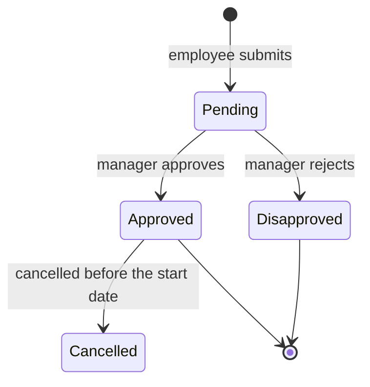
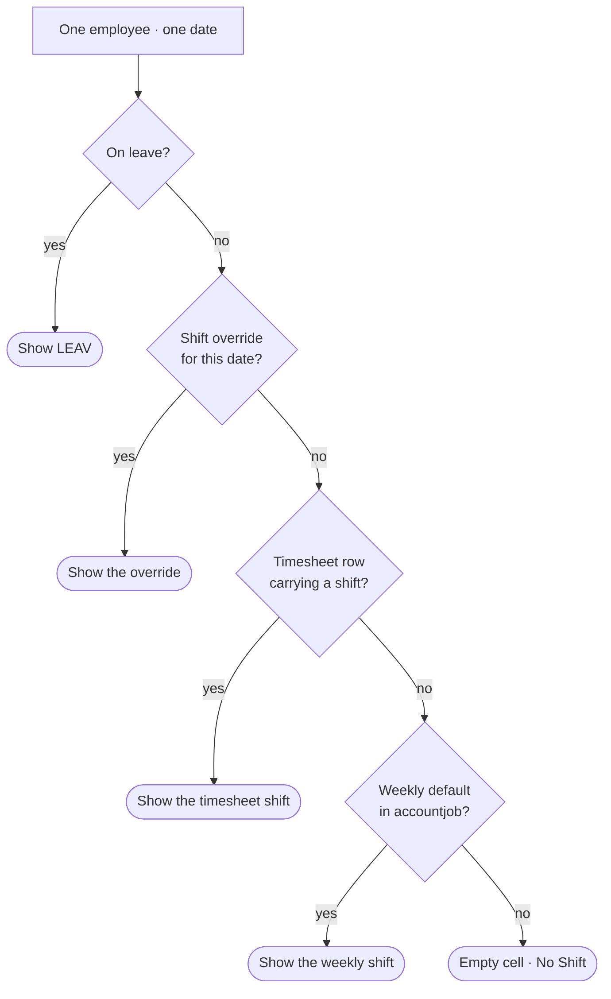

# Webkit Document

Produces **one guide per feature** that two different readers can both use:

| Half | Reader | Contains |
| :--- | :--- | :--- |
| **Above the line** | Anyone — HR staff, a manager, a client, a new hire on day one | What it does, where it lives, **a diagram of the journey**, numbered steps of what you see and click, the rules that decide what appears, what to do when it looks wrong |
| **Below the line** (`---` + *Under the hood*) | A developer who will edit it | Data sources, route table, frontend structure, **architecture and cascade diagrams**, known issues, related features |

The top half is the point. A reader who never scrolls past the `---` should still be able to use the page correctly.

> [!IMPORTANT]
> **This skill MUST NOT modify application code.** Its only output is the guide. If documenting the page reveals a bug, that is a finding for the **Known issues** section and a follow-up `/webkit.investigate` — not an edit.

> [!IMPORTANT]
> **Document what shipped, not what was designed.** The spec says what was intended; the code says what a user will actually meet on Monday. Where they differ, **the code wins and the difference gets written down** — see [Phase 6](#phase-6--verify-every-claim). A guide that describes a button nobody built is worse than no guide, because it sends people looking for it.

---

## Where guides live, and why not in the ticket folder

**`.agents/docs/<feature-kebab>.md`** — beside [`duty-roster.md`](../../docs/duty-roster.md) and [`hrms-chatbot.md`](../../docs/hrms-chatbot.md), which are the house format.

Every other skill in this family writes into `.agents/specs/<project>/T#####/`. This one does not, deliberately:

- A **ticket** is one piece of work and is finished. A **feature guide** outlives it — Duty Roster will be touched by a dozen tickets and must still have exactly one guide.
- [`ticket-numbering.md`](../../rules/ticket-numbering.md) §5 fixes six filenames inside a ticket folder and says nothing else belongs there. A guide in `T00004/` would be invisible to anyone looking for how the feature works.

So: **one feature, one guide, updated forever.** The ticket is recorded *inside* the guide's header, not in its path.

---

## Phase 0 — Resolve the Project (BLOCKING)

Run the **[Which Project Am I In?](../../rules/project-profile.md)** gate and state the answer. The reader-facing vocabulary is not portable:

| | SubHRMS | ScaleUP |
| :--- | :--- | :--- |
| Navigation | "Employee Portal → Timekeeping → …" | no portals at all — domains |
| Who the reader is | HR staff, managers, employees | organization members |
| Domain words | pay period, cut-off, timesheet, statutory | organizations, members, roles |

Writing "go to the Payroll Portal" in a ScaleUP guide sends the reader looking for a menu that does not exist.

---

## Phase 1 — Resolve the Feature, and Check It Is Not Already Documented (MANDATORY)

### 1. Document the *feature*, not the file

A guide covers a whole user-facing capability, even when it spans several pages, two portals, and four files. [`duty-roster.md`](../../docs/duty-roster.md) covers four pages across two portals because **to a user that is one thing**. Four separate guides would have hidden the most important fact about it — that two of those pages are duplicates.

Ask: *what would the reader call this?* That is the feature, and that is the filename.

### 2. Reuse before creating ([`duplicate-prevention.md`](../../rules/duplicate-prevention.md))

```bash
ls .agents/docs/
grep -ril '<feature|route|page name>' .agents/docs/ 2>/dev/null
```

| Result | Do |
| :--- | :--- |
| A guide covers this feature | **Update it in place.** Bump `> **Updated:**`, add a changelog line. Never write a second file. |
| A guide covers a *neighbouring* feature | Extend it if a user would see them as one thing; otherwise create a new guide and cross-link both under **Related features**. |
| Nothing | Create `.agents/docs/<feature-kebab>.md`. |

### 3. Read the spec for intent — then stop trusting it

```bash
grep -ril '<feature>' .agents/specs/<project> --include='*.md' 2>/dev/null
```

A `specs.md` tells you *why* the feature exists and what the business rules are meant to be — worth reading, and often the only place the "why" is written. It is **not** evidence of what the page does. Phase 2 is.

---

## Phase 2 — Gather Ground Truth from the Code

You are describing a screen you cannot see. Every sentence about it must come from a file, not from what a page like this usually does.

### The menu path the reader will follow

```bash
grep -n '<feature>' resources/views/web/src/composables/useSidebarLinks.ts
```

That file is where the sidebar labels live — use its exact wording for the navigation breadcrumb, not a guess at it.

### The URL and page title

```bash
cat resources/views/web/src/module/<portal>/<feature>/route/<feature>.routes.ts
```

Gives the `path`, the route `name`, and `meta.title`.

### The exact on-screen labels

**Never paraphrase a button.** If the template says `Generate Payslips`, the guide says **Generate Payslips** — a reader searching the screen for "Create" will not find it.

```bash
# visible text nodes
grep -oE '>[^<>{}]{2,48}<' <Page>.vue | tr -d '><' | sed 's/^ *//;s/ *$//' | grep -v '^$' | sort -u
# labels, placeholders, headers, tooltips
grep -oE '(label|title|placeholder|header|aria-label)="[^"]+"' <Page>.vue | sort -u
# what is clickable, and what it calls
grep -nE '@click|@submit|@change' <Page>.vue
```

### What each action actually does

```bash
sed -n '1,80p' <module>/api/<feature>.api.ts          # which endpoint each action hits
sed -n '1,120p' <module>/composables/use<Feature>.ts   # state, filters, what reloads when
grep -rn '<endpoint>' routes/api/                      # the real route + controller
```

Then follow the controller into its Query/Handler to learn **what makes a row appear or disappear** — that is the single most useful thing the guide can explain, and it is never visible from the frontend.

### What the reader is *not* allowed to do

Permissions, portal scoping (`team_only`), and role checks decide what the reader sees. Find them in the controller and middleware, and say so in plain words: *"A manager sees only their own team. HR sees everyone."*

> [!CAUTION]
> [`context-loading.md`](../../rules/context-loading.md) caps you at ~2 full files at once. Use the targeted greps above and read line ranges. A feature spanning six files is documented by reading the right 40 lines of each, not all six whole.

---

## Phase 3 — Write the Reader-Facing Half

### The simplicity contract — this is what "dali ra masabtan" means in practice

Not a tone. A set of rules you can check yourself against:

| Rule | Why |
| :--- | :--- |
| **One action per numbered step.** "Pick the period, then click Generate" is two steps. | The reader is doing this while reading. Two actions in one line means one gets missed. |
| **25 words maximum per step.** | Longer means it is describing, not instructing. |
| **Bold = the exact on-screen label**, copied from the template. *Italic* = an example value. | The reader matches your word against the screen. A synonym breaks that match. |
| **No jargon above the line** — not *composable, endpoint, payload, query, component, store, state, hook, API, props, mount*. | Every one of these sends a non-developer to ask someone. Below the `---` they are fine. |
| **Define a domain word on first use**, or put it in the glossary — *pay period*, *cut-off*, *statutory*, *rest day*. | New hires and clients do not know these yet, and they are the main readers. |
| **Rules go in tables, not paragraphs.** | Nobody finds "employees with no approved timesheet are excluded" inside a paragraph. |
| **Name the screen state**, not the mechanism: "the button turns into a progress bar", not "an async request fires". | The reader is looking at the screen, not the network tab. |
| **No marketing words** — *seamless, powerful, robust, intuitive, simply, just*. | They add length and say nothing. "Simply click" is never simpler than "Click". |

### The sections, in order

**`# <Feature Name>`** — what the reader calls it. If the UI brands it differently from the code, give both: *HRMS Chatbot (branded **HRMS Copilot** in the app)*.

**`## What is it`** — 2–4 sentences: the problem it solves, who uses it, and — where confusion is likely — **what it is not**. The duty-roster guide opens by distinguishing the manager's scheduling grid from the employee's shift-change request, because those get mixed up constantly. That one sentence is the most valuable in the doc.

**A journey diagram, straight after it** — see [Phase 4](#phase-4--draw-the-diagrams). For anything with a
branch or more than three steps, the picture is what makes the page click before the reader has read a word.

**`## Where to find it`** — a table: portal, the menu path as it reads in the sidebar, the URL, and the file (linked). One row per page in the feature.

**`## Step by step`** — the core. One `###` sub-heading **per task the reader wants to accomplish**, not per screen region. "Generating payslips for a period", "Fixing one employee's payslip" — those are tasks. "The filter bar" is not.

```markdown
### Generating payslips for a period

1. Open **Payroll → Payslips**.
2. Pick the period in the **Period** dropdown at the top (e.g. *Aug 16–31, 2026*).
3. Click **Generate**. The button turns into a progress bar.
4. When it finishes, every employee row shows a **Download** button.

**What the page is doing while you wait:** it reads each employee's approved
timesheet for that period, applies their rate and any adjustments, and saves
one payslip per employee.
```

That closing line is required on any step list where the wait is non-trivial — it is the difference between a user who waits and a user who clicks Generate four times.

**`## The rules that decide what you see`** — a table of the business rules that change what appears on screen, in plain words. This is where the Query logic you traced in Phase 2 becomes readable:

```markdown
| Rule | What it means on screen |
|---|---|
| Only approved timesheets count | An employee whose timesheet is still pending will not appear in the list at all |
| A manager is scoped to their team | Managers see only their own unit; HR sees everyone |
```

**`## When something looks wrong`** — symptom → cause → what to do. Write the ones a reader will actually hit, taken from the rules above and from the empty/error states in the template. Three real entries beat ten invented ones.

```markdown
**An employee is missing from the list.**
They have no approved timesheet for that period. Approve it in
**Timekeeping → Timesheets** first, then generate again.
```

Then the divider: `---`

---

## Phase 4 — Draw the Diagrams

A picture is the fastest way to make a feature click, and it is the main reason this guide should be easier
to understand than the code. **Mermaid is the house tool** — both existing guides use it, and it renders on
GitHub, in VS Code preview, and in most viewers without a build step.

> [!IMPORTANT]
> **At least one diagram above the line** whenever the feature has a branch, more than one person involved,
> or more than three steps. Put it directly under `## What is it`, before the numbered steps — the reader
> sees the shape of the thing first, then the detail.

### Which diagram for which job

| What you are explaining | Diagram | Mermaid |
| :--- | :--- | :--- |
| The path a user takes through the screens | Journey | `flowchart LR` |
| A request handed between people (file → approve → validate) | Who-does-what | `flowchart LR`, actors as nodes |
| A record's statuses, and what moves it between them | State machine | `stateDiagram-v2` |
| Which source wins when several could supply a value | Priority cascade | `flowchart TB` with `{ }` decisions |
| A request travelling frontend → backend → database | Request path | fenced ASCII tree (house style) or `sequenceDiagram` |
| How pages, controllers and tables connect | Architecture | `flowchart TB` + `subgraph` |
| A pay period / cut-off calendar | Timeline | `gantt` — only when the dates themselves are the point |

One diagram, one question. A picture that answers three questions answers none of them clearly.

### Above the line: label everything the way the reader sees it

This is what separates a diagram that helps from one that just looks technical.

| Rule | |
| :--- | :--- |
| Nodes are **people, screens, and button labels** | `"Manager reviews"`, `"Approve"` — never `GetDutyRosterQuery` or `app_shift` |
| **7 boxes maximum** | Past that it is harder to read than the numbered list it was meant to summarize |
| No file paths, class names, table names, or endpoints | They belong below the line |
| It **repeats** the steps, never adds to them | Either the diagram or the list alone must be enough |

Below the line, the opposite applies: use the real controller, Query and table names, exactly as
[`duty-roster.md`](../../docs/duty-roster.md) does in its architecture diagram.

### House syntax (matching the existing guides)

- **Always quote labels** — `A["Text"]`. Unquoted labels break on `(` `)` `/` `,` `:` `#`, and mermaid fails the whole block.
- `<br/>` for a line break inside a node; `&middot;` to separate items on one line.
- Shapes carry meaning: `["step"]` action · `{"question?"}` decision · `(["end state"])` terminal · `[("table")]` data.
- Label the edges that branch: `-->|"Approve"|`, `-->|"Reject"|`.
- `LR` for a sequence; `TB` for layers.

### Worked examples

**Reader-facing journey** — every label is a person or a button:


**Status flow** — for any record with a lifecycle, this answers "why is mine still Pending":



**Priority cascade** — the under-the-line picture of a "which source wins" table, so a reader can trace one
cell instead of reading four rows and holding them in their head:



### Before shipping a mermaid block

It fails **silently to an error box** — a broken diagram makes the whole guide look unmaintained. Check:

| Check | |
| :--- | :--- |
| Every label quoted | `B{"Manager reviews"}`, not `B{Manager reviews}` |
| Brackets balanced | every `[` `(` `{` closed, in that order |
| Arrows are `-->` | not `->`, which is `sequenceDiagram` syntax |
| No reserved word as a node id | `end`, `graph`, `class`, `style` — use `endState` |
| One diagram type per fence | no `stateDiagram` lines inside a `flowchart` |
| Every box is real | the same verification as any other claim — [Phase 6](#phase-6--verify-every-claim) covers diagrams too |

If a diagram will not render cleanly, **ship the numbered list alone.** A missing picture costs the reader
nothing; a broken one costs them trust in everything around it.

---

## Phase 5 — Write the Under-the-Hood Half

Match the existing house format ([`duty-roster.md`](../../docs/duty-roster.md) is the reference). Adjust depth to the feature; drop any section that would be empty.

- **`### The data behind it`** — where each thing on screen comes from. If it is computed rather than stored, **say so outright** ("there is no duty roster table") and give the resolution order as a priority table. This is usually the single most valuable paragraph in the guide.
- **`### Backend`** — a route table: method, route, controller action, what it does. Link the controller and the Query/Handler with line anchors.
- **`### Frontend`** — where the pages live, whether state is a composable or a Pinia store, how it is scoped. If two implementations exist, **say that they are duplicates**.
- **Diagrams** — the architecture and request-path pictures from [Phase 4](#phase-4--draw-the-diagrams) belong here. Below the line they may use real identifiers: controller, Query, and table names, as [`duty-roster.md`](../../docs/duty-roster.md) does.
- **`## Glossary`** — codes and status labels as they appear in the data, with meanings. Readers meet `NGHT` and `REST` on screen with no legend.
- **`## Known issues and limitations`** — **required, and written honestly.** Verified current behavior, numbered, each saying what actually happens. "Clicking Publish reliably reports '0 draft schedules activated'" is a real sentence from the existing guide and exactly the standard. Link the investigation report when one exists. A guide that documents only the happy path teaches people to file bugs that are already known.
- **`## Related features`** — the neighbouring pages a reader will confuse this with, and the one-line difference.

---

## Phase 6 — Verify Every Claim

A guide is read as fact by people who cannot check it. Before writing the file, confirm:

```bash
# every bold on-screen label appears in a template
grep -rn 'Generate Payslips' <module>/ --include='*.vue'
# every route exists
grep -rn '<route path>' routes/api/ resources/views/web/src/module/<portal>/*/route/
# every linked file exists, from .agents/docs/
for f in <each ../../ path you linked>; do [ -f ".agents/docs/$f" ] && echo "ok $f" || echo "BROKEN $f"; done
```

| Check | Fail means |
| :--- | :--- |
| Every **bold label** greps to a template | You invented or paraphrased a button |
| Every route greps to `routes/` or a `.routes.ts` | The URL in the guide 404s |
| Every `file:line` link resolves | The reader lands on the wrong line, and stops trusting the guide |
| Every rule traces to a Query, Handler, or middleware | It is a plausible guess, which in a guide is a lie |
| Every step order matches the template's actual flow | You documented the page you expected |
| Every diagram box names something real | A box invented to balance the picture is the easiest lie to miss |
| Every mermaid block renders | It fails to an error box, silently — ship the list alone rather than a broken picture |
| Spec and code disagree | **Code wins.** Note the difference in Known issues. |

Anything you could not verify does not get written as fact. Either cut it, or mark it plainly: *"Export appears in the UI but produces no file — see Known issues."*

---

## Phase 7 — Persist

Write **`.agents/docs/<feature-kebab>.md`** with this header:

```markdown
# <Feature Name>

> **Project:** SubHRMS | ScaleUP · **Portal:** <portal or n/a>
> **Ticket:** `T#####` (or *—*) · **Updated:** <YYYY-MM-DD>
> **Verified against:** <branch or commit> — every step below was checked against the code on that date.
```

- **Update in place** on re-runs — same filename forever. Bump `> **Updated:**` and append one line to the changelog at the bottom saying what changed. Never `duty-roster-v2.md`.
- Links are relative from `.agents/docs/` — `../../resources/views/web/src/...`, `../../app/...` — matching the existing guides.
- Close with:

```markdown
<!-- Changelog -->
- 2026-09-15 — initial guide, verified against T00012
```

Then tell the user the path, and **name anything you could not verify** so they know where the guide is thin.

---

## Anti-Patterns

| Anti-pattern | Why it fails |
| :--- | :--- |
| Describing the screen from how pages like this usually work | The reader is standing in front of the real one. [`anti-hallucination.md`](../../rules/anti-hallucination.md) |
| Paraphrasing a button — **Create** for **Generate Payslips** | The reader scans the screen for your word and does not find it |
| Documenting the spec instead of the build | Sends people hunting for features nobody shipped |
| Happy path only | The reader's first real question is "why is this employee missing" |
| Skipping Known issues to make the feature look finished | The next person re-reports a bug the team already knows about |
| Jargon above the line | One word like "payload" ends the doc for a non-developer |
| One guide per `.vue` file | Splits one user-facing thing into four docs and hides the duplication |
| A second guide for a documented feature | Two guides drift; within a month both are wrong |
| A diagram restating a two-line list | Costs a screen of space, adds nothing |
| Class and table names in a diagram above the line | The half that exists for non-developers becomes the half only developers can read |
| A 20-box diagram | Past ~7 boxes it is harder to follow than the numbered steps it was meant to replace |
| Shipping a mermaid block without a render check | It fails silently to an error box, and the guide looks broken |
| Fixing the bug you found while writing | This skill writes docs; the report is the deliverable |
| "Simply click" / "seamless experience" | Longer and emptier than the plain sentence |

---

## Follow-up Commands

- A bug you documented: `/webkit.investigate <target_path> <the behavior described in Known issues>`
- The look of the page: `/webkit.design-review <target_path>`
- Does it match the spec: `/webkit.verify T#####`
