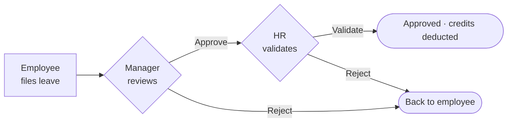
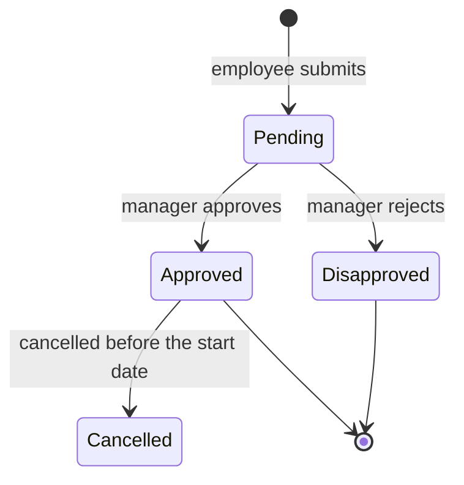

# Webkit Document

Acts as a technical writer documenting a feature that already shipped. It produces **one guide per feature** that two different readers can both use:

| Half | Reader | Contains |
| --- | --- | --- |
| **Reader half** (top) | Anyone: staff, a manager, a client, a new hire on day one | What it is, a diagram of the journey, where to find it, numbered steps of what you see and click, the rules that decide what appears, what to do when something looks wrong |
| **Under the Hood** | A developer who will edit the feature | Data sources, route table, frontend structure, architecture diagram, glossary, known issues, related features |

The reader half is the point. Someone who never scrolls past **Under the Hood** should still be able to use the page correctly.

This skill only documents. It is **not** responsible for:

- fixing a bug it finds (`/webkit-investigate`, then `/webkit-fix`),
- checking the build against its spec (`/webkit-verify`),
- reviewing code quality or the visual layer (`/webkit-code-review`, `/webkit-design-review`),
- writing or changing a specification (`/webkit-specify`),
- code comments, PHPDoc, or README setup notes ([documentation.md](../../rules/documentation.md)).

> [!IMPORTANT]
> **This skill MUST NOT modify application code, specs, or data.** Its only output is the guide in `.agents/docs/`. A bug found while documenting goes under Known Issues and Limitations and is handed to `/webkit-investigate`; it is never fixed here.

---

## Authority Boundary

This skill owns **only** writing the feature guide from the code that shipped ([authority-boundary.md](../../rules/authority-boundary.md)). It does not perform another skill's responsibility. Tasks that belong to another workflow stage:

- changing code → `/webkit-fix` or `/webkit-implement`
- finding a root cause → `/webkit-investigate` (the guide records the symptom under Known Issues)
- writing or changing a spec → `/webkit-specify`

If a task belongs to another stage: **stop, report it, and do not continue** that task. Report it as `Authority boundary: <the task> belongs to /webkit-<skill>. Not done here.` Do not compensate for another skill, and do not generate work outside this authority.

---

## Inputs

| Form | Meaning |
| --- | --- |
| `/webkit-document <target_path>` | Document the feature that page, module, or component belongs to, as the working tree has it. |
| `/webkit-document T#####` | Document the feature as that ticket's branch built it (`F####` works the same way); analyzed without checking it out. |
| `/webkit-document <feature name>` | Document the feature the reader calls by that name; find its pages first. |

---

## Where Guides Live

| | Spec | Feature guide (this skill) |
| --- | --- | --- |
| Path | `.agents/specs/<project>/T#####/spec.md` | `.agents/docs/<feature-kebab>.md` |
| Describes | What was intended | What shipped |
| Written | Before building | After the page is real |
| Scope | One ticket | One feature, across every ticket that touches it |
| Lifetime | Finished with the ticket | Updated in place for as long as the feature exists |

A guide never goes in a ticket folder. [ticket-numbering.md](../../rules/ticket-numbering.md) §5 fixes the seven filenames allowed there, and a guide inside `T00004/` is invisible to anyone looking for how the feature works. A ticket is one piece of work and finishes; a feature is touched by many tickets and must still have exactly one guide. The tickets that shaped it are recorded in the guide's Metadata, not in its path.

---

## Workflow Integration

```text
   webkit-specify → webkit-implement → webkit-verify / webkit-code-review
                                                 │
                                  webkit-fix / webkit-refactor (as needed)
                                                 │
                                                 ▼
                                         webkit-document                ← you are here
                                                 │
                                                 ▼
          feature guide  (.agents/docs/<feature>.md, one per feature, updated in place)
                                                 │
                     ┌───────────────────────────┴──────────────────────┐
                     ▼                                                  ▼
            webkit-investigate                                   webkit-verify
     (a Known Issue that needs a fix)                 (the spec and the build disagree)
```

---

## Core Rules

- **Document what shipped, not what was designed.** Where the code and the spec disagree, the code wins and the difference is written under Known Issues. A guide that describes a button nobody built sends people looking for it.
- **Verified or not written.** Every label, route, rule, link, and diagram box traces to a file on the branch or commit named in Verified Against. Anything unverified is cut, or stated plainly as unverified.
- **Exact labels.** Bold text is the on-screen label copied from the template. Never paraphrase a button.
- **One feature, one guide.** Update an existing guide in place; never write a second file or a `-v2`.
- **Two readers, two halves.** No developer jargon above Under the Hood; real identifiers below it.
- **No edits.** No code, specs, or data. A bug becomes a Known Issue and a follow-up, never a fix.

## Documentation Mindset

Ask:

- What would the reader call this, and what do they confuse it with?
- What does a first-time user see and click, in what order?
- What makes a row appear, disappear, or stay Pending?
- What will they hit when something looks wrong, and what do they do then?
- Where did I read each sentence, and is that file current on the branch I named?
- What did the spec promise that the build does not do?

---

## Phase 0 — Resolve the Project (BLOCKING)

Run [Which Project Am I In?](../../rules/project-profile.md), **state the resolved project in your first message**, and read only your project's sections. The reader's vocabulary and the files you read are not portable:

| | Project with portals | Project without portals |
| --- | --- | --- |
| Navigation the reader follows | Portal → menu → page | Domains; there are no portals |
| Who the reader is | HR staff, managers, employees | Organization members |
| Domain words to define | pay period, cut-off, timesheet, statutory | organizations, members, roles |
| Menu labels | `src/composables/useSidebarLinks.ts` | Not recorded in the profile: grep the label and cite the file it is in |
| Page routes | `src/module/<portal>/<feature>/route/<feature>.routes.ts` | `src/module/<domain>/route/<domain>.routes.tsx`, mounted by `app/routes.tsx` |
| Page state | Composable or Pinia store | Hook or React Context |
| Who-sees-what scoping | Portal, team scope (`team_only`), role | Organization scope, role |

Paths are relative to `resources/views/web/`; your project's section of the profile has the full layout. Writing "go to the Payroll Portal" in a guide for a project without portals sends the reader looking for a menu that does not exist.

---

## Phase 1 — Resolve the Feature (MANDATORY)

### 1. Document the feature, not the file

A guide covers one user-facing capability, even when it spans several pages, two portals, and many files. [duty-roster.md](../../docs/duty-roster.md) covers four pages across two portals because, to a user, that is one thing; four guides would have hidden the most important fact about it, that two of those pages are duplicates.

Ask *what would the reader call this?* That is the feature, and its kebab-case form is the filename. Then find every page that belongs to it, whichever form the argument took:

```bash
grep -rn '<feature label>' resources/views/web/src/composables/useSidebarLinks.ts   # menu entries (project with portals)
grep -rln '<feature>' resources/views/web/src/module/ | sort                       # pages, routes, api files
```

### 2. Check it is not already documented

Reuse before creating ([duplicate-prevention.md](../../rules/duplicate-prevention.md)):

```bash
ls .agents/docs/
grep -ril '<feature|route|page label>' .agents/docs/ 2>/dev/null
```

| Result | Do |
| --- | --- |
| A guide covers this feature | **Update it in place** ([Phase 7](#phase-7--write-the-guide)). Never write a second file. |
| A guide covers a neighbouring feature | Extend it when a user would see the two as one thing; otherwise write a new guide and cross-link both under Related Features. |
| Nothing | Create `.agents/docs/<feature-kebab>.md`. |

### 3. Given a ticket? Document the branch, not the tree

`/webkit-document T00004` (or `F0135`) means "document what was built on that branch". Resolve it per [ticket-numbering.md §8](../../rules/ticket-numbering.md#8-resolving-a-ticket-argument-to-its-branch): fetch and analyze **without checking out** (Steps 1–4, §8.3). When several branches match the ticket, stop and ask.

```bash
base=$(git symbolic-ref --quiet --short refs/remotes/origin/HEAD 2>/dev/null || echo origin/master)
git diff --name-only "$base"...origin/<branch>                     # which feature the ticket touched
git show "origin/<branch>:<path>"                                  # read a file as the branch has it
git grep -n '<label>' "origin/<branch>" -- resources/views/web/    # grep the branch, not the tree
git rev-parse --short "origin/<branch>"                            # the commit for Verified Against
```

The diff tells you which feature the ticket touched. The guide still documents the **whole feature** as that branch has it, not only the lines the ticket changed.

### 4. Read the spec for intent, then stop trusting it

```bash
grep -ril '<feature>' ".agents/specs/$project" --include='spec.md' --include='specs.md' 2>/dev/null
```

A ticket's spec (`.agents/specs/<project>/T#####/spec.md`, `specs.md` on older tickets) says *why* the feature exists and what its rules were meant to be; often it is the only place the "why" is written. It is **not** evidence of what the page does: Phase 2 is. Every ticket whose spec covers the feature goes in the Ticket(s) row. An `F####` ticket usually has no spec folder; its branch is the source of truth.

**Before Phase 2, state:** the feature, its pages, the guide path (new, or existing with its current Guide Version), and what you are verifying against (branch and commit, or the working tree).

---

## Phase 2 — Gather Ground Truth from the Code

You are describing a screen you cannot see. Every sentence about it comes from a file, not from what a page like this usually does ([anti-hallucination.md](../../rules/anti-hallucination.md)).

### The menu path the reader will follow

Read the menu labels file from your project's column of the Phase 0 table and use its exact wording for the breadcrumb. In a project without portals, grep the label under `resources/views/web/` and cite the file it is in.

### The URL and page title

Read the page's routes file (Phase 0 table). It gives the `path`, the route name, and the page title. In a project without portals, the layout tree it is mounted under in `app/routes.tsx` (`GuestGuard`, `AuthGuard`) also tells you whether the reader must sign in first.

### The exact on-screen labels

**Never paraphrase a button.** If the template says `Generate Payslips`, the guide says **Generate Payslips**; a reader scanning the screen for "Create" will not find it.

```bash
# visible text nodes
grep -oE '>[^<>{}]{2,48}<' <page file> | tr -d '><' | sed 's/^ *//;s/ *$//' | grep -v '^$' | sort -u
# labels, placeholders, headers, tooltips
grep -oE '(label|title|placeholder|header|aria-label)="[^"]+"' <page file> | sort -u
# what is clickable, and what it calls
grep -nE '@click|@submit|@change|onClick=|onSubmit=|onChange=' <page file>
```

Collect the empty-state, error, and disabled-state messages too: they become the entries under When Something Looks Wrong.

### What each action actually does

```bash
sed -n '1,80p' <module>/api/<feature>.api.ts      # which endpoint each action hits
sed -n '1,120p' <state file>                      # composable, store, hook, or context: state, filters, what reloads when
grep -rn '<endpoint>' routes/api/                 # the real route and controller
```

Then follow the controller into its Query or Handler to learn **what makes a row appear or disappear**. That is the single most useful thing the guide can explain, and it is never visible from the frontend.

### What the reader is not allowed to do

Permissions, scoping, and role checks decide what the reader sees: portal and team scope (`team_only`) in a project with portals, organization scope in a project without portals. Find them in the controller and middleware, and say them in plain words: *"A manager sees only their own team. HR sees everyone."*

> [!CAUTION]
> [context-loading.md](../../rules/context-loading.md) caps you at about two full files at once. Use the targeted greps above and read line ranges. A feature spanning six files is documented by reading the right 40 lines of each, not all six whole.

---

## Phase 3 — Draft the Reader Half

### The simplicity contract

Not a tone; rules you can check yourself against:

| Rule | Why |
| --- | --- |
| **One action per numbered step.** "Pick the period, then click Generate" is two steps. | The reader is doing this while reading. Two actions in one line means one gets missed. |
| **25 words maximum per step.** | Longer means it is describing, not instructing. |
| **Bold = the exact on-screen label**, copied from the template. *Italic* = an example value. | The reader matches your word against the screen. A synonym breaks that match. |
| **No jargon above Under the Hood**: not *composable, endpoint, payload, query, component, store, state, hook, API, props, mount*. | Every one of these sends a non-developer to ask someone. Below it they are fine. |
| **Define a domain word on first use**, or put it in the Glossary. | New hires and clients do not know these yet, and they are the main readers. |
| **Rules go in tables, not paragraphs.** | Nobody finds "employees with no approved timesheet are excluded" inside a paragraph. |
| **Name the screen state**, not the mechanism: "the button turns into a progress bar", not "an async request fires". | The reader is looking at the screen, not the network tab. |
| **No marketing words**: *seamless, powerful, robust, intuitive, simply, just*. | They add length and say nothing. "Simply click" is never simpler than "Click". |

### What goes in each section

- **Title**: what the reader calls the feature. If the UI brands it differently from the code, the Feature row gives both.
- **What It Is**: 2–4 sentences: the problem it solves, who uses it, and, where confusion is likely, **what it is not**. The duty-roster guide opens by separating the manager's scheduling grid from the employee's shift-change request, because those get mixed up constantly; that one sentence is the most valuable in the guide.
- **The Journey at a Glance**: see [Phase 4](#phase-4--draw-the-diagrams). For anything with a branch or more than three steps, the picture makes the page click before the reader has read a word.
- **Where to Find It**: one row per page: portal, the menu path as the navigation labels read, the URL, and the linked file.
- **Step by Step**: the core. One `###` per **task the reader wants to accomplish**, not per screen region. "Generating payslips for a period" and "Fixing one employee's payslip" are tasks; "The filter bar" is not.
- **Rules That Decide What You See**: the Query logic you traced in Phase 2, made readable.
- **When Something Looks Wrong**: symptom, cause, what to do, for the problems a reader will actually hit, taken from the rules and from the empty and error states in the template. Three real entries beat ten invented ones.

A finished task block reads like this:

```markdown
### Generating payslips for a period

1. Open **Payroll → Payslips**.
2. Pick the period in the **Period** dropdown (e.g. *Aug 16–31, 2026*).
3. Click **Generate**. The button turns into a progress bar.
4. When it finishes, every employee row shows a **Download** button.

**What the page is doing while you wait:** it reads each employee's approved
timesheet for that period, applies their rate and any adjustments, and saves
one payslip per employee.
```

The closing line is required on any step list where the wait is noticeable. It is the difference between a user who waits and a user who clicks Generate four times.

---

## Phase 4 — Draw the Diagrams

A picture is the fastest way to make a feature click, and the main reason the guide is easier to understand than the code. **Mermaid is the house tool**: it renders on GitHub, in VS Code preview, and in most viewers without a build step.

> [!IMPORTANT]
> **At least one diagram above Under the Hood** whenever the feature has a branch, more than one person involved, or more than three steps. It goes in The Journey at a Glance, before the numbered steps: the reader sees the shape of the thing first, then the detail.

### Which diagram for which job

| What you are explaining | Diagram | Mermaid |
| --- | --- | --- |
| The path a user takes through the screens | Journey | `flowchart LR` |
| A request handed between people (file → approve → validate) | Who-does-what | `flowchart LR`, people as nodes |
| A record's statuses, and what moves it between them | State machine | `stateDiagram-v2` |
| Which source wins when several could supply a value | Priority cascade | `flowchart TB` with `{ }` decisions |
| A request travelling frontend → backend → database | Request path | `sequenceDiagram`, or a fenced text tree |
| How pages, controllers, and tables connect | Architecture | `flowchart TB` + `subgraph` |
| A calendar of periods or deadlines | Timeline | `gantt`, only when the dates themselves are the point |

One diagram, one question. A picture that answers three questions answers none of them clearly.

### Above Under the Hood: label everything the way the reader sees it

| Rule | Why |
| --- | --- |
| Nodes are **people, screens, and button labels**: `"Manager reviews"`, `"Approve"` | Never `GetDutyRosterQuery` or `app_shift`; the reader has never seen those words. |
| **7 boxes maximum** | Past that it is harder to read than the numbered list it summarizes. |
| No file paths, class names, table names, or endpoints | They belong under Under the Hood. |
| It **repeats** the steps, never adds to them | Either the diagram or the list alone must be enough. |

Under the Hood, the opposite applies: use the real controller, Query, and table names.

### House syntax

- **Always quote labels**: `A["Text"]`. Unquoted labels break on `(` `)` `/` `,` `:` `#`, and mermaid fails the whole block.
- `<br/>` for a line break inside a node; `&middot;` to separate items on one line.
- Shapes carry meaning: `["step"]` action, `{"question?"}` decision, `(["end state"])` terminal, `[("table")]` data. Never the `{{hexagon}}` shape: the template's fill rules forbid `{{` in a finished guide.
- Label the edges that branch: `-->|"Approve"|`, `-->|"Reject"|`.
- `LR` for a sequence; `TB` for layers.

### Worked examples

**Reader-facing journey**: every label is a person or a button.



**Status flow**: for any record with a lifecycle, this answers "why is mine still Pending?"



**Priority cascade** (Under the Hood): the picture of a "which source wins" table, so a reader can trace one cell instead of holding four rows in their head.


### Before shipping a mermaid block

A broken block fails **silently to an error box**, and makes the whole guide look unmaintained. Check:

| Check | Example |
| --- | --- |
| Every label quoted | `B{"Manager reviews"}`, not `B{Manager reviews}` |
| Brackets balanced | every `[` `(` `{` closed, in that order |
| Arrows are `-->` | not `->`, which is `sequenceDiagram` syntax |
| No reserved word as a node id | `end`, `graph`, `class`, `style`: use `endState` |
| One diagram type per fence | no `stateDiagram` lines inside a `flowchart` |
| Every box is real | verified like any other claim ([Phase 6](#phase-6--verify-every-claim)) |

If a diagram will not render cleanly, **ship the numbered list alone** and write "N/A — <reason>" in its place. A missing picture costs the reader nothing; a broken one costs them trust in everything around it.

---

## Phase 5 — Draft the Under-the-Hood Half

- **The Data Behind It**: where each thing on screen comes from. If it is computed rather than stored, **say so outright** ("there is no duty roster table") and give the resolution order as a priority table. This is usually the single most valuable paragraph in the guide.
- **Backend**: a route table (method, route, controller action, what it does), linking the controller and its Query, Handler, or Action with line anchors.
- **Frontend**: where the pages live, whether state is a composable or store (Vue) or a hook or context (React), and how it is scoped. If two implementations of one page exist, **say that they are duplicates**.
- **Architecture**: the architecture or request-path diagram from [Phase 4](#phase-4--draw-the-diagrams), with real controller, Query, and table names, plus the priority cascade when the data has a resolution order.
- **Glossary**: codes and status labels as they appear on screen and in the data, with meanings. Readers meet codes like `NGHT` and `REST` on screen with no legend.
- **Known Issues and Limitations**: **required, and written honestly.** Verified current behavior, numbered, each saying what actually happens. "Clicking Publish reliably reports '0 draft schedules activated'" is the standard. Include every spec-vs-code difference, and link the investigation (`.agents/specs/<project>/T#####/investigation.md`, or `.agents/reports/`) when one exists. A guide that documents only the happy path teaches people to file bugs that are already known.
- **Related Features**: the neighbouring features a reader will confuse this with, and the one-line difference.

---

## Phase 6 — Verify Every Claim

A guide is read as fact by people who cannot check it. Before writing the file, confirm, from the project root:

```bash
# every bold on-screen label appears in a template
grep -rn '<Exact Label>' resources/views/web/ --include='*.vue' --include='*.tsx'
# every route exists, backend and page
grep -rn '<route path>' routes/api/ resources/views/web/src/module/
# every linked file exists (links are relative from .agents/docs/; strip the #L anchor)
for f in <each ../../ path you linked>; do [ -f ".agents/docs/${f%%#*}" ] && echo "ok $f" || echo "BROKEN $f"; done
# for a ticket argument, check the branch, not the tree
git grep -n '<Exact Label>' "origin/<branch>" -- resources/views/web/
git cat-file -e "origin/<branch>:<path>" && echo "ok <path>"
```

| Check | Fail means |
| --- | --- |
| Every **bold label** greps to a template | You invented or paraphrased a button. |
| Every route greps to `routes/` or a page routes file | The URL in the guide 404s. |
| Every link resolves, and every `#L` anchor lands on the line it describes | The reader lands on the wrong line and stops trusting the guide. |
| Every rule traces to a Query, Handler, or middleware | It is a plausible guess, which in a guide is a lie. |
| Every step order matches the template's actual flow | You documented the page you expected. |
| Every diagram box names something real | A box invented to balance the picture is the easiest lie to miss. |
| Every mermaid block passes the pre-ship checks | It fails silently to an error box; ship the list alone instead. |
| Spec and code disagree | **The code wins.** Record the difference under Known Issues. |

Anything you could not verify is not written as fact. Cut it, or mark it plainly: *"Export appears on the page but produces no file; see Known Issues."*

---

## Phase 7 — Write the Guide

Fill the template [.agents/template/feature-guide.md](../../template/feature-guide.md). Follow its exact structure: no custom format, no added, removed, renamed, or reordered sections. Follow the fill rules in its header comment, then delete every guide comment except the `<!-- Update history -->` marker.

### Persist the guide (MANDATORY)

**Step 1 — Choose the file.** The existing guide from Phase 1, or `.agents/docs/<feature-kebab>.md` named for what the reader calls the feature. No dates, ticket numbers, portal prefixes, or `-v2` in the filename: history lives inside the file.

**Step 2 — Write it.**

- **New guide:** Guide Version `v1 — initial`, Last Updated today, nothing yet under `<!-- Update history -->`.
- **Updating a guide** overwrites it in place. Before overwriting, append the previous **Guide Version** value with its **Last Updated** date (e.g. `- v1 — 2026-09-15 — initial, verified against T00012`) to the list under `<!-- Update history -->`. Then increment Guide Version with one line on what changed (`v2 — added the bulk-approve steps from T00031`), set Last Updated to today, refresh Verified Against, and add the new ticket to Ticket(s). Never delete a superseded line.
- Verified Against vouches for **every** claim in the guide, so re-verify the sections you did not change too, or the row lies.
- **A guide written before this template** (a `> **Project:**` header block and a `<!-- Changelog -->` list) is converted to the template on its first update: its changelog lines move under `<!-- Update history -->` unchanged, and its content is re-verified section by section.
- Links are relative from `.agents/docs/`: `../../app/...`, `../../resources/views/web/...`, `../specs/<project>/T#####/...`.
- Create no branch, and do not stage or commit.

**Step 3 — Report.** End your message with the guide path, whether it is new or updated (with its Guide Version), what it was verified against, the number of Known Issues, and **anything you could not verify**, so the user knows where the guide is thin.

---

## Anti-Patterns

| Anti-pattern | Why it fails |
| --- | --- |
| Describing the screen from how pages like this usually work | The reader is standing in front of the real one ([anti-hallucination.md](../../rules/anti-hallucination.md)). |
| Paraphrasing a button: **Create** for **Generate Payslips** | The reader scans the screen for your word and does not find it. |
| Documenting the spec instead of the build | Sends people hunting for features nobody shipped. |
| Documenting the working tree for a ticket argument | The tree may not hold what the ticket built; the branch does. |
| Portal menu paths in a project without portals | Sends the reader to a menu that does not exist. |
| Happy path only | The reader's first real question is "why is this employee missing?" |
| Skipping Known Issues to make the feature look finished | The next person re-reports a bug the team already knows about. |
| Jargon above Under the Hood | One word like "payload" ends the guide for a non-developer. |
| One guide per page file | Splits one user-facing thing into several guides and hides the duplication. |
| A second guide, or a `-v2`, for a documented feature | Two guides drift; within a month both are wrong. |
| Overwriting a guide without appending to its update history | Destroys the only record of what the guide said before. |
| Refreshing Verified Against without re-checking unchanged sections | The row then vouches for claims nobody checked. |
| A diagram restating a two-line list | Costs a screen of space and adds nothing. |
| Class and table names in a diagram above Under the Hood | The half that exists for non-developers becomes readable only by developers. |
| A 20-box diagram | Past ~7 boxes it is harder to follow than the steps it summarizes. |
| Shipping a mermaid block without the pre-ship checks | It fails silently to an error box, and the guide looks unmaintained. |
| Fixing the bug you found while writing | This skill writes guides; the bug goes under Known Issues and to `/webkit-investigate`. |
| "Simply click" / "seamless experience" | Longer and emptier than the plain sentence. |

---

## Follow-up Commands

Always include the saved guide path:

- A bug recorded under Known Issues: `/webkit-investigate <target_path> <Known Issue #n from .agents/docs/<feature>.md>`
- The spec and the build disagree: `/webkit-verify <ticket>`
- The look of the page: `/webkit-design-review <target_path>`
- A limitation that should become new behavior: `/webkit-specify <description>`
- The feature changed again: `/webkit-document <feature name>` (updates the same guide; the update history records it).
