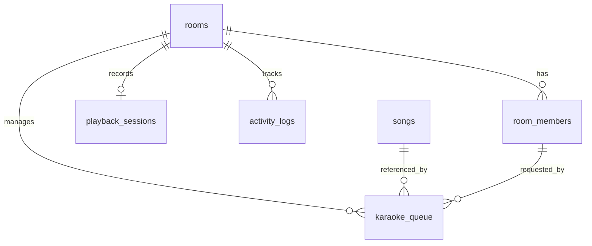

# Spec — Karaoke Party (QueueMic) Cloud-Based Room & Queue System

> **Ticket:** `T00001` (queuemic) — this file is `.agents/specs/queuemic/T00001/specs.md`; branch `T00001`.
> **Kind:** Greenfield — Cloud-based real-time Karaoke Room & Social Queue System. v2 amends the built system.
> **Portal:** **`mobile-app` & `api`** (`/api/v1/...` routes, Expo React Native cross-platform client).
> **Version:** v3 — 2026-10-07 — §2.13 decided by the product owner: YouTube Data API only (the results-page scraper is removed); `HEARTBEAT_FAILED` added to the error-code table.
>
> **Route:** `/api/v1/rooms`, `/api/v1/rooms/{code}/*`, `/api/v1/songs/search`.
> **Conventions:** Clean Architecture (thin controllers; Actions / Queries / Services), event-driven WebSocket streaming, dark glassmorphic UI. QueueMic is **not** covered by [project-gate.md](../../../rules/core/project-gate.md) (which profiles SubHRMS and ScaleUP only). Its conventions are this spec plus `backend/AGENTS.md` and `mobapp/AGENTS.md`.
> **System Awareness:**
> - Models reused: Room, RoomMember, Song, KaraokeQueue, PlaybackSession, ActivityLog.
> - Tables reused; one column and one index added to `karaoke_queue`.
> - Routes reused; one new route (`POST /rooms/{code}/heartbeat`).
> - New migration: **yes** — `karaoke_queue.idempotency_key` (D8).

---

## 1. Purpose

Traditional karaoke setups require passing around physical microphones, remote controls, or a single host mobile device to search YouTube. That causes friction, interruptions and chaotic turn-taking.

**Karaoke Party** solves this with a cloud-synchronized Karaoke Room:

- A single device connected to the TV/sound system acts as the **Host Player**.
- Party attendees join from their own phones by scanning a QR code or entering a 6-character room code.
- Guests can search a song catalog, queue songs under their nickname, see whose turn it is, and follow along.
- Nobody needs a password, an account, or to copy video links.

---

## 2. Design Decisions (Pros & Cons)

> Decisions 1–4 are from v1 and remain binding; v2 corrects their wording to match the system as built. Decisions 5–11 were made by the product owner on 2026-10-07 in answer to `verify.md` v2. Decision 12 records technical defaults applied per that report. Section 2.13 was decided on 2026-10-07 (v3).

### Decision 1: Authentication & Session Strategy

> **DECIDED — device-bound session tokens (Option A), implemented without Sanctum.**
> - Create and join each issue a **40-character random bearer token**.
> - Only its SHA-256 hash is stored, in `room_members.session_token_hash`.
> - The app sends the token as `Authorization: Bearer <token>` (or `X-Session-Token`).
> - The same token authorizes REST calls and Reverb presence-channel auth.
> - `laravel/sanctum` is installed but **not used**: the spec's own schema and channel callback define this custom token.

**Option A — Ephemeral Device-Bound Session Tokens (Chosen)**
- A transient bearer token tied to a `device_uuid` is issued on create/join. No email or password. The token is stored on the device.

| Pros | Cons |
|---|---|
| Zero-friction onboarding (join in < 3 seconds via QR code). | If the user clears app data, their seat is orphaned until the room expires (D6). |
| One token for REST and presence-channel auth. | Sessions are tied to a device rather than a cross-device account. |
| Host and Guest roles live on `room_members.role`. | |

**Option B — Pure Cookie-Based State with Ephemeral Sessions** (rejected)

| Pros | Cons |
|---|---|
| Native Laravel session handling without token storage. | Fragile with React Native WebSocket handshakes and mobile network transitions. |

---

### Decision 2: Song Catalog Search & Karaoke Provider Integration

> **DECIDED — server-side provider proxy with local song caching (Option A).**
> - The app calls `GET /api/v1/songs/search?q=…&room_code=…` (members only, §4).
> - The backend queries the provider, normalizes the metadata (`title`, `artist`, `duration_formatted`, `duration_seconds`, `thumbnail_url`, `external_video_id`, `source_provider`), upserts it into `songs`, and returns normalized results.
> - Result pages are cached for 30 minutes; an empty page is never cached.
>
> **Provider drivers** (`KARAOKE_PROVIDER_DRIVER`):
> - **`youtube`** (default). Uses the **YouTube Data API v3** when `YOUTUBE_API_KEY` is set: `search` (`type=video`, `videoEmbeddable=true`, " karaoke" appended), then one `videos?part=contentDetails` call per page for real lengths. Without `YOUTUBE_API_KEY` it returns no results and logs a warning; it never scrapes youtube.com pages (§2.13). Use `mock` for offline development.
> - **`mock`**. Offline fixtures for demos and tests. Ids are placeholders and do not play.
>
> A length that cannot be read is stored as the column default `00:00` / `0` ("unknown"), never a made-up value.

**Option A — Server-Side Provider Search Proxy with Local Song Caching (Chosen)**

| Pros | Cons |
|---|---|
| API keys stay on the backend. | Requires a caching layer to avoid provider rate limits. |
| Consistent metadata regardless of provider. | Small proxy latency on search. |
| The host player only receives sanctioned playback ids. | |

**Option B — Direct Client-Side Provider API Calling** (rejected)

| Pros | Cons |
|---|---|
| Offloads backend traffic. | Leaked API keys, quota exhaustion, inconsistent filtering across client versions. |

---

### Decision 3: Real-Time Event Synchronization Engine

> **DECIDED — Laravel Reverb presence channel (Option A).**
> - All room events go out on the presence channel `room.{code}` (client name `presence-room.{code}`). They are sent immediately (`ShouldBroadcastNow`).
> - `GET /api/{v1/}broadcasting/config` lets the backend switch clients between Reverb (default) and hosted Pusher with an `.env` change only.
> - pusher-js replays nothing after a disconnect, so **the app re-reads room state from the REST API whenever its socket reconnects** (§5.4).

| Event class | `broadcastAs` | Payload | Emitted by |
|---|---|---|---|
| `MemberJoinedRoomEvent` | `member.joined` | `id, nickname, avatar_color, role, is_connected` | Join |
| `MemberLeftRoomEvent` | `member.left` | `id` | Leave |
| `QueueUpdatedEvent` | `queue.updated` | `queue` (pending items, ordered) | Add, move, remove, next, skip |
| `SongStartedEvent` | `song.started` | `current_playing` (item + song) or `null` | Next, skip, auto-start |
| `PlaybackStateChangedEvent` | `playback.state_changed` | `state, current_time_seconds, queue_item_id, position_at_ms` | Playback state |
| `HostTransferredEvent` | `host.transferred` | `new_host_id, new_host_nickname` | Transfer host |
| `RoomClosedEvent` | `room.closed` | `room_code, message` | Close, expiry |
| `RoomSettingsUpdatedEvent` | `room.settings_updated` | `settings, name` | Settings |

**Option A — Laravel Reverb WebSockets with Presence & Private Channels (Chosen)**

| Pros | Cons |
|---|---|
| Sub-50 ms latency across connected phones. | Requires connection maintenance and reconnect handling (re-sync, §5.4). |
| Presence channels detect who is online. | Requires the Reverb daemon in production (`php artisan reverb:start`). |
| No external SaaS cost. | |

**Option B — HTTP Polling** (rejected)

| Pros | Cons |
|---|---|
| No WebSocket daemon. | Server load, battery drain, up to 3 s delay. |

---

### Decision 4: Playback Synchronization & Host Player Engine

> **DECIDED — host-authoritative state with broadcast sync (Option A).**
> - The Host device is the playback clock. It posts state to `POST /playback/state`: on play/pause/seek, and as a heartbeat every 4 s while playing, stamped with `position_at_ms` on the server timeline from `GET /api/v1/time`.
> - The backend stores it and broadcasts the canonical state.
> - **Server auto-start (as built):** when a song is added and nothing is playing, the server starts it immediately (`StartNextSongAction`), so every device shares one "now playing" and one start time.
> - **Single audio stream:** only the Host Player plays sound by default. Guest players are muted by default (D7).

| Pros | Cons |
|---|---|
| Immune to race conditions across guest phones. | Host connectivity loss pauses progression until the host returns or is replaced (D6). |
| One audible stream in the room. | The host app must stay in the foreground with the screen awake. |
| Precise sync for guest progress views. | |

**Option B — Server-Side Timer Tick Engine** (rejected): desynchronizes when the host buffers or lags.

---

### Decision 5: Guest permissions the host can switch on

> **DECIDED (2026-10-07) — both opt-ins kept, off by default.**
> - Playback (`/playback/state|next|skip`) and queue moves (`/queue/{id}/move`) are **host-only by default**.
> - The host may enable either per room with `allow_guest_playback_control` / `allow_guest_reorder` (Settings toggles).
> - A non-host rejected by either rule gets `403 HOST_PERMISSION_REQUIRED`.

| Option | Pros | Cons |
|---|---|---|
| **Host opt-in per room (chosen)** | Hosts who want a shared remote can have one; safe default | Two more settings to explain; guests could disrupt if enabled |
| Strictly host-only | Simplest; one authority | Removes a feature hosts already use |

### Decision 6: When an inactive room closes

> **DECIDED (2026-10-07) — host-presence expiry.**
> - A room stays open while the host's app is open. The host app sends a heartbeat every 60 s, even when nothing is playing.
> - The room closes **30 minutes after the host seat was last seen**.
> - Song activity and guest activity do **not** keep a room alive.
> - After a host transfer, the new host seat's `last_seen_at` governs.
> - Replaces v1's as-built rule (closed after 30 min with no song added and nothing playing).

| Option | Pros | Cons |
|---|---|---|
| **Host-presence (chosen)** | Never closes on a present host during a lull; a host-less room cannot live forever | Needs an idle-time heartbeat from the host app |
| Song-idle (old as-built) | No heartbeat | Closes on a present host; host-less rooms survive while guests add songs |
| Both must be idle | Most conservative | Host-less rooms still survive while guests keep adding songs |

### Decision 7: What guest phones show for the current song

> **DECIDED (2026-10-07) — muted synced video with a toggle.**
> - Guests see the synced video (for lyrics), **muted by default**, with a "Listen on this phone" toggle on the guest player.
> - The toggle resets to muted on every room entry.
> - The Host Player is always unmuted.
> - A guest screen holds a wake lock **only while a song is on stage**.

| Option | Pros | Cons |
|---|---|---|
| **Muted video + toggle (chosen)** | Lyrics on every phone; one audible stream | One extra control; guests may still unmute and echo |
| No video on guests | Lightest; simplest | No lyrics on phones |
| Video with sound | No change | Echo from many phones; breaks the single-stream guarantee |

### Decision 8: Making a retried "add song" safe

> **DECIDED (2026-10-07) — `Idempotency-Key` header with a unique column.**
> - The app sends an `Idempotency-Key` with every add. The server stores it in `karaoke_queue.idempotency_key` with **`unique(room_id, idempotency_key)`**.
> - Replaying a key returns the original row.
> - The 5-second duplicate window (§6) stays as the double-tap guard for clients that send no key.

| Option | Pros | Cons |
|---|---|---|
| **Key + DB column (chosen)** | Durable; the unique constraint also stops concurrent duplicates | Needs a migration |
| Key + cache | No migration | Weaker under races; keys expire |
| Drop the requirement | Nothing to build | A retry after a long timeout can duplicate |

### Decision 9: Per-guest queue limit

> **DECIDED (2026-10-07) — enforce `max_queue_per_user`, unset by default.**
> - The host may set 1–50 (or clear it for unlimited) in Settings.
> - The limit counts a member's **pending** songs (the song on stage does not count). **The host is exempt.**
> - Over the limit → `422 QUEUE_LIMIT_REACHED`.

| Option | Pros | Cons |
|---|---|---|
| **Enforce, off by default (chosen)** | Fairness tool for busy parties; schema already anticipated it | One more Settings field |
| Drop it | Less to build | No fairness control |

### Decision 10: Telling guests the party ended

> **DECIDED (2026-10-07) — blocking alert (as built).**
> - On `room.closed`, or on any `ROOM_NOT_FOUND` during a session, the app clears room state, returns Home, and shows an alert titled **"Party Room Ended"** with the server's reason message.
> - Replaces v1's "toast"; no Toast component is required.

| Option | Pros | Cons |
|---|---|---|
| **Blocking alert (chosen)** | Already built; the reason (closed vs expired) is read before continuing | Needs a tap to dismiss |
| Non-blocking toast | Less intrusive | New component; reason easy to miss |

### Decision 11: Host Player layout in landscape

> **DECIDED (2026-10-07) — queue sidebar in landscape.**
> - When the Host Player window is wider than tall: the video sits on the left (≈65% width), and a right-hand column shows Next Up, the queue (with host controls) and "+ Add Song".
> - In portrait the layout stays stacked (video above, queue below).
> - Full-screen mode hides the sidebar.

| Option | Pros | Cons |
|---|---|---|
| **Landscape sidebar (chosen)** | TV-friendly; queue visible while the video plays | Two layouts to maintain |
| Always stacked | No change | Queue pushed off-screen on a landscape TV |

### Decision 12: Technical defaults applied in v2 (amendments per `verify.md` v2)

> **DECIDED — technical defaults; reopen if a requirement changes.**
> - **Foreign keys:** `karaoke_queue.song_id` and `karaoke_queue.requested_by_member_id` **cascade on delete**, as built. Rooms are hard-deleted by cleanup (§6), and cascading every room-owned row avoids FK-ordering failures on that path.
> - **Song search index:** no FULLTEXT index. Search is provider-backed and never queries `songs` locally; `title` and `artist` keep plain indexes.
> - **Default avatar colour:** `#8B5CF6` (hosts). Guests get a random colour from `#EC4899, #06B6D4, #10B981, #F59E0B, #6366F1, #3B82F6`.
> - **Token storage on device:** persisted with Zustand over AsyncStorage (`localStorage` on web), as Decision 1 permits. `expo-secure-store` is not used: the token is a short-lived, single-room credential, and the web build needs `localStorage`.
> - **Authorization mechanism:** route middleware (`room.member`, `room.host`, `room.playback_control`, `room.queue_reorder`) plus an owner check inside `RemoveQueueItemAction`. No Policy classes.
> - **Reorder:** one action, `MoveQueueItemAction`, handles `direction` (`up`, `down`, `top`, `bottom`) and `target_position`. No separate `ReorderQueueAction`.
> - **Styling:** `@shopify/restyle` theme (`src/theme/`), not NativeWind.
> - **Framework:** Laravel **13**.

### 2.13 YouTube results-page fallback

> **DECIDED (2026-10-07) — Data API only.** The results-page scraper is removed. Without `YOUTUBE_API_KEY` the `youtube` driver returns an empty result list and logs a warning; it makes no request to youtube.com. Offline development uses `KARAOKE_PROVIDER_DRIVER=mock`.

Before v3, when no `YOUTUBE_API_KEY` was configured (or the API returned nothing), search parsed YouTube's **public results page**.

| Option | Pros | Cons |
|---|---|---|
| Keep the fallback | Works with no API key or quota | Scraping may conflict with YouTube's Terms; breaks whenever YouTube changes its page |
| **Data API only (chosen)** | Sanctioned, stable | Requires a key and quota in every environment; search returns nothing without one |

---

## 2.5 Acceptance Criteria

Unless a row says otherwise:
- "Envelope" means the error body `{"success": false, "message": <string>, "code": <CODE>, "errors": {}}`, with `errors` keyed by field for 422s.
- Codes are 6 characters from `ABCDEFGHJKLMNPQRSTUVWXYZ23456789`.
- Requests carry `Accept: application/json`.

| # | Given | When | Then |
|---|---|---|---|
| **AC-1** | User enters nickname `"Alex"` and room name `"Friday Jam"` | `POST /api/v1/rooms` | `201`; `data.room.code` matches `^[A-Z0-9]{6}$`; `data.member.role = "host"`; `data.member.avatar_color = "#8B5CF6"`; `data.token` is a 40-character string; `rooms.host_member_id = data.member.id` |
| **AC-2** | Room `"K7P9X2"` is active | Guest `"Sam"` sends `POST /rooms/join` `{room_code: "k7p9x2", nickname: "Sam"}` | `200`; `data.room.code = "K7P9X2"`; `data.member.role = "guest"`; `data.token` 40 characters; `member.joined` broadcast on `presence-room.K7P9X2` |
| **AC-3** | No active room `"XXXXXX"` | Join with `room_code: "XXXXXX"` | `404` `{"success":false,"message":"Room not found or closed","code":"ROOM_NOT_FOUND","errors":{}}` |
| **AC-4** | Member of an active room | `GET /songs/search?q=Bohemian%20Rhapsody&room_code=<code>` | `200`; `data` is an array of `{id, external_video_id, title, artist, duration_formatted, duration_seconds, thumbnail_url, source_provider}`; every result exists in `songs` |
| **AC-5** | Queue holds N pending songs and a song is playing | Guest sends `POST /rooms/{code}/queue {song_id: 42}` | `201`; new item `position = N+1`, `status = "pending"`; `queue.updated` broadcast with the full ordered pending list |
| **AC-6** | Room has default settings (`allow_guest_playback_control` false) | Guest sends `POST /rooms/{code}/playback/skip` | `403` `{"success":false,"message":"Only the room host can control playback","code":"HOST_PERMISSION_REQUIRED","errors":{}}`; nothing changes |
| **AC-7** | Pending items at positions 1, 2, 3 | Host sends `POST /queue/{id of pos 3}/move {direction:"up"}` | `200`; that item is now position 2, the former position 2 is now 3, positions renumbered 1..N in one transaction; `queue.updated` broadcast |
| **AC-8** | A song is playing and the next song is pending | The video plays to the end on the Host Player | The app calls `POST /playback/next`. The finished item becomes `completed` with `finished_at` set; the next pending item becomes `playing`; `song.started` broadcast |
| **AC-9** | Alex hosts; Sam is a connected guest | Alex taps Transfer Host → Sam → "Yes, Transfer" | The app calls `POST /transfer-host {new_host_member_id: Sam}` → `200`. Sam `role = "host"`, Alex `role = "guest"`, `rooms.host_member_id = Sam`; `host.transferred` broadcast; Alex's device moves to Guest Room; Sam's device moves to Host Player |
| **AC-10** | Active room with guests | Host sends `DELETE /rooms/{code}` | `200`; room `status = "closed"`, `closed_at` set; `room.closed` broadcast; any member's next room request → `404 ROOM_NOT_FOUND`; presence-channel auth for that room → `403` (AC-42) |
| **AC-11** | — | (a) `POST /rooms` or `/rooms/join` with `nickname: "   "`; (b) add to queue with `singer_name: "   "`; (c) search with `q` blank | (a) `422 VALIDATION_FAILED`, `errors.nickname`; (b) `201`, `singer_name` = the member's nickname; (c) `200` with trending results ("Karaoke Hits") |
| **AC-12** | Host is on the Host Player | Playback runs | The screen does not sleep (`expo-keep-awake` active while the screen is mounted); full-screen toggle works; in landscape the queue shows in a right-hand sidebar (D11), in portrait below the video |
| **AC-13** | A song is playing | Host taps Skip (`POST /playback/skip`) | `200`; the item becomes `skipped` with `finished_at` set; an `activity_logs` row `action = "song_skipped"`; next pending → `playing`; `song.started` broadcast |
| **AC-14** | Nothing is playing and the queue is empty | Any member adds a song | `201` with `status = "playing"`; `song.started` broadcast; playback session `state = "playing"` |
| **AC-15** | Sam queued item X (pending) | Sam sends `DELETE /rooms/{code}/queue/X` | `200`; X becomes `removed`; remaining pending items renumbered 1..N; `queue.updated` broadcast. The Guest Room shows a remove control only on Sam's own items |
| **AC-16** | Alex queued item Y | (a) Sam sends `DELETE /queue/Y`; (b) the host deletes Y; (c) anyone deletes id `999999` | (a) `403 HOST_PERMISSION_REQUIRED`; (b) `200`; (c) `404 QUEUE_ITEM_NOT_FOUND` |
| **AC-17** | Sam queued song 7 as "Sam" 2 s ago, without an `Idempotency-Key` | Sam adds song 7 as "Sam" again | `201` with the **same** item id; no new row, activity log or broadcast |
| **AC-18** | An add with `Idempotency-Key: k-123e4567-e89b` succeeded (item Z) | The identical request is replayed (any time later) | `201` with item Z's body; no new row, activity log or broadcast |
| **AC-19** | Key `k-123e4567-e89b` was used for song 7 | The same key is sent with `song_id: 8` | `409` `code = "IDEMPOTENCY_KEY_MISMATCH"`; no row created |
| **AC-20** | — | Two identical adds with the same key arrive simultaneously | Exactly one row exists; both responses are `201` with the same item id |
| **AC-21** | — | `Idempotency-Key: "ab"` (or a value with characters outside `[A-Za-z0-9-]`, or longer than 64) | `422 VALIDATION_FAILED`, `errors.idempotency_key` |
| **AC-22** | A guest's add request got no response (timeout or offline) | The guest confirms the same song and singer again within 2 minutes | The app re-sends the **same** `Idempotency-Key`. Exactly one row exists for that add. A key is discarded once any HTTP response arrives |
| **AC-23** | `max_queue_per_user = 2`; Sam has 2 pending songs | (a) Sam adds a third; (b) the host adds a third of their own; (c) the host clears the limit (`null`) and Sam adds | (a) `422` `code = "QUEUE_LIMIT_REACHED"`, message `"You already have 2 songs waiting. Wait for one to play before adding more."`; (b) `201` (host exempt); (c) `201` |
| **AC-24** | `allow_guest_playback_control = true` | Guest sends `POST /playback/skip` | `200` and the skip happens (AC-13 effects) |
| **AC-25** | `allow_guest_reorder` = (a) `true`, (b) `false` | Guest sends `POST /queue/{id}/move {direction:"up"}` | (a) `200` with AC-7 effects; (b) `403 HOST_PERMISSION_REQUIRED` |
| **AC-26** | — | `PATCH /rooms/{code}/settings`: (a) by a guest; (b) by the host with `{allow_guest_reorder:true, max_queue_per_user:3}`; (c) by the host with `max_queue_per_user: 0`, `51` or `"x"` | (a) `403 HOST_PERMISSION_REQUIRED`; (b) `200`, settings stored, `room.settings_updated` broadcast; (c) `422 VALIDATION_FAILED`, `errors.max_queue_per_user` |
| **AC-27** | Alex hosts | (a) Alex transfers to himself; (b) Alex transfers to a member of another room | (a) `422` `code = "INVALID_TRANSFER_TARGET"`, roles unchanged; (b) `404` `code = "MEMBER_NOT_FOUND"` |
| **AC-28** | Sam's phone is locked when Alex transfers host to Sam | Sam unlocks and the socket reconnects | Within one re-sync (`GET /members` shows Sam = host), Sam's app sets role `host` and opens the Host Player. A server answer requested before a later role change is ignored |
| **AC-29** | Sam's app was closed during the transfer | Sam reopens the app | The splash screen reads `data.host_member_id` from `GET /rooms/{code}` and opens the Host Player with role `host` |
| **AC-30** | Host app open on the Host Player; nothing added or played for 31 minutes | Any member makes a room request | The room is still `active` (the host heartbeat kept `last_seen_at` current) |
| **AC-31** | Host seat `last_seen_at` is 31 minutes old | Any member makes a room request, or cleanup runs | The room closes. Request → `404 ROOM_NOT_FOUND` with message `"This party ended because the host has been away for 30 minutes."`; `room.closed` broadcast with the same message |
| **AC-32** | Host seat last seen 31 minutes ago; guests added songs in the last minute | Any member makes a room request | The room closes as in AC-31 (guest and song activity do not extend it) |
| **AC-33** | Member of an active room | `POST /rooms/{code}/heartbeat` | `200 {"success":true,"data":{"last_seen_at":"<ISO-8601>"}}`; the caller's `room_members.last_seen_at` ≈ now and `is_connected = true` |
| **AC-34** | The host closed the app 10 minutes ago | The host reopens the app with the stored token | The room is active; the host lands on the Host Player with role `host` |
| **AC-35** | — | `GET /songs/search?q=queen`: (a) no `room_code`; (b) `room_code` but no token; (c) a token from another room | (a) `400 ROOM_CODE_REQUIRED`; (b) `401 UNAUTHENTICATED`; (c) `403 INVALID_SESSION` |
| **AC-36** | Member of an active room | Search with (a) `q="b"`; (b) a 101-character `q`; (c) `limit=51` | `422 VALIDATION_FAILED` with `errors.q` (a, b) or `errors.limit` (c). The app sends no request for a 1-character query |
| **AC-37** | Member A made 60 searches in the last minute | (a) A searches again; (b) member B searches | (a) `429` `code = "TOO_MANY_REQUESTS"`; (b) `200` (the limit is per session token, not per IP) |
| **AC-38** | — | Create or join with: room name of 1 or 51 characters; nickname of 1 or 31 characters; nickname containing `<` or `>`; `room_code` not 6 letters/digits (e.g. `"ab12cd34"`); `device_uuid` over 64 characters | `422 VALIDATION_FAILED` with the offending field in `errors`. A 2-character nickname and a lower-case 6-character code are accepted |
| **AC-39** | Connected member "Sam" is in the room | Another device joins as `"sam"` | `422` `code = "NICKNAME_TAKEN"` |
| **AC-40** | Guest Sam (device `dev-sam`) left the room | Sam rejoins with the same `device_uuid` | `200` with the **same** member id, a new token, `is_connected = true` |
| **AC-41** | — | (a) `GET /api/v1/does-not-exist`; (b) `PUT /api/v1/rooms/join`; (c) an unexpected server error with `APP_DEBUG=false` | Envelopes: (a) `404 NOT_FOUND`; (b) `405 METHOD_NOT_ALLOWED`; (c) `500 SERVER_ERROR` with `message = "Server Error"` |
| **AC-42** | Member tokens for an active room, a closed room and another room | `POST /api/v1/broadcasting/auth` for `presence-room.<code>` | Active, own channel → `200` with a signature. Closed room, other room or unknown token → `403` `code = "BROADCAST_AUTH_FAILED"` |
| **AC-43** | A song is playing; 2 pending | Member sends `GET /rooms/{code}/queue` | `200` `{"success":true,"data":[2 pending, by position],"current":{status:"playing",…}}`; `current` is `null` when nothing plays |
| **AC-44** | A song is on stage | A guest enters the Guest Room | The guest video is muted. Tapping "Listen on this phone" unmutes it on that device only. Leaving and re-entering mutes it again. The Host Player is unmuted |
| **AC-45** | A guest is on the Guest Room | (a) A song is on stage; (b) the stage is empty | (a) Wake lock held; (b) no wake lock |
| **AC-46** | A guest is in a room | The host closes it, or it expires | The guest's app returns Home and shows the alert "Party Room Ended" with the server's message |
| **AC-47** | `YOUTUBE_API_KEY` set; the API reports `PT4M13S` for one result and nothing for another | Search | The first result has `duration_seconds = 253`, `duration_formatted = "04:13"`; the second has `0` / `"00:00"` |
| **AC-48** | — | On a phone: confirm an add, move a queue item, tap Skip | Each gives haptic feedback (not on web) |

---

## 3. Database Schema (MySQL 8.0+)



Columns below are as built unless marked **NEW**. Every room-owned row is deleted with its room (cascade).

### 1. `rooms` (reused)

- `id` BIGINT UNSIGNED PK
- `code` VARCHAR(8) UNIQUE — always 6 characters in practice
- `name` VARCHAR(100) NOT NULL — validated 2–50 characters (§6)
- `host_member_id` BIGINT UNSIGNED NULL (indexed; no FK)
- `status` ENUM('active','closed') DEFAULT 'active', INDEX
- `settings` JSON NULL — keys (all optional):

  | Key | Type | Default | Meaning |
  |---|---|---|---|
  | `allow_guest_reorder` | bool | `false` | D5 |
  | `allow_guest_playback_control` | bool | `false` | D5 |
  | `max_queue_per_user` | int 1–50 or `null` | `null` (unlimited) | D9 |

- `created_at`, `updated_at`, `closed_at`

### 2. `room_members` (reused)

- `id` PK; `room_id` FK → rooms ON DELETE CASCADE
- `session_token_hash` VARCHAR(64) UNIQUE — SHA-256 of the 40-character token (D1)
- `device_uuid` VARCHAR(64) NOT NULL
- `nickname` VARCHAR(50) NOT NULL — validated 2–30 characters
- `avatar_color` VARCHAR(7) NOT NULL DEFAULT `'#8B5CF6'` (D12)
- `role` ENUM('host','guest') DEFAULT 'guest'
- `is_connected` BOOLEAN DEFAULT TRUE — false after Leave
- `last_seen_at` TIMESTAMP NOT NULL — **now drives room expiry for the host seat (D6)**. Updated by the heartbeat and by authenticated requests (§4).
- Indexes `(room_id, is_connected)`, `(room_id, role)`

### 3. `songs` (reused)

- `external_video_id` VARCHAR(100) UNIQUE
- `title` VARCHAR(255) NOT NULL, indexed
- `artist` VARCHAR(255) NOT NULL DEFAULT 'Unknown', indexed
- `duration_formatted` VARCHAR(10) DEFAULT '00:00'
- `duration_seconds` INT UNSIGNED DEFAULT 0
- `thumbnail_url` TEXT NOT NULL
- `source_provider` VARCHAR(50) DEFAULT 'youtube' (`custom` for mock fixtures)
- `metadata_payload` JSON NULL
- timestamps. **No FULLTEXT index** (D12).

### 4. `karaoke_queue` (reused + NEW column)

- `room_id` FK CASCADE
- `song_id` FK → songs CASCADE (D12)
- `requested_by_member_id` FK → room_members CASCADE (D12)
- `singer_name` VARCHAR(50)
- `position` INT UNSIGNED — 1..N among **pending** items
- `status` ENUM('pending','playing','completed','skipped','removed') DEFAULT 'pending', INDEX
- `played_at`, `finished_at` NULL; timestamps; index `(room_id, status, position)`
- **NEW:** `idempotency_key` VARCHAR(64) NULL, with **UNIQUE `(room_id, idempotency_key)`** (D8). NULL for adds sent without a key; MySQL allows many NULLs under a unique index.

### 5. `playback_sessions` (reused)

- `room_id` UNIQUE FK CASCADE
- `queue_item_id` NULL FK (null on delete)
- `song_id` NULL FK (null on delete)
- `state` ENUM('playing','paused','buffering','stopped') DEFAULT 'stopped'
- `current_time_seconds` INT UNSIGNED DEFAULT 0
- `started_at` NULL
- `created_at`, `updated_at` — `updated_at` marks when the reported position was true

### 6. `activity_logs` (reused)

- `room_id` FK CASCADE
- `room_member_id` NULL FK SET NULL
- `action` VARCHAR(50) — `room_created`, `member_joined`, `member_rejoined`, `member_left`, `song_queued`, `song_skipped`, `host_transferred`, `room_closed`
- `payload` JSON NULL; `created_at`

**Migration (NEW):** `add_idempotency_key_to_karaoke_queue` — add the column and the composite unique index; `down()` drops both.

---

## 4. Backend Architecture (Laravel 13)

### Folder structure (as built + v2 additions)

```text
backend/app/
├── Actions/
│   ├── Room/      CreateRoomAction, JoinRoomAction, LeaveRoomAction, TransferHostAction, CloseRoomAction,
│   │              UpdateRoomSettingsAction, ExpireRoomIfIdleAction (→ host-presence rule, D6),
│   │              CleanupInactiveRoomsAction, RecordMemberHeartbeatAction (NEW)
│   ├── Queue/     AddSongToQueueAction (+ idempotency D8, + limit D9), MoveQueueItemAction, RemoveQueueItemAction
│   └── Playback/  StartNextSongAction, UpdatePlaybackStateAction, SkipCurrentSongAction
├── Queries/       Room/{GetRoomDetailsQuery, GetRoomMembersQuery}, Queue/{GetRoomQueueQuery, GetCurrentPlayingQuery},
│                  Song/SearchKaraokeSongsQuery
├── Services/      KaraokeProvider/{KaraokeProviderInterface, YouTubeKaraokeProvider, MockKaraokeProvider},
│                  CodeGenerator/RoomCodeGeneratorService
├── Events/        (8 events — Decision 3 table)
├── Http/
│   ├── Controllers/Api/V1/  RoomController, QueueController, PlaybackController, SongController, MemberController,
│   │                        BroadcastAuthController
│   ├── Requests/V1/         CreateRoomRequest, JoinRoomRequest, AddQueueRequest (+ Idempotency-Key), MoveQueueRequest,
│   │                        UpdatePlaybackRequest, TransferHostRequest, UpdateRoomSettingsRequest (+ max_queue_per_user),
│   │                        SearchSongsRequest
│   └── Middleware/          EnsureRoomMember (+ refresh last_seen_at), EnsureRoomHost, EnsurePlaybackControl,
│                            EnsureQueueReorder, CleanupInactiveRooms
├── Models/        Room, RoomMember, Song, KaraokeQueue, PlaybackSession, ActivityLog
└── Providers/AppServiceProvider   (broadcast user resolution by session token; `song-search` rate limiter)
config/karaoke.php   driver, youtube_api_key, host_away_minutes (NEW, replaces room_idle_minutes; default 30), unused_song_days
bootstrap/app.php    route-middleware aliases; API error-envelope renderers
routes/api.php, routes/channels.php, routes/console.php (rooms:cleanup)
```

### REST API (`/api/v1`)

| Method | Endpoint | Purpose | Auth |
|---|---|---|---|
| `POST` | `/rooms` | Create room and register Host | None |
| `POST` | `/rooms/join` | Join (or rejoin the same device's guest seat) | None |
| `GET` | `/time` | Server clock `{server_time_ms}` for playback sync | None |
| `GET` | `/songs/search?q=&limit=&room_code=` | Search catalog (D2); limited to 60 requests/min per session token | Room Member (via `room_code`) |
| `GET` | `/rooms/{code}` | Room metadata, settings, current playback | Room Member |
| `POST` | `/rooms/{code}/leave` | Leave (`is_connected = false`) | Room Member |
| `POST` | `/rooms/{code}/heartbeat` | **NEW** — record the caller's presence (D6) | Room Member |
| `GET` | `/rooms/{code}/members` | Connected members (host first) | Room Member |
| `GET` | `/rooms/{code}/queue` | `data` = pending items by position; `current` = playing item or `null` | Room Member |
| `POST` | `/rooms/{code}/queue` | Add song (`song_id`, optional `singer_name`, optional `Idempotency-Key` header) | Room Member |
| `DELETE` | `/rooms/{code}/queue/{queueId}` | Remove pending item | Host, or the member who queued it |
| `POST` | `/rooms/{code}/queue/{queueId}/move` | `direction` ∈ up/down/top/bottom, or `target_position` | Host (+ guests when `allow_guest_reorder`) |
| `GET` | `/rooms/{code}/playback` | Current item, state, position, `position_age_ms` | Room Member |
| `POST` | `/rooms/{code}/playback/state` | Report state + position (`position_at_ms`) | Host (+ guests when `allow_guest_playback_control`) |
| `POST` | `/rooms/{code}/playback/next` | Song finished → next (completes current) | as above |
| `POST` | `/rooms/{code}/playback/skip` | Skip current (marks it skipped) | as above |
| `PATCH` | `/rooms/{code}/settings` | Room name + settings keys (§3) | **Host** |
| `POST` | `/rooms/{code}/transfer-host` | Transfer host role | **Host** |
| `DELETE` | `/rooms/{code}` | Close room | **Host** |
| `GET`/`POST` | `/api/{v1/}broadcasting/config`, `/api/{v1/}broadcasting/auth` | Client broadcaster config; presence-channel auth | Token (auth) |

### Rules the actions implement

- **Add song** (`AddSongToQueueAction`) runs in one transaction, in this order:
  1. Lock the room's last pending row.
  2. **Idempotency replay (D8):** if `Idempotency-Key` matches a row in this room, return it when song and singer match; otherwise `409 IDEMPOTENCY_KEY_MISMATCH`.
  3. **5 s duplicate window:** same member, song and singer, `status ∈ {pending, playing}`, created ≤ 5 s ago → return that row.
  4. **Queue limit (D9):** non-host with `max_queue_per_user` set and pending count ≥ limit → `422 QUEUE_LIMIT_REACHED`.
  5. Insert at `max(pending position) + 1`.
  6. Log `song_queued`.
  7. Auto-start if the stage is empty (D4), else broadcast `queue.updated`.

  A unique-index collision on the key returns the existing row. Returned rows use the same body as a fresh add (`201`).
- **Room expiry** (`ExpireRoomIfIdleAction`, D6): a room is expired when its host seat's `last_seen_at` < now − `host_away_minutes`. It is checked by `EnsureRoomMember` (every room request), by `JoinRoomAction`, and by cleanup (at most every 5 min, after the response, from the `CleanupInactiveRooms` middleware or `php artisan rooms:cleanup`). It closes the room with the AC-31 message.
- **Presence refresh:** `EnsureRoomMember` sets the authenticated member's `last_seen_at = now` when the stored value is older than 60 s. `RecordMemberHeartbeatAction` always sets it, along with `is_connected = true`.
- **Cleanup** (`CleanupInactiveRoomsAction`): expires rooms per D6, then **hard-deletes closed rooms**. Members, queue, playback session and activity logs go with them by cascade. It also deletes songs no queue uses and no search returned for 7 days, and purges expired database-cache rows.
- **Transfer host** rejects a self-transfer (`422 INVALID_TRANSFER_TARGET`) and a member of another room (`404 MEMBER_NOT_FOUND`). It updates both roles and `rooms.host_member_id`, then broadcasts `host.transferred`.
- **Remove** marks the item `removed` and renumbers pending positions. A guest may remove only their own items (`403 HOST_PERMISSION_REQUIRED` otherwise).

### Broadcast channel (`routes/channels.php`)

`room.{code}`: the user is resolved from the bearer token (`AppServiceProvider`). Authorized only when the member's room is **`status = 'active'`** and its code matches. Returns `{id, nickname, avatar_color, role, is_connected}`.

### Error envelope and codes

Every API error uses the envelope (§2.5). `bootstrap/app.php` renders framework errors on `api/*`: `ValidationException` → `422 VALIDATION_FAILED` with field errors; HTTP exceptions → their status with `BAD_REQUEST`, `UNAUTHENTICATED`, `FORBIDDEN`, `NOT_FOUND`, `METHOD_NOT_ALLOWED`, `UNPROCESSABLE`, `TOO_MANY_REQUESTS` (or `HTTP_ERROR`); anything else → `500 SERVER_ERROR` (generic message unless `APP_DEBUG`).

| Status | Codes |
|---|---|
| 400 | `ROOM_CODE_REQUIRED`, `ROOM_CREATION_FAILED`, `ROOM_JOIN_FAILED`, `QUEUE_ADD_FAILED`, `MOVE_FAILED`, `REMOVE_FAILED`, `LEAVE_FAILED`, `CLOSE_FAILED`, `TRANSFER_FAILED`, `SETTINGS_UPDATE_FAILED`, `PLAYBACK_UPDATE_FAILED`, `NEXT_FAILED`, `SKIP_FAILED`, `HEARTBEAT_FAILED` |
| 401 | `UNAUTHENTICATED` |
| 403 | `HOST_PERMISSION_REQUIRED`, `INVALID_SESSION`, `UNAUTHORIZED`, `BROADCAST_AUTH_FAILED` |
| 404 | `ROOM_NOT_FOUND`, `QUEUE_ITEM_NOT_FOUND`, `MEMBER_NOT_FOUND`, `NOT_FOUND` |
| 405 | `METHOD_NOT_ALLOWED` |
| 409 | `IDEMPOTENCY_KEY_MISMATCH` (NEW) |
| 422 | `VALIDATION_FAILED`, `NICKNAME_TAKEN`, `INVALID_TRANSFER_TARGET`, `QUEUE_LIMIT_REACHED` (NEW) |
| 429 | `TOO_MANY_REQUESTS` |
| 500 | `SERVER_ERROR`, `ROOM_FETCH_FAILED`, `MEMBERS_FETCH_FAILED`, `QUEUE_FETCH_FAILED`, `PLAYBACK_FETCH_FAILED`, `SEARCH_FAILED` |

---

## 5. Frontend Architecture (React Native & Expo)

### 5.1 Tech stack
- **Framework:** Expo SDK 57 (managed, prebuild-compatible), React Native 0.86, TypeScript strict.
- **Navigation:** React Navigation v7 native stack, plus `navigationRef` helpers.
- **State:** Zustand (`useAuthStore`, `useRoomStore`, `useQueueStore`, `usePlaybackStore`), persisted via AsyncStorage / `localStorage` (D12).
- **Server cache:** TanStack Query v5 (song search).
- **Real time:** `laravel-echo` + `pusher-js` to Reverb (or Pusher per backend config).
- **Styling:** `@shopify/restyle` theme (D12).
- **Media and device:** YouTube IFrame API in a WebView, `expo-keep-awake`, `expo-camera` + `jsqr` (QR scan), `qrcode` (QR generation), `expo-haptics`, `expo-screen-orientation`.

### 5.2 Folder structure (components in use)

```text
mobapp/src/
├── api/          client.ts (Bearer + X-Session-Token), roomApi, queueApi (+ Idempotency-Key, NEW), songApi (+ room_code),
│                 playbackApi
├── components/
│   ├── common/   GlassCard, NeonButton (haptics), AvatarBadge, HeaderBar, NicknameModal
│   ├── room/     QRCodeModal, QRScannerModal, MemberListSheet, TransferHostModal
│   ├── queue/    QueueItemCard (haptics; remove for host or own item), EmptyQueueState
│   ├── player/   HostVideoPlayer (host: unmuted; guest: muted + "Listen on this phone", NEW), PlaybackControls (Skip
│   │             haptics), NextUpOverlay, SongDetailsModal
│   └── search/   SearchInput (max 100), SongSearchModal, SongSearchResultItem, SongSearchSkeleton, AddSingerModal
├── hooks/        useEchoRoom (events + re-sync), useKeepAwakeHost, useDebounce, useSubmitGuard
├── navigation/   RootNavigator, types, navigationRef (navigateToHome, switchRoomScreen, applyOwnRole, autoExitRoomSession)
├── screens/      Splash, Home, CreateRoom, JoinRoom, GuestRoom, HostPlayer (+ landscape sidebar, NEW), SongSearch,
│                 Settings (+ song limit, NEW)
├── services/     echo.ts, serverClock.ts
├── store/        useAuthStore, useRoomStore, useQueueStore, usePlaybackStore
├── theme/        colors, typography, theme (Restyle), index
└── utils/        formatting, normalizer, storage
```

`DraggableQueueList`, `QueueReorderModal`, `GuestPlaybackBar` and `NowPlayingHero` exist in the repo but are rendered nowhere. They are **not** part of this spec (see §9).

### 5.3 Screens and behaviour
- **Splash:** restores the persisted session, then asks the server (`GET /rooms/{code}`):
  - Room gone → AC-46 behaviour.
  - Session invalid → Home.
  - Otherwise opens Host Player when `host_member_id` equals this device's member id, else Guest Room (AC-29).
  - Offline → the persisted role's screen.
- **Host Player:**
  - Video with full-screen toggle, playback controls, Next Up, queue manager (reorder, remove, + Add Song), QR, members (Transfer Host), Settings.
  - Landscape sidebar (D11).
  - Keep-awake while mounted.
  - Playback heartbeat every 4 s while playing.
  - **Presence heartbeat** `POST /heartbeat` every 60 s while a room screen is mounted and the app is in the foreground (NEW, D6).
  - Song end → `/next` (AC-8); Skip → `/skip` (AC-13).
- **Guest Room:**
  - Synced video, muted by default with a "Listen on this phone" toggle (D7).
  - Wake lock only while a song is on stage (AC-45).
  - Queue; remove on own items (AC-15).
  - Reorder and playback controls only when the matching setting is on (D5).
  - Search, members, Leave.
- **Settings (host):** room info, QR, members, the D5 toggles, and a **"Songs each guest can have waiting" field: No limit / 1–50** (D9, NEW). Close Room is behind a confirmation.
- **Search:**
  - Debounced 300 ms; no request for a 1-character query.
  - Blank shows trending.
  - The add confirm is guarded by `useSubmitGuard` (500 ms and one request in flight).
  - `QUEUE_LIMIT_REACHED` shows its message.

### 5.4 Real-time recovery and role changes
- `useEchoRoom` runs a **room sync** (queue, now playing, members) on entry, and again **whenever the socket returns to `connected` after a drop**. Missed events are never replayed.
- `applyOwnRole` is the only place a device changes its own role. It is used by Transfer Host, `host.transferred` and the sync. A server answer requested before the last role change is ignored (AC-28).
- Any `ROOM_NOT_FOUND` during a session, or a `room.closed` event, triggers AC-46.

### 5.5 Idempotency on the client (D8)
- The app generates a random key (16–64 characters from `[A-Za-z0-9-]`) when a song and singer are first confirmed, and sends it as `Idempotency-Key`.
- If that request gets **no HTTP response**, the key is kept for 2 minutes and reused if the same song and singer are confirmed again (AC-22).
- Any HTTP response discards the key.

---

## 6. UI/UX & Design Specification

### Aesthetic foundation (as built)
- **Background:** Obsidian Void `#0A0A0F`, Slate Sheet `#12131C`.
- **Accents:** Cyber Violet `#8B5CF6`, Neon Fuchsia `#EC4899`, Electric Cyan `#06B6D4`.
- **Cards:** glass with a 1 px border `rgba(255,255,255,0.08)`.
- **Text:** Pure Frost `#F8FAFC`, Muted `#94A3B8`, Golden Mic `#F59E0B`.
- **Haptics:** on adding a song, reordering, and Skip (not on web) — AC-48.

### Key screen flows

```text
SPLASH ──(server says host)──► HOST PLAYER                       SPLASH ──(guest)──► GUEST ROOM
   │                            portrait: video / controls / queue                     muted synced video + "Listen on this phone"
   ▼                            landscape: video │ Next Up + queue + Add Song           Up Next queue (remove own; reorder if allowed)
 HOME ── Create ─► CREATE ROOM ─────────────►                                          + Add Song · Members · Leave
      └─ Join ──► JOIN ROOM (code / QR) ─────────────────────────────────────────────►
```

---

## 7. Business Rules, Edge Cases & Failure Modes

### Business rules
1. **One host per room.** Only `role = host` may close the room, change settings or transfer host. Playback and reorder are host-only unless the host enables the D5 opt-ins.
2. **Removal:** the host can remove any pending item; a guest only their own.
3. **Queue order:** pending items are numbered 1..N. New items go to N+1. Moves and removals renumber in one transaction. The song on stage is excluded from numbering.
4. **Playback:** natural end → `completed` via `/next`; Skip → `skipped` via `/skip` (+ `song_skipped` log); first song on an empty stage auto-starts.
5. **Per-guest limit (D9):** counts pending songs; the host is exempt; unset = unlimited.
6. **Expiry (D6):** 30 minutes after the host seat was last seen; nothing else extends it. Closed rooms are deleted by cleanup together with their history. **No activity history is retained after a room closes.**
7. **Nicknames** are unique per room among connected members, case-insensitive.
8. **Rejoin:** the same device rejoining a room reuses its guest seat (same member id, new token). A host seat is never taken over by a code join. The host reclaims by stored token only.

### Edge cases

| Case | Handling |
|---|---|
| Move the top item up / the bottom item down / an out-of-range `target_position` | Clamped; `200` with the unchanged or clamped order |
| Move with neither `direction` nor `target_position` | `200`, no change |
| Remove or move an item that is no longer pending | `404` (`QUEUE_ITEM_NOT_FOUND` for remove; `MOVE_FAILED` path for move) |
| A late playback heartbeat for a song no longer on stage | Ignored (`queue_item_id` mismatch) |
| Self-transfer / a target outside the room | `422 INVALID_TRANSFER_TARGET` / `404 MEMBER_NOT_FOUND` |
| Transfer target's phone offline | It becomes host on its next re-sync or app open (AC-28/29); the room expires 30 min after that seat was last seen if it never returns |
| Room code typed in lower case | Upper-cased before validation |
| Search returns the same video twice | Deduplicated |
| Provider returns nothing | Empty `200`; not cached |
| Unknown video length | `00:00` / 0 |
| Socket drop | Re-sync on reconnect (§5.4) |
| Code collision with an active room | Regenerated (up to 10 tries, alphabet without 0/O/1/I) |

### Non-functional & failure-mode checklist

| Category | Requirement & behaviour |
|---|---|
| **Authorization & boundaries** | Rules 1–2 above. Rejections → `403 HOST_PERMISSION_REQUIRED`. Missing token → `401 UNAUTHENTICATED`; another room's token → `403 INVALID_SESSION`. Presence auth needs an active room member (`403 BROADCAST_AUTH_FAILED`) |
| **Concurrency & double-submit** | The add locks the room's last pending row; the D8 unique index makes concurrent same-key adds produce one row (AC-20); the 5 s window catches keyless repeats (AC-17); the app guards the add for 500 ms plus one in flight. Moves and removals run in transactions with row locks |
| **Idempotency on retries** | `Idempotency-Key` + `unique(room_id, idempotency_key)` (D8): a replay returns the original row with `201`; a different payload with the same key → `409 IDEMPOTENCY_KEY_MISMATCH`; the client reuses the key after a no-response failure (AC-18…22) |
| **Error response shape** | Envelope on every API error, including framework errors (§4); status codes 400/401/403/404/405/409/422/429/500 |
| **Input validation boundaries** | Room name 2–50; nickname 2–30, no `<` or `>`; `room_code` exactly 6 of `[A-Z0-9]` after upper-casing; `device_uuid` ≤ 64; `singer_name` ≤ 50 (blank → nickname); search `q` blank or 2–100, `limit` 1–50; `max_queue_per_user` 1–50 or null; `Idempotency-Key` 8–64 of `[A-Za-z0-9-]`; playback `state` ∈ playing/paused/buffering/stopped, `current_time_seconds` ≥ 0 |
| **Host disconnect** | D6 host-presence expiry; reclaim with the stored token (AC-34); transfer reaches an offline target on its return (AC-28/29) |
| **Room teardown** | `status = closed`, `room.closed` with the reason; channel auth refused; guests → Home with the "Party Room Ended" alert (D10) |
| **Rate limiting** | Search: 60 requests/min per session token → `429 TOO_MANY_REQUESTS` |

---

## 8. Build Order (remaining work for v2)

v1's build order was completed on `T00001`. What remains is only what v2 introduces:

1. **Migration:** `karaoke_queue.idempotency_key` + `unique(room_id, idempotency_key)` (§3).
2. **Backend:**
   - `AddQueueRequest` validates the `Idempotency-Key` header.
   - `AddSongToQueueAction`: idempotent replay / `409`, then the queue limit (`422 QUEUE_LIMIT_REACHED`).
   - `UpdateRoomSettingsRequest`: `max_queue_per_user` nullable integer 1–50.
   - `RecordMemberHeartbeatAction` + `POST /rooms/{code}/heartbeat`.
   - `EnsureRoomMember` refreshes `last_seen_at` (≥ 60 s apart).
   - `ExpireRoomIfIdleAction` and `CleanupInactiveRoomsAction` move to the host-presence rule with `karaoke.host_away_minutes` and the AC-31 message.
3. **Frontend Gate 1 (static design):** Settings song-limit field; guest-player "Listen on this phone" toggle; Host Player landscape sidebar.
4. **Frontend Gate 2 (live wiring):**
   - `queueApi.addToQueue` sends `Idempotency-Key` with key reuse (§5.5).
   - Presence heartbeat every 60 s from room screens.
   - Guest wake lock gated on a song being on stage.
   - Guest player muted by default.
   - `QUEUE_LIMIT_REACHED` message.
5. **Verification:** `/webkit.verify T00001` against AC-1…AC-48; device check for AC-12, AC-28, AC-44, AC-45, AC-48.

---

## 9. Out of Scope (Future Specs)

- Singer voice pitch & scoring engine (planned T00002)
- Real-time emoji & cheer reactions (planned T00003)
- Room passwords & private VIP rooms
- Android TV standalone app mode
- Spotify / Apple Music lyric integrations
- Singer history & party highlights leaderboard (requires retaining activity history beyond room close — rule 6)
- A server-side guard against double-advance when song end and Skip race (candidate for `/webkit.code-review`)
- Removing the unused components listed in §5.2 (candidate for `/webkit.refactor`)

---

## 10. Definition of Done

- [ ] Every row in the **Acceptance Criteria** table passes (AC-1 … AC-48)
- [ ] Every category in the **Non-Functional & Failure-Mode Checklist** is addressed
- [x] §2.13 (YouTube results-page fallback) is decided — Data API only (v3)
- [ ] No open findings from adversarial verification — see `verify.md` beside this file
- [ ] No open `CRITICAL`/`HIGH` findings from diff review — see `code-review.md` beside this file

<!-- Changelog -->

- v1 — 2026-10-05 — initial production-ready architecture and UI/UX specification.
- v2 — 2026-10-07 — amended per `verify.md` v2: seven decisions recorded (D5–D11): guest opt-in permissions, host-presence room expiry, muted guest video, idempotency key column, per-guest queue limit, end-of-party alert, landscape host sidebar; as-built corrections: custom session token, event names, Skip vs Next, blank inputs, schema notes, middleware authorization, Restyle, Laravel 13, server auto-start; shipped-but-unspecced behaviour documented; AC-1…AC-12 amended; AC-13…AC-48 added.
