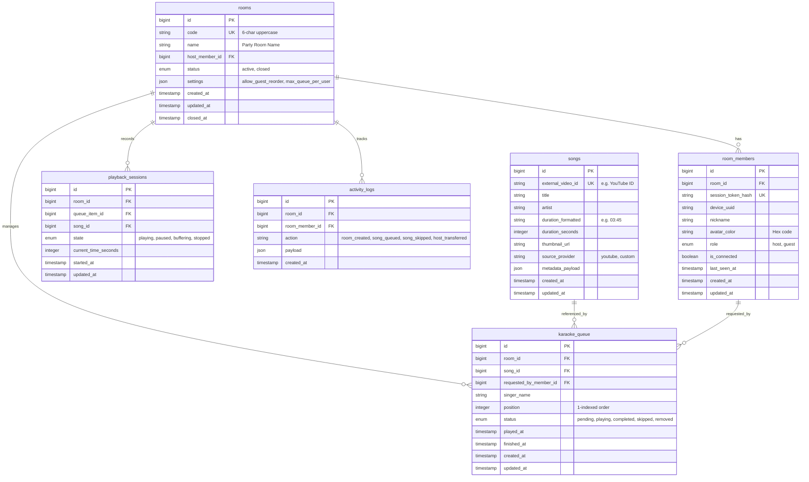

# Spec — Karaoke Party (QueueMic) Cloud-Based Room & Queue System

> **Ticket:** `T00001` (queuemic) — this file is `.agents/specs/queuemic/T00001/specs.md`; branch `T00001`.
> **Kind:** Greenfield — Cloud-based real-time Karaoke Room & Social Queue System.
> **Portal:** **`mobile-app` & `api`** (`/api/v1/...` routes, Expo React Native cross-platform client).
> **Version:** v1 — 2026-10-05 — initial production-ready architecture and UI/UX specification.
> **Route:** `/api/v1/rooms`, `/api/v1/rooms/{code}/*`, `/api/v1/songs/search`.
> **Conventions:** Clean Architecture, Action/Query Pattern, Event-Driven WebSocket Streaming, Dark Minimalist Glassmorphic UI.
> **System Awareness:** Models `created` (Room, RoomMember, Song, KaraokeQueue, PlaybackSession, ActivityLog); Tables `created`; Routes `created`; New migrations: `yes` (Initial Greenfield Schema).

---

## 1. Purpose

Traditional karaoke setups require passing around physical microphones, remote controls, or a single host mobile device to search YouTube, causing friction, interruptions, and chaotic turn-taking. 

**Karaoke Party** solves this by establishing a cloud-synchronized Karaoke Room. A single device connected to the TV/sound system acts as the **Host Player**, while party attendees join seamlessly from their personal smartphones by scanning a QR code or entering a 6-character room code. Guests can instantly search a rich song catalog, queue songs under their nickname, view real-time singer turn indicators, and follow along without ever needing passwords, account registrations, or manual video link copying.

---

## 2. Design Decisions (Pros & Cons)

### Decision 1: Authentication & Session Strategy

**Option A — Ephemeral Device-Bound Session Tokens with Laravel Sanctum (Recommended)**
- Generates a transient Bearer token tied to a `session_uuid` and `device_id` upon `createRoom` or `joinRoom`. Does not require email/password registration. Token is stored in device SecureStore / AsyncStorage.

| Pros | Cons |
|---|---|
| Zero-friction onboarding (join in < 3 seconds via QR code). | If user clears app data, their active nickname connection is orphaned (mitigated by room heartbeat / cleanup). |
| Compatible with standard Laravel Sanctum guard and policy authorizers. | Sessions are tied to device tokens rather than permanent cross-device accounts. |
| Clean separation between Host role and Guest role stored on the `room_members` pivot. | |

**Option B — Pure Cookie-Based State with Ephemeral Sessions**
- Uses stateful encrypted HTTP cookies and session headers.

| Pros | Cons |
|---|---|
| Native Laravel session handling without token storage. | Fragile with React Native WebSocket handshakes (Laravel Reverb) and native mobile network transitions. |

**Recommendation:** Option A. Seamless guest onboarding is critical for party environments, while Sanctum tokens provide robust stateless authorization for both REST APIs and Reverb private/presence channels.

---

### Decision 2: Song Catalog Search & Karaoke Provider Integration

**Option A — Server-Side Provider Search Proxy with Local Song Caching (Recommended)**
- Mobile client calls `GET /api/v1/songs/search?q=...`. The backend queries the configured video provider (e.g., YouTube Data API v3 with karaoke filters or specialized karaoke API), normalizes metadata (`title`, `artist`, `duration`, `thumbnail_url`, `external_video_id`), caches results in the `songs` table, and returns clean DTOs to the client.

| Pros | Cons |
|---|---|
| API keys remain secure on the backend; zero exposure on client devices. | Requires backend caching layer (Redis / MySQL) to avoid hitting provider rate limits. |
| Consistent metadata schema regardless of underlying data provider. | Minimal proxy latency (~100-200ms) on search requests. |
| Host player only receives sanctioned playback IDs. | |

**Option B — Direct Client-Side Provider API Calling**
- Mobile clients call YouTube / External APIs directly with client-embedded API keys.

| Pros | Cons |
|---|---|
| Offloads backend server traffic. | High security risk (leaked API keys), quota exhaustion, and inconsistent search filtering across client versions. |

**Recommendation:** Option A. Keeps provider API secrets strictly confidential, enables centralized rate-limiting/caching, and ensures uniform karaoke search formatting.

---

### Decision 3: Real-Time Event Synchronization Engine

**Option A — Laravel Reverb WebSockets with Presence & Private Channels (Recommended)**
- Uses Laravel 12's native first-party WebSocket server (Laravel Reverb) via Pusher protocol and `laravel-echo` in React Native. Broadcasts room state mutations (`MemberJoined`, `QueueUpdated`, `SongStarted`, `PlaybackStateChanged`, `HostTransferred`, `RoomClosed`).

| Pros | Cons |
|---|---|
| Sub-50ms real-time latency across all connected mobile clients. | Requires WebSocket connection maintenance and auto-reconnect logic on mobile network blips. |
| Built-in Presence Channels allow instant detection of joined/offline guests. | Requires running the Reverb daemon in production (`php artisan reverb:start`). |
| Zero external SaaS costs (unlike Pusher cloud). | |

**Option B — HTTP Long-Polling / Periodic Polling (e.g., every 3s)**
- Clients periodically poll `GET /api/v1/rooms/{code}/state`.

| Pros | Cons |
|---|---|
| Simple server infrastructure without WebSocket daemon. | High server load, significant battery drain on phones, and sluggish party experience (up to 3s delay). |

**Recommendation:** Option A. Real-time instant updates are fundamental to an exciting, responsive karaoke party experience.

---

### Decision 4: Playback Synchronization & Host Player Engine

**Option A — Host-Authoritative State Engine with Broadcast Sync (Recommended)**
- The Host device is the sole playback clock authority. When a song starts, pauses, or finishes, the Host emits playback status events to `POST /api/v1/rooms/{code}/playback`. The backend updates the database and broadcasts the canonical state to all connected guests.

| Pros | Cons |
|---|---|
| Immune to network race conditions across multiple guest phones. | If Host loses connectivity, song progression pauses until Host reconnects or Host is transferred. |
| Guaranteed single audio/video stream playing in the room. | Host app must run in foreground or with screen awake (WakeLock API). |
| Precise synchronization for lyrics/progress bar across guest views. | |

**Option B — Server-Side Timer Tick Engine**
- Backend increments playback clock and automatically pops queue items based on duration timers.

| Pros | Cons |
|---|---|
| Independent of Host device connectivity. | Desynchronizes if Host buffers video, pauses locally, or experiences stream lag. |

**Recommendation:** Option A. Audio/video buffering is local to the Host hardware; Host-authoritative synchronization ensures the queue moves exactly when the actual video finishes or when the Host hits Skip.

---

## 2.5 Acceptance Criteria

| # | Given | When | Then |
|---|---|---|---|
| **AC-1** | User enters host nickname `"Alex"` and room name `"Friday Jam"` on Home | Presses "Create Room" | Room is created with unique 6-character alphanumeric code, user is assigned `role: 'host'`, Sanctum token is returned, and status is `201 Created`. |
| **AC-2** | Guest has valid room code `"K7P9X2"` and nickname `"Sam"` | Presses "Join Room" or scans QR | Guest receives member token, room state, `200 OK`, and `MemberJoined` is broadcast via Reverb Presence Channel. |
| **AC-3** | Guest inputs invalid / non-existent room code `"XXXXXX"` | Submits join request | Backend returns `404 Not Found` with `{"message": "Room not found or closed", "code": "ROOM_NOT_FOUND"}`. |
| **AC-4** | Guest searches `"Bohemian Rhapsody"` | Debounced search triggers | Backend queries song provider, caches song metadata, and returns `200 OK` with normalized results array. |
| **AC-5** | Guest taps "+ Add Queue" on song `song_id: 42` | POST to `/api/v1/rooms/{code}/queue` | Item appended to queue at position `N+1`, `QueueUpdated` broadcast with full ordered list, returns `201 Created`. |
| **AC-6** | Guest attempts to call Host-only action (e.g. `POST /api/v1/rooms/{code}/playback/skip`) | Non-host token is passed | Rejection with `403 Forbidden` and `{"message": "Only the room host can control playback", "code": "HOST_PERMISSION_REQUIRED"}`. |
| **AC-7** | Host taps "Move Up" on queue item at position 3 | POST `/api/v1/rooms/{code}/queue/{id}/move` with `direction: "up"` | Queue item swapped to position 2, positions re-indexed in atomic DB transaction, `QueueUpdated` event broadcast. |
| **AC-8** | Host presses "Skip" or current song ends | POST `/api/v1/rooms/{code}/playback/next` | Current item marked `status: 'completed'`, next queue item marked `status: 'playing'`, `SongStarted` event broadcast. |
| **AC-9** | Host selects "Transfer Host" to member `"Sam"` | POST `/api/v1/rooms/{code}/transfer-host` with `new_host_member_id` | Member `"Sam"` becomes `role: 'host'`, caller downgraded to `role: 'guest'`, `HostChanged` event broadcast to room. |
| **AC-10** | Host initiates "Close Room" | DELETE `/api/v1/rooms/{code}` | Room status marked `closed`, `RoomClosed` broadcast, all member sessions invalidated, returning `200 OK`. |
| **AC-11** | Guest attempts to add song to queue with empty/whitespace nickname or query | Validation fails | Returns `422 Unprocessable Content` with field-level validation errors. |
| **AC-12** | Host device screen is on Player screen | Playback starts | Native `expo-keep-awake` prevents screen sleep; full-screen video renders with responsive controls and queue sidebar. |

---

## 3. Database Schema (MySQL 8.0+)



### Table Definitions & Indexes

#### 1. `rooms`
- `id` (BIGINT UNSIGNED, AUTO_INCREMENT, PRIMARY KEY)
- `code` (VARCHAR(8), UNIQUE, INDEX) — e.g. `K7P9X2`
- `name` (VARCHAR(100), NOT NULL)
- `host_member_id` (BIGINT UNSIGNED, NULLABLE)
- `status` (ENUM('active', 'closed'), DEFAULT 'active', INDEX)
- `settings` (JSON, NULLABLE) — e.g. `{"allow_explicit": true, "max_songs_per_user": 5}`
- `created_at`, `updated_at`, `closed_at` (TIMESTAMP)

#### 2. `room_members`
- `id` (BIGINT UNSIGNED, AUTO_INCREMENT, PRIMARY KEY)
- `room_id` (BIGINT UNSIGNED, NOT NULL, FOREIGN KEY -> `rooms.id` ON DELETE CASCADE)
- `session_token_hash` (VARCHAR(64), UNIQUE, INDEX)
- `device_uuid` (VARCHAR(64), NOT NULL)
- `nickname` (VARCHAR(50), NOT NULL)
- `avatar_color` (VARCHAR(7), NOT NULL, DEFAULT '#6366F1')
- `role` (ENUM('host', 'guest'), DEFAULT 'guest')
- `is_connected` (BOOLEAN, DEFAULT TRUE)
- `last_seen_at` (TIMESTAMP, NOT NULL)
- `created_at`, `updated_at` (TIMESTAMP)
- **Composite Index:** `(room_id, is_connected)`, `(room_id, role)`

#### 3. `songs`
- `id` (BIGINT UNSIGNED, AUTO_INCREMENT, PRIMARY KEY)
- `external_video_id` (VARCHAR(100), UNIQUE, INDEX)
- `title` (VARCHAR(255), NOT NULL)
- `artist` (VARCHAR(255), NOT NULL, DEFAULT 'Unknown')
- `duration_formatted` (VARCHAR(10), NOT NULL, DEFAULT '00:00')
- `duration_seconds` (INTEGER UNSIGNED, NOT NULL, DEFAULT 0)
- `thumbnail_url` (TEXT, NOT NULL)
- `source_provider` (VARCHAR(50), DEFAULT 'youtube')
- `metadata_payload` (JSON, NULLABLE)
- `created_at`, `updated_at` (TIMESTAMP)
- **Fulltext Index:** `(title, artist)` for high-speed catalog lookups.

#### 4. `karaoke_queue`
- `id` (BIGINT UNSIGNED, AUTO_INCREMENT, PRIMARY KEY)
- `room_id` (BIGINT UNSIGNED, NOT NULL, FOREIGN KEY -> `rooms.id` ON DELETE CASCADE)
- `song_id` (BIGINT UNSIGNED, NOT NULL, FOREIGN KEY -> `songs.id`)
- `requested_by_member_id` (BIGINT UNSIGNED, NOT NULL, FOREIGN KEY -> `room_members.id`)
- `singer_name` (VARCHAR(50), NOT NULL)
- `position` (INTEGER UNSIGNED, NOT NULL)
- `status` (ENUM('pending', 'playing', 'completed', 'skipped', 'removed'), DEFAULT 'pending', INDEX)
- `played_at` (TIMESTAMP, NULLABLE)
- `finished_at` (TIMESTAMP, NULLABLE)
- `created_at`, `updated_at` (TIMESTAMP)
- **Composite Index:** `(room_id, status, position)`

#### 5. `playback_sessions`
- `id` (BIGINT UNSIGNED, AUTO_INCREMENT, PRIMARY KEY)
- `room_id` (BIGINT UNSIGNED, NOT NULL, UNIQUE, FOREIGN KEY -> `rooms.id` ON DELETE CASCADE)
- `queue_item_id` (BIGINT UNSIGNED, NULLABLE, FOREIGN KEY -> `karaoke_queue.id`)
- `song_id` (BIGINT UNSIGNED, NULLABLE, FOREIGN KEY -> `songs.id`)
- `state` (ENUM('playing', 'paused', 'buffering', 'stopped'), DEFAULT 'stopped')
- `current_time_seconds` (INTEGER UNSIGNED, DEFAULT 0)
- `started_at` (TIMESTAMP, NULLABLE)
- `updated_at` (TIMESTAMP)

#### 6. `activity_logs`
- `id` (BIGINT UNSIGNED, AUTO_INCREMENT, PRIMARY KEY)
- `room_id` (BIGINT UNSIGNED, NOT NULL, FOREIGN KEY -> `rooms.id` ON DELETE CASCADE)
- `room_member_id` (BIGINT UNSIGNED, NULLABLE, FOREIGN KEY -> `room_members.id` ON DELETE SET NULL)
- `action` (VARCHAR(50), NOT NULL)
- `payload` (JSON, NULLABLE)
- `created_at` (TIMESTAMP)

---

## 4. Backend Architecture (Laravel 12)

### Clean Architecture & Folder Structure

```text
backend/
├── app/
│   ├── Actions/
│   │   ├── Room/
│   │   │   ├── CreateRoomAction.php
│   │   │   ├── JoinRoomAction.php
│   │   │   ├── LeaveRoomAction.php
│   │   │   ├── TransferHostAction.php
│   │   │   └── CloseRoomAction.php
│   │   ├── Queue/
│   │   │   ├── AddSongToQueueAction.php
│   │   │   ├── MoveQueueItemAction.php
│   │   │   ├── RemoveQueueItemAction.php
│   │   │   └── ReorderQueueAction.php
│   │   └── Playback/
│   │       ├── StartNextSongAction.php
│   │       ├── UpdatePlaybackStateAction.php
│   │       └── SkipCurrentSongAction.php
│   ├── Queries/
│   │   ├── Room/
│   │   │   ├── GetRoomDetailsQuery.php
│   │   │   └── GetRoomMembersQuery.php
│   │   ├── Queue/
│   │   │   ├── GetRoomQueueQuery.php
│   │   │   └── GetCurrentPlayingQuery.php
│   │   └── Song/
│   │       └── SearchKaraokeSongsQuery.php
│   ├── Services/
│   │   ├── KaraokeProvider/
│   │   │   ├── KaraokeProviderInterface.php
│   │   │   ├── YouTubeKaraokeProvider.php
│   │   │   └── MockKaraokeProvider.php
│   │   └── CodeGenerator/
│   │       └── RoomCodeGeneratorService.php
│   ├── Events/
│   │   ├── MemberJoinedRoomEvent.php
│   │   ├── MemberLeftRoomEvent.php
│   │   ├── QueueUpdatedEvent.php
│   │   ├── SongStartedEvent.php
│   │   ├── PlaybackStateChangedEvent.php
│   │   ├── HostTransferredEvent.php
│   │   └── RoomClosedEvent.php
│   ├── Http/
│   │   ├── Controllers/Api/V1/
│   │   │   ├── RoomController.php
│   │   │   ├── QueueController.php
│   │   │   ├── PlaybackController.php
│   │   │   ├── SongController.php
│   │   │   └── MemberController.php
│   │   ├── Requests/V1/
│   │   │   ├── CreateRoomRequest.php
│   │   │   ├── JoinRoomRequest.php
│   │   │   ├── AddQueueRequest.php
│   │   │   ├── MoveQueueRequest.php
│   │   │   ├── UpdatePlaybackRequest.php
│   │   │   └── TransferHostRequest.php
│   │   └── Middleware/
│   │       ├── EnsureRoomMember.php
│   │       └── EnsureRoomHost.php
│   ├── Models/
│   │   ├── Room.php
│   │   ├── RoomMember.php
│   │   ├── Song.php
│   │   ├── KaraokeQueue.php
│   │   ├── PlaybackSession.php
│   │   └── ActivityLog.php
│   └── Policies/
│       ├── RoomPolicy.php
│       └── KaraokeQueuePolicy.php
├── config/
│   ├── reverb.php
│   └── karaoke.php
└── routes/
    ├── api.php
    └── channels.php
```

### REST API Endpoints Specification

| Method | Endpoint | Description | Auth Required |
|---|---|---|---|
| `POST` | `/api/v1/rooms` | Create new room & register Host | None |
| `POST` | `/api/v1/rooms/join` | Join existing room as Guest | None |
| `GET` | `/api/v1/rooms/{code}` | Get complete room metadata & state | Room Member |
| `DELETE` | `/api/v1/rooms/{code}` | Close room and terminate session | **Host Only** |
| `POST` | `/api/v1/rooms/{code}/leave` | Leave active room | Room Member |
| `POST` | `/api/v1/rooms/{code}/transfer-host` | Transfer Host role to another member | **Host Only** |
| `GET` | `/api/v1/rooms/{code}/members` | List connected room members | Room Member |
| `GET` | `/api/v1/songs/search` | Search karaoke catalog | Room Member |
| `GET` | `/api/v1/rooms/{code}/queue` | Get ordered active queue & current item | Room Member |
| `POST` | `/api/v1/rooms/{code}/queue` | Add selected song to party queue | Room Member |
| `DELETE` | `/api/v1/rooms/{code}/queue/{queueId}` | Remove item from queue | Host or Song Owner |
| `POST` | `/api/v1/rooms/{code}/queue/{queueId}/move` | Move item up/down in queue | **Host Only** |
| `GET` | `/api/v1/rooms/{code}/playback` | Get current playback status & progress | Room Member |
| `POST` | `/api/v1/rooms/{code}/playback/state` | Update state (playing, paused, buffering) | **Host Only** |
| `POST` | `/api/v1/rooms/{code}/playback/next` | Advance to next queued song | **Host Only** |
| `POST` | `/api/v1/rooms/{code}/playback/skip` | Skip current song | **Host Only** |

### Broadcast WebSocket Channels (`routes/channels.php`)

```php
// Presence channel for real-time room state and member presence
Broadcast::channel('room.{code}', function ($user, $code) {
    $member = RoomMember::where('session_token_hash', hash('sha256', $user->token))
        ->whereHas('room', fn($q) => $q->where('code', $code)->where('status', 'active'))
        ->first();

    if ($member) {
        return [
            'id' => $member->id,
            'nickname' => $member->nickname,
            'role' => $member->role,
            'avatar_color' => $member->avatar_color,
        ];
    }
    return false;
});
```

---

## 5. Frontend Architecture (React Native & Expo)

### Tech Stack & Libraries
- **Framework**: React Native with Expo SDK 52+ (Managed Workflow, Prebuild compatible)
- **Language**: TypeScript (Strict Mode)
- **Navigation**: React Navigation v7 (Native Stack + Bottom Sheets)
- **State Management**: Zustand (Global UI, Room State, Session Storage via `expo-secure-store`)
- **Server Cache & Mutation**: TanStack React Query v5
- **Real-Time WebSockets**: `laravel-echo` + `pusher-js` connected to Laravel Reverb
- **Styling & Design System**: TailwindCSS via NativeWind v4 + Custom Glassmorphic tokens
- **Media & Device Controls**: `react-native-youtube-iframe` / `expo-video`, `expo-keep-awake`, `expo-camera` (QR scanner), `expo-haptics`

### Frontend Folder Structure

```text
mobapp/
├── src/
│   ├── api/
│   │   ├── client.ts              # Axios instance with Bearer interceptors
│   │   ├── roomApi.ts             # Create, Join, Leave, Close, Transfer
│   │   ├── queueApi.ts            # List, Add, Move, Remove
│   │   ├── songApi.ts             # Search catalog
│   │   └── playbackApi.ts         # Play, Pause, Next, Skip
│   ├── components/
│   │   ├── common/
│   │   │   ├── GlassCard.tsx      # Frosted glass card container
│   │   │   ├── NeonButton.tsx     # Vibrant gradient CTA button
│   │   │   ├── GradientText.tsx   # Premium gradient typography
│   │   │   ├── AvatarBadge.tsx    # Member initials with vibrant color ring
│   │   │   ├── AnimatedPressable.tsx # Micro-interaction spring button
│   │   │   └── Toast.tsx          # Non-blocking HUD alerts
│   │   ├── room/
│   │   │   ├── QRCodeModal.tsx    # Room share QR Code generator
│   │   │   ├── MemberListSheet.tsx # Connected users bottom drawer
│   │   │   └── TransferHostModal.tsx
│   │   ├── queue/
│   │   │   ├── QueueItemCard.tsx  # Song card with singer tag & drag handle
│   │   │   ├── NowPlayingHero.tsx # Pulsing vinyl / glowing player card
│   │   │   └── EmptyQueueState.tsx
│   │   ├── player/
│   │   │   ├── HostVideoPlayer.tsx # Full-screen YouTube/Video embedded player
│   │   │   ├── PlaybackControls.tsx # Play/Pause/Skip glowing HUD
│   │   │   └── NextUpOverlay.tsx  # Next singer banner preview
│   │   └── search/
│   │       ├── SearchInput.tsx    # Instant debounced search bar
│   │       ├── SongSearchResultItem.tsx
│   │       └── AddSingerModal.tsx # Custom singer nickname picker
│   ├── hooks/
│   │   ├── useEchoRoom.ts         # Reverb WebSocket listener lifecycle hook
│   │   ├── useKeepAwakeHost.ts    # Screen wake lock for Host Player
│   │   ├── useDebounce.ts
│   │   └── useHaptics.ts
│   ├── navigation/
│   │   ├── RootNavigator.tsx      # Stack Navigator (Auth/Home vs Room vs HostPlayer)
│   │   └── types.ts               # ParamList typed definitions
│   ├── screens/
│   │   ├── SplashScreen.tsx       # Animated glowing logo launch screen
│   │   ├── HomeScreen.tsx         # Create Room / Join Room cards
│   │   ├── CreateRoomScreen.tsx   # Host setup screen
│   │   ├── JoinRoomScreen.tsx     # Code input & QR scanner screen
│   │   ├── GuestRoomScreen.tsx    # Guest Dashboard (Now Playing + Queue + Search)
│   │   ├── HostPlayerScreen.tsx   # TV/Screen Output Mode with video player
│   │   ├── SongSearchScreen.tsx   # Songbook exploration screen
│   │   └── SettingsScreen.tsx     # Host controls, room settings & close
│   ├── store/
│   │   ├── useAuthStore.ts        # Session token, nickname, device_id, role
│   │   ├── useRoomStore.ts        # Current room, code, members list
│   │   └── useQueueStore.ts       # Active queue, now playing item
│   ├── theme/
│   │   ├── colors.ts              # Obsidian Black, Cyber Purple, Neon Cyan
│   │   ├── typography.ts          # Outfit / Inter typography scale
│   │   └── index.ts
│   └── utils/
│       ├── formatting.ts          # Duration mm:ss, initials
│       └── storage.ts             # SecureStore wrappers
├── app.json
├── package.json
└── tsconfig.json
```

---

## 6. UI/UX & Design Specification

### Aesthetic Foundation
- **Theme**: Ultra-Modern Dark Luxury (Inspired by Spotify, Netflix, Apple Music)
- **Palette**:
  - **Background**: Obsidian Void `#0A0A0F`, Slate Sheet `#12131C`
  - **Accents**: Cyber Violet `#8B5CF6`, Neon Fuchsia `#EC4899`, Electric Cyan `#06B6D4`
  - **Card Surfaces**: Glassmorphism with 1px border `rgba(255, 255, 255, 0.08)`, subtle backdrop blur
  - **Text**: Pure Frost `#F8FAFC`, Muted Violet `#94A3B8`, Golden Mic `#F59E0B`
- **Typography**: Large, bold headings with high-contrast metadata badges.
- **Haptics**: Subtle tactile feedback on adding songs, skipping, and reordering.

### Key Screen Flows

```text
┌────────────────────────────────────────────────────────┐
│                      SPLASH SCREEN                     │
│               [ Glowing Neon Microphone ]              │
│                     KARAOKE PARTY                      │
└───────────────────────────┬────────────────────────────┘
                            │
                            ▼
┌────────────────────────────────────────────────────────┐
│                       HOME SCREEN                      │
│                                                        │
│  ┌────────────────────────┐  ┌──────────────────────┐  │
│  │     🎤 CREATE ROOM     │  │     📱 JOIN ROOM     │  │
│  │   Start hosting party  │  │   Enter code or scan │  │
│  └────────────────────────┘  └──────────────────────┘  │
└─────────────┬───────────────────────────┬──────────────┘
              │                           │
              ▼ (Host Path)               ▼ (Guest Path)
┌───────────────────────────┐ ┌──────────────────────────┐
│     CREATE ROOM MODAL     │ │     JOIN ROOM SCREEN     │
│  Room Name: [Family Jam ] │ │  Room Code: [ K 7 P 9 X 2]│
│  Your Name: [Alex (Host)] │ │  Your Name: [Maria       ]│
│  [  LAUNCH PARTY ROOM  ]  │ │  [ SCAN QR ] [ JOIN NOW ]│
└─────────────┬─────────────┘ └───────────┬──────────────┘
              │                           │
              ▼                           ▼
┌───────────────────────────┐ ┌──────────────────────────┐
│    HOST PLAYER SCREEN     │ │    GUEST ROOM SCREEN     │
│  ┌─────────────────────┐  │ │  ┌────────────────────┐  │
│  │   FULL-SCREEN VIDEO │  │ │  │ NOW PLAYING:       │  │
│  │   (Lyrics on TV)    │  │ │  │ "My Way" - Sinatra │  │
│  └─────────────────────┘  │ │  │ Singer: John 🎤    │  │
│  NOW PLAYING: "My Way"    │ │  └────────────────────┘  │
│  [ ⏸ PAUSE ] [ ⏭ SKIP ]   │ │  UPCOMING QUEUE (3 songs)│
│  Next: "Zombie" (Pedro)   │ │  1. "Perfect" (Maria)    │
│  Room Code: K7P9X2 [QR]   │ │  2. "Zombie" (Pedro)     │
│  [ + Search / Add Song ]  │ │  [ 🔍 SEARCH SONG BOOK ] │
└───────────────────────────┘ └──────────────────────────┘
```

---

## 7. Business Rules, Edge Cases & Failure Modes

### Non-Functional & Failure-Mode Checklist

| Category | Requirement & System Behavior |
|---|---|
| **Authorization & Boundaries** | Only the authenticated member with `role === 'host'` can execute playback commands (`/playback/*`), remove other members' songs, move queue items, or close the room. Guests attempting host actions receive `403 Forbidden` (`HOST_PERMISSION_REQUIRED`). |
| **Concurrency & Duplicate Guard** | Song queueing uses database transactions with row-level locks on `karaoke_queue` to ensure deterministic sequential `position` integers. Double-tapping "+ Add" is mitigated by frontend button debounce (500ms) and backend duplicate check (prevents identical song queued by same singer within 5 seconds). |
| **Idempotency on Retries** | Unique queue insertions assign UUID transaction keys. If network drops during request, retrying with same payload does not generate duplicate queue records. |
| **Error Response Shapes** | All API errors return a standard JSON envelope: `{"success": false, "message": "...", "code": "ERROR_CODE", "errors": {}}`. Standard status codes: `400 Bad Request`, `401 Unauthorized`, `403 Forbidden`, `404 Not Found`, `422 Unprocessable Content`, `500 Server Error`. |
| **Input Validation Boundaries** | Room names: 2-50 chars. Nicknames: 2-30 chars, alphanumeric with emojis allowed, sanitized against XSS. Room codes: 6 uppercase chars matching `^[A-Z0-9]{6}$`. Search queries: trimmed, minimum 2 chars, max 100 chars. |
| **Host Disconnect Handling** | If Host disconnects, the room remains open for up to 30 minutes. If the host rejoins with their stored session token, they immediately reclaim host authority. If host explicitly chooses "Transfer Host", another member is promoted seamlessly. |
| **Room Teardown** | When Host taps "Close Room", backend marks room `status = 'closed'`, disconnects Reverb channels, and pushes `RoomClosedEvent`. All guest apps immediately transition to Home screen with a "Party Ended" toast alert. |

---

## 8. Build Order & Implementation Phases

```text
Phase 1: Backend Infrastructure & Core Models (Gate 2 Prep)
├── 1.1 Laravel 12 API scaffolding + Laravel Reverb WebSocket setup
├── 1.2 Database migrations (rooms, room_members, songs, karaoke_queue, playback_sessions, activity_logs)
├── 1.3 Eloquent Models with relationships, casts, and query scopes
├── 1.4 RoomCodeGeneratorService & KaraokeProviderService (YouTube API / Mock driver)
└── 1.5 Base Action & Query classes

Phase 2: Frontend Design-First UI Scaffolding (Gate 1)
├── 2.1 React Native Expo setup with TypeScript & NativeWind v4
├── 2.2 Theme tokens (Obsidian dark palette, typography, glass cards, glowing accents)
├── 2.3 Reusable UI components (GlassCard, NeonButton, AvatarBadge, NowPlayingHero, QueueItemCard)
├── 2.4 Mobile Screens with mock hardcoded data (Home, CreateRoom, JoinRoom, GuestRoom, HostPlayer, SongSearch)
└── 2.5 User design validation & UI review

Phase 3: Backend API Endpoints & Real-Time Events
├── 3.1 Room Actions: CreateRoomAction, JoinRoomAction, TransferHostAction, CloseRoomAction
├── 3.2 Queue Actions: AddSongToQueueAction, MoveQueueItemAction, RemoveQueueItemAction
├── 3.3 Playback Actions: StartNextSongAction, UpdatePlaybackStateAction, SkipCurrentSongAction
├── 3.4 Reverb Broadcast Events (MemberJoined, QueueUpdated, SongStarted, PlaybackStateChanged, RoomClosed)
└── 3.5 API Controllers, FormRequests, and Policy Authorizers

Phase 4: Frontend Live Dynamic Data & WebSocket Wiring (Gate 2)
├── 4.1 Axios API client & TanStack React Query hooks
├── 4.2 Zustand stores (Auth, Room, Queue, Playback)
├── 4.3 Laravel Echo + Reverb listener integration in `useEchoRoom` hook
├── 4.4 Host Video Player integration (YouTube embedded player with keep-awake lock)
└── 4.5 QR Code Generator & Scanner integration

Phase 5: Verification & Quality Assurance
├── 5.1 Adversarial Spec Verification (`/webkit.verify`)
├── 5.2 Code & Security Diff Review (`/webkit.code-review`)
├── 5.3 Mobile Device E2E Party Flow Simulation
└── 5.4 Feature Documentation (`/webkit.document`)
```

---

## 9. Out of Scope (Future Specs)

- **Singer Voice Pitch & Scoring Engine** (Planned for T00002)
- **Real-time Emoji & Cheer Reactions during singing** (Planned for T00003)
- **Room Passwords & Private VIP Rooms**
- **Android TV Standalone Native App Mode**
- **Spotify / Apple Music Karaoke Lyric Integrations**
- **Singer History & Party Highlights Leaderboard**

---

## 10. Definition of Done

- [ ] Every row in the **Acceptance Criteria** table passes (`AC-1` … `AC-12`).
- [ ] Every category in the **Non-Functional & Failure-Mode Checklist** is fully addressed and verified.
- [ ] Clean Architecture separation enforced across `Actions/`, `Queries/`, `Services/`, and thin Controllers.
- [ ] No hardcoded secrets; API credentials managed securely via `.env`.
- [ ] Mobile UI passes premium design audit with smooth animations and responsive dark glass aesthetic.
- [ ] Spec verified by `/webkit.verify` with zero `CRITICAL` or `HIGH` findings.
