# Dependency Map — ReactJS Web Application (QueueMic Web)

<!--
TEMPLATE: dependency-map (dependency-map.md — written by /webkit-context; rewritten on every run)
-->

| Field | Value |
| --- | --- |
| Ticket | T00002 (queuemic) |
| Context Run | v1 — 2026-10-17 |

## 1. Chains

```mermaid
flowchart TD
  subgraph Frontend Web Architecture
    WebHome["webapp/src/pages/HomePage.tsx"]
    WebHost["webapp/src/pages/HostPlayerPage.tsx"]
    WebGuest["webapp/src/pages/GuestRoomPage.tsx"]
    WebClient["webapp/src/api/client.ts"]
    WebEcho["webapp/src/services/echo.ts"]
    WebClock["webapp/src/services/serverClock.ts"]
    WebEchoHook["webapp/src/hooks/useEchoRoom.ts"]
    WebStores["webapp/src/store/* (auth, room, queue, playback)"]
  end

  subgraph API Layer
    RouteRoom["POST /api/v1/rooms & /join"]
    RouteQueue["GET/POST/DELETE /api/v1/rooms/{code}/queue"]
    RoutePlayback["POST /api/v1/rooms/{code}/playback/*"]
    RouteTime["GET /api/v1/time"]
    RouteBC["GET/POST /api/v1/broadcasting/*"]
    RouteSongs["GET /api/v1/songs/search"]
  end

  subgraph Backend Controllers
    CtrlRoom["RoomController"]
    CtrlQueue["QueueController"]
    CtrlPlayback["PlaybackController"]
    CtrlBC["BroadcastAuthController"]
    CtrlSong["SongController"]
  end

  subgraph Backend Clean Architecture
    ActCreate["CreateRoomAction"]
    ActJoin["JoinRoomAction"]
    ActAddQueue["AddSongToQueueAction"]
    ActPlayback["UpdatePlaybackStateAction"]
    QryQueue["GetRoomQueueQuery"]
    QrySong["SearchKaraokeSongsQuery"]
  end

  subgraph Realtime Broadcast
    EventQueue["QueueUpdatedEvent (.queue.updated)"]
    EventPlayback["PlaybackStateChangedEvent (.playback.state_changed)"]
    EventSong["SongStartedEvent (.song.started)"]
    PresChannel["PresenceChannel('room.{code}')"]
  end

  subgraph Database Models
    ModelRoom[("Room")]
    ModelMember[("RoomMember")]
    ModelQueue[("KaraokeQueue")]
    ModelSession[("PlaybackSession")]
    ModelSong[("Song")]
  end

  WebHome --> WebClient
  WebHost --> WebEchoHook & WebStores & WebClient
  WebGuest --> WebEchoHook & WebStores & WebClient
  WebEchoHook --> WebEcho & WebClock
  WebClient --> RouteRoom & RouteQueue & RoutePlayback & RouteTime & RouteSongs
  WebEcho --> RouteBC

  RouteRoom --> CtrlRoom
  RouteQueue --> CtrlQueue
  RoutePlayback --> CtrlPlayback
  RouteTime --> CtrlPlayback
  RouteBC --> CtrlBC
  RouteSongs --> CtrlSong

  CtrlRoom --> ActCreate & ActJoin
  CtrlQueue --> ActAddQueue & QryQueue
  CtrlPlayback --> ActPlayback
  CtrlSong --> QrySong

  ActCreate --> ModelRoom & ModelMember & ModelSession
  ActJoin --> ModelMember
  ActAddQueue --> ModelQueue & EventQueue
  ActPlayback --> ModelSession & EventPlayback

  EventQueue & EventPlayback & EventSong --> PresChannel
  PresChannel -.->|WebSocket stream| WebEcho
```

## 2. Edges

| From | To | Relation | Evidence |
| --- | --- | --- | --- |
| `RoomController@store` | `CreateRoomAction::execute()` | calls | `backend/app/Http/Controllers/Api/V1/RoomController.php:29` |
| `RoomController@join` | `JoinRoomAction::execute()` | calls | `backend/app/Http/Controllers/Api/V1/RoomController.php:51` |
| `QueueController@index` | `GetRoomQueueQuery::execute()` | queries | `backend/app/Http/Controllers/Api/V1/QueueController.php:25` |
| `QueueController@store` | `AddSongToQueueAction::execute()` | calls | `backend/app/Http/Controllers/Api/V1/QueueController.php:51` |
| `AddSongToQueueAction` | `QueueUpdatedEvent` | dispatches | `backend/app/Actions/Queue/AddSongToQueueAction.php:72` |
| `PlaybackController@clock` | `server_time_ms` | returns | `backend/app/Http/Controllers/Api/V1/PlaybackController.php:45` |
| `PlaybackController@updateState` | `UpdatePlaybackStateAction::execute()` | calls | `backend/app/Http/Controllers/Api/V1/PlaybackController.php:56` |
| `UpdatePlaybackStateAction` | `PlaybackStateChangedEvent` | dispatches | `backend/app/Actions/Playback/UpdatePlaybackStateAction.php:50` |
| `BroadcastAuthController@authenticate` | `RoomMember::where('session_token_hash')` | authorizes | `backend/app/Http/Controllers/Api/V1/BroadcastAuthController.php:30` |
| `routes/channels.php` | `presence-room.{code}` | defines presence payload | `backend/routes/channels.php:12-46` |
| `serverClock.ts` | `GET /api/v1/time` | NTP samples | `mobapp/src/services/serverClock.ts:20` |
| `echo.ts` | `GET /api/v1/broadcasting/config` | fetches WS options | `mobapp/src/services/echo.ts:68` |
| `echo.ts` | `POST /api/v1/broadcasting/auth` | authenticates socket | `mobapp/src/services/echo.ts:168` |
| `useEchoRoom.ts` | `echo.join('room.' + code)` | subscribes presence | `mobapp/src/hooks/useEchoRoom.ts:48` |

## 3. Callers That Must Keep Working

| Changed node | Caller | Evidence |
| --- | --- | --- |
| `POST /api/v1/rooms` | `mobapp/src/screens/CreateRoomScreen.tsx` via `roomApi.createRoom` | `mobapp/src/api/roomApi.ts:8` |
| `POST /api/v1/rooms/join` | `mobapp/src/screens/JoinRoomScreen.tsx` via `roomApi.joinRoom` | `mobapp/src/api/roomApi.ts:23` |
| `GET /api/v1/rooms/{code}/queue` | `mobapp/src/screens/HostPlayerScreen.tsx`, `GuestRoomScreen.tsx` | `mobapp/src/api/queueApi.ts:26` |
| `POST /api/v1/rooms/{code}/queue` | `mobapp/src/components/search/SongSearchModal.tsx` via `queueApi.addToQueue` | `mobapp/src/api/queueApi.ts:40` |
| `POST /api/v1/rooms/{code}/playback/state` | `mobapp/src/components/player/PlaybackControls.tsx` via `playbackApi.updatePlaybackState` | `mobapp/src/api/playbackApi.ts:18` |
| `GET /api/v1/time` | `mobapp/src/services/serverClock.ts` | `mobapp/src/services/serverClock.ts:20` |
| `GET /api/v1/broadcasting/config` | `mobapp/src/services/echo.ts` | `mobapp/src/services/echo.ts:68` |
| `presence-room.{code}` | `mobapp/src/hooks/useEchoRoom.ts` | `mobapp/src/hooks/useEchoRoom.ts:48` |
