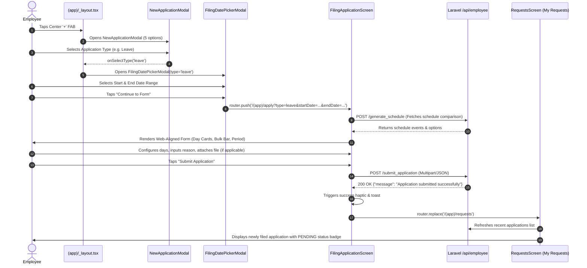

# Spec — Filing Application Mobile Screen & Workflow (Expo React Native)

> **Kind:** Greenfield / UI Migration & Redesign — Porting, elevating, and aligning the 5 timekeeping filing applications (`leave`, `cs`, `aa`, `ot`, `obt`) into the modern **React Native Expo Mobile Application** (`resources/views/mobapp`).  
> **Portal:** **Employee Mobile App** (`/api/employee/...` routes, `filing` mobile module).  
> **Version:** v3 — 2026-09-07 — amended route to /(app)/apply query params, enforced single-day overtime, live expo-document-picker, and biometric vs filed application calendar separation per verify report.  
> **Route:** `/(app)/apply` (`FilingApplicationScreen`), triggered via floating action button (FAB) in `/(app)/_layout.tsx` -> `NewApplicationModal.tsx` -> `FilingDatePickerModal.tsx` -> `/(app)/apply` -> `/(app)/requests`.  
> **Conventions:** [project-profile.md](../../rules/project-profile.md), [ui-design.md](../../rules/ui-design.md), [hrms-rules.md](../../rules/hrms-rules.md), [laravel-standards.md](../../rules/laravel-standards.md).  
> **System Awareness:**  
> - **Models Reused:** `AppLeave`, `AppChangeShift`, `AppOvertime`, `AppAdjustment`, `AppOfficialBusinessTrip`, `PayPeriod`, `Timesheet`, `AccountDetailVW`, `ApproverMatrix`.  
> - **Tables Reused:** `app_leaves`, `app_changeshift`, `app_overtime`, `app_adjustment`, `app_obtrip`, `payperiods`, `timesheets`, `tbl_account_details`.  
> - **Routes Reused:** `POST /api/employee/generate_schedule`, `POST /api/employee/submit_application`, `GET /api/employee/shift_schedule`, `POST /api/employee/checkExistingLogs`, `POST /api/employee/getLeavesCredit`, `GET /api/payroll/payPeriod`, `POST /api/employee/cancel_application`, `POST /api/employee/application-details`.  
> - **New Migration Needed:** No (Reuses existing domain tables, queries, handlers, and unified submission endpoints).

---

## 1. Purpose

In the legacy Vue mobile app (`mobapp-vue`), timekeeping applications were scattered across separate mobile pages with inconsistent UX. In the web application (`resources/views/web/src/module/employee/timekeeping_applications`), filing follows a cohesive two-phase experience: selecting the application type and date range, reviewing live schedule comparisons (current vs. new shifts, missed logs, or leave balances), adjusting day-by-day parameters, and reviewing filed requests in a unified status tracker.

This specification defines the **end-to-end Mobile Filing Application workflow for React Native Expo (`resources/views/mobapp`)**, matching the exact **functional concepts and design consistency of the Web HRMS portal**:
1. **Application Type Picker (`NewApplicationModal.tsx`)**: Tapping the center `+` FAB opens the bottom sheet with 5 application options: Leave, Change Shift, Attendance Adjustment, Overtime, and Official Business Trip.
2. **Dedicated Date Range Selection Modal (`FilingDatePickerModal.tsx`)**: Tapping an application type immediately opens a calendar modal with cutoff-period awareness, shift indicator dots, rest days, holiday badges, and distinct biometric time logs (Sky Blue dot `#0EA5E9`) separated from filed applications (Amber dot `#F59E0B`). The user confirms their date range (`From Date` → `To Date`, or single-day for Overtime) before advancing.
3. **Web-Aligned Application Form (`/(app)/apply`)**: After confirming dates, the user is redirected to the full-screen filing form replicating the web's layout and controls:
   - **Recap Header**: Shows the chosen type, date range, and a badge with the total days count (`X Day(s) Selected`).
   - **Type-Specific Schedule & Controls**:
     - **Change Shift (`cs`)**: "Shift Change Setup" with "Generate Schedule" button, Bulk Apply bar ("Apply to all" shift selector), progress bar (`X/Y set`), and day-by-day cards showing `Current Shift -> New Shift` with a clear button.
     - **Attendance Adjustment (`aa`)**: "Time Log Correction" with "Generate Schedule" button, day-by-day `Time In` and `Time Out` time pickers, and automated net hours computation (auto-deducting 1-hour lunch when > 5 hours).
     - **Overtime (`ot`)**: "Overtime Summary" with "Generate Schedule" button, Shift summary card, Reference Time, and Est. OT Hours (enforcing minimum 1h beyond regular shift and strictly single-day filing matching daily attendance punch logs).
     - **Official Business Trip (`obt`)**: "Trip Type" selector, "Trip Schedule" with "Generate Schedule" button, and day-by-day period selectors (`Whole Day`, `First Half`, `Second Half`).
     - **Leave (`leave`)**: Leave Credit selector with balance cards (entitled, used, pending, balance, or LWOP), "Leave Schedule" with "Generate Schedule" button, and day-by-day period selectors.
   - **Reason / Justification**: Required multi-line text input (minimum 5 characters).
   - **Supporting Attachment**: File/document upload (PDF, JPG, PNG up to 5MB via `expo-document-picker`). **Conditionally rendered: hidden for Change Shift (`cs`) and Overtime (`ot`)** to match web behavior exactly.
4. **Post-Submission Redirect to Application Status Page (`/(app)/requests`)**: Upon successful submission, the screen shows a success toast and haptic feedback, then **immediately redirects to the mobile app's Application Status page (`/(app)/requests`)**, refreshing the requests list so the new application appears with its real-time `PENDING` status badge.

---

## 2. Design Decisions (Pros & Cons)

### Decision 1: Overall Filing Navigation & Step Progression

**Option A — 3-Step Flow: Type Modal → Date Picker Modal → Form Screen → Redirect to Requests Status Page (Recommended)**
- **Step 1:** Center FAB `+` opens `NewApplicationModal` (5 options).
- **Step 2:** Selecting a type closes the type sheet and presents `FilingDatePickerModal` to select start/end dates.
- **Step 3:** Confirming dates redirects to `/(app)/apply?type=[type]&startDate=YYYY-MM-DD&endDate=YYYY-MM-DD`.
- **Step 4:** On submit success, screen navigates to `/(app)/requests` ("My Requests" status screen) with an updated list.

| Pros | Cons |
|---|---|
| • **Zero Ambiguity:** User knows the application type and date range before loading heavy schedule data.<br>• **Direct Parity with Web:** Matches web flow where dates are locked before schedule generation.<br>• **Immediate Status Tracking:** Redirecting to `/(app)/requests` reassures the user that their request was successfully queued and shows the live status badge.<br>• **Clean Ergonomics:** Full-screen form avoids bottom-tab or bottom-sheet keyboard clipping. | • Requires coordinating two modal steps before reaching the form. |

**Option B — Selecting Type Navigates Directly to Empty Form Screen Where Dates Are Picked**
- Selecting a type navigates to `/(app)/apply/[type]` with blank dates. The user picks dates inside the form.

| Pros | Cons |
|---|---|
| • One fewer modal step up front. | • High initial visual clutter; empty schedule cards and disabled generate buttons confuse first-time mobile users; deviates from the web modal flow. |

**Recommendation:** **Option A**. Matches the user's explicit requirement and aligns with the web workflow.

---

### Decision 2: Mobile Form Layout Parity with Web (`ApplicationTypeSelectorModal.vue`)

**Option A — Identical Functional Sections & Conditional Controls (Recommended)**
Replicate the exact web structure inside `FilingApplicationScreen`:
1. **Recap Header Bar**: Application icon, title, selected date range, and `X Days Selected` badge with an "Edit Dates" link.
2. **Type-Specific Schedule Block**:
   - Header with "Generate Schedule" button.
   - For Change Shift: Bulk Apply Bar + Progress Bar + Day Cards (`Current -> New`).
   - For Attendance Adjustment: Day Cards with Time-In/Time-Out + Net Hours.
   - For Overtime: Summary Card with Shift, Reference Hours, Est. OT Hours, 1h minimum warning.
   - For Official Business: Trip Type select + Day Cards with Period select.
   - For Leave: Leave Balance selector + Day Cards with Period select.
3. **Reason / Justification Textarea**: Minimum 5 characters.
4. **Conditional Supporting Attachment**: Visible **only** for `leave`, `aa`, and `obt`; **hidden** for `cs` and `ot` (identical to web line 674: `v-if="selectedType !== 'cs' && selectedType !== 'ot'"`).
5. **Sticky Submit Bar**: Displays validation state and sends payload to `/api/employee/submit_application`.

| Pros | Cons |
|---|---|
| • 100% consistent UX and business logic between Web and Mobile.<br>• Eliminates employee confusion when switching between desktop and phone.<br>• Reuses identical validation rules, field keys, and API contracts. | • Requires crafting dedicated sub-components for each of the 5 filing types. |

**Option B — Generic Simplified Form for All Types**
- A single generic form with date pickers, one note field, and one upload button without schedule generation or day-by-day breakdown.

| Pros | Cons |
|---|---|
| • Less UI code. | • Fails backend validation; cannot support multi-day half-day leaves, shift comparisons, or attendance adjustment hour math. |

**Recommendation:** **Option A**. Delivers full feature parity with the web HRMS platform.

---

### Decision 3: Post-Submission Destination & Feedback

**Option A — Immediate Redirect to `/(app)/requests` ("My Requests" Status Page) with Auto-Refresh (Recommended)**
- Upon `200 OK` from `POST /api/employee/submit_application`:
  1. Trigger success haptic (`Haptics.notificationAsync(Success)`).
  2. Show a brief success toast (`"Application submitted successfully"`).
  3. Replace/navigate route to `/(app)/requests`.
  4. Trigger dashboard/requests hook refresh so the newly created item appears at the top under `PENDING`.

| Pros | Cons |
|---|---|
| • Confirms successful submission immediately in the user's primary tracking view.<br>• Clean user mental model: "I filed -> now I monitor its status".<br>• Prevents accidental duplicate submissions from users lingering on the completed form. | • Form inputs are cleared upon leaving the screen (intended behavior on success). |

**Option B — Stay on Form Screen with "File Another" Button**
- Show a static success modal and stay on the empty form screen.

| Pros | Cons |
|---|---|
| • Convenient if filing 5 leaves in a row. | • Employees rarely file multiple different applications consecutively; creates confusion about whether the request actually submitted. |

**Recommendation:** **Option A**. Directly fulfills the requirement: *"after fill up form mo redirect dayon siya sa application status page in app"*.

---

### Decision 4: Attachment Handling & File Upload

**Option A — `expo-document-picker` with Conditional Render (Hidden for `cs` and `ot`) (Recommended)**
- Support `.pdf`, `.png`, `.jpg`, `.jpeg` up to 5MB.
- Attachment picker renders **only** for `leave`, `attendance-adjustment`, and `official-business`.
- Attachment picker is completely hidden for `change-shift` and `overtime`.

| Pros | Cons |
|---|---|
| • Strict parity with web HRMS rules.<br>• Prevents employees from uploading unnecessary files for shift changes or overtime where supporting documents are not accepted. | • Requires conditional rendering in form wrapper. |

**Option B — Show Attachment for All Types**
- Allow file uploads on all 5 types.

| Pros | Cons |
|---|---|
| • Uniform layout. | • Violates web business logic; shifts and OT do not have file columns in `app_changeshift` and `app_overtime`. |

**Recommendation:** **Option A**. Strictly mirrors the database and web implementation.

---

## 2.5 Acceptance Criteria

| # | Given | When | Then |
|---|-------|------|------|
| **AC-1** | User is on any main app tab and taps the center `+` FAB | FAB is pressed | `NewApplicationModal` opens from bottom displaying the 5 application options: Change Shift, Attendance Adjustment, Overtime, Official Business Trip, and Leave. |
| **AC-2** | User selects any application type (e.g. Leave) from `NewApplicationModal` | Option is tapped | `NewApplicationModal` closes, and `FilingDatePickerModal` immediately opens displaying the calendar grid with active pay period boundaries and shift/holiday dots. |
| **AC-3** | User picks `startDate` and `endDate` in `FilingDatePickerModal` | User taps "Continue to Form" / "Proceed" | Date modal closes, light haptic feedback fires, and user is redirected to `/(app)/apply?type=[type]&startDate=YYYY-MM-DD&endDate=YYYY-MM-DD`. |
| **AC-4** | `FilingApplicationScreen` loads with query params | Screen initializes | Header displays the application title, type icon, and a recap chip: `YYYY-MM-DD → YYYY-MM-DD` with `X Day(s) Selected` and an "Edit Dates" link. |
| **AC-5** | User files **Change Shift (`cs`)** and taps **Generate Schedule** | `POST /api/employee/generate_schedule` returns data | Screen displays Bulk Apply Bar ("Apply to all" shift selector), Progress bar (`X/Y set`), and Day Cards showing Current Shift → New Shift dropdown with clear `(X)` button. |
| **AC-6** | User files **Change Shift** and selects a shift in the Bulk Apply Bar | Bulk shift is selected | All generated day cards instantly update their `newshift` value, and progress updates to `100% (X/X set)`. |
| **AC-7** | User files **Attendance Adjustment (`aa`)** and taps **Generate Schedule** | Schedule is generated | Day cards render `Time In` and `Time Out` time pickers for each date. Entering `08:00` to `17:00` automatically computes net `8.0h` (1-hour lunch deducted). |
| **AC-8** | User files **Overtime (`ot`)** and taps **Generate Schedule** | Schedule is generated | Displays shift summary card, reference times, and estimated OT hours (`otPlanHours`). If OT is less than 1 hour beyond shift, banner warns `"Overtime must be at least 1 hour beyond regular shift"`. |
| **AC-9** | User selects date for **Overtime (`ot`)** | Date picker is configured for Overtime | Calendar operates in single-date mode (`isRangeMode = false`); selecting a date locks both start and end dates to that single calendar date, blocking multi-day overtime spans. |
| **AC-10** | User files **Official Business Trip (`obt`)** | Form renders | Screen displays "Trip Type" selector (Client Visit, Conference, Field Work, etc.), "Trip Schedule" with "Generate Schedule", and day cards with Period selector (`Whole Day`, `First Half`, `Second Half`). |
| **AC-11** | User files **Leave (`leave`)** | Screen renders | Displays leave credit balances carousel/cards (`Entitled`, `Used`, `Pending`, `Balance`, and `LWOP`). Selecting a leave type populates day cards with Period selectors (`Whole Day`, `First Half`, `Second Half`). |
| **AC-12** | Form is loaded for **Change Shift (`cs`)** or **Overtime (`ot`)** | Attachment section checks type | Attachment upload section is **completely hidden** from the screen. |
| **AC-13** | Form is loaded for **Leave (`leave`)**, **Attendance Adjustment (`aa`)**, or **Official Business Trip (`obt`)** | User taps "Attach document or image" | Native file picker (`expo-document-picker`) opens allowing document/image selection (`.pdf`, `.png`, `.jpg`, `.jpeg`) up to 5MB with file chip and remove `(X)` button. Files exceeding 5MB trigger an alert and are blocked. |
| **AC-14** | User enters reason with fewer than 5 characters | Form validates | Submit button remains disabled; helper text indicates `"Remarks must be at least 5 characters."` |
| **AC-15** | All required fields and schedules are configured and user taps **Submit Application** | Button is tapped | Medium haptic triggers, button shows loading spinner and disables (`isSubmitting = true`), and payload is sent to `POST /api/employee/submit_application`. |
| **AC-16** | Submission succeeds (`200 OK`) | Backend responds | Success toast displays, success haptic triggers, and app **immediately redirects to `/(app)/requests` (Application Status Page)**, where the newly submitted application appears at the top of "My Requests" with a `PENDING` status badge. |
| **AC-17** | Server returns `400` or `422` error | Backend responds with error | Error toast displays the server message (`error.message`), form remains open with user-entered inputs intact, and submit button re-enables. |
| **AC-18** | User views calendar in `FilingDatePickerModal` on dates with biometric punches and filed applications | Calendar renders day dots and event list | Biometric punches (`Time In` / `Time Out`) display under `BIOMETRIC TIME LOG` (Sky Blue dot `#0EA5E9`) without approval badges; genuine filed applications display under `FILED APPLICATION` (Amber dot `#F59E0B`) with approval status badges (`pending`/`approved`/`declined`). |

---

## 3. Database

Reuses existing domain tables, columns, and relationships without schema modifications.

### Reused Domain Tables

| Table Name | Entity / Purpose | Key Columns | Soft Delete | Relationship IDs |
|---|---|---|---|---|
| `app_leaves` | Leave applications | `id`, `idacct`, `idleave`, `date`, `period` (1=Whole, 2=First Half, 3=Second Half), `remarks`, `file`, `status` (0=Pending, 1=Approved, 2=Declined, 3=Cancelled) | `status` (0/1) | Index only (`idacct`, `idleave`) |
| `app_changeshift` | Shift change requests | `id`, `idacct`, `date_start`, `date_end`, `oldshiftid`, `newshiftid`, `remarks`, `status` | `status` (0/1) | Index only (`idacct`, `newshiftid`) |
| `app_overtime` | Overtime requests | `id`, `idacct`, `date`, `time_from`, `time_to`, `total_hours`, `ot_type`, `remarks`, `status` | `status` (0/1) | Index only (`idacct`) |
| `app_adjustment` | Missed log adjustments | `id`, `idacct`, `date`, `time_in`, `time_out`, `adjustment_type`, `remarks`, `status` | `status` (0/1) | Index only (`idacct`) |
| `app_obtrip` | Official business trips | `id`, `idacct`, `date_start`, `date_end`, `destination`, `purpose`, `remarks`, `status` | `status` (0/1) | Index only (`idacct`) |
| `payperiods` | Active payroll cutoffs | `id`, `period`, `period_start`, `period_end`, `paydate`, `status` (1=Active) | N/A | None |
| `tbl_account_details` | Employee profile & approvers | `id`, `empid`, `fullname`, `dep_id`, `pos_id`, `comp_id` | N/A | None |

---

## 4. Backend Architecture

Reuses existing Laravel controller endpoints and domain handlers in `app/Http/Controllers/employee/TKApplicationController.php`.

### API Endpoints Reused

```text
POST /api/employee/generate_schedule    -> TKApplicationController@generate_schedule
POST /api/employee/submit_application  -> TKApplicationController@submit_application
GET  /api/employee/shift_schedule       -> TKApplicationController@index
POST /api/employee/checkExistingLogs    -> TKApplicationController@checkExistingLogs
POST /api/employee/getLeavesCredit      -> TKApplicationController@leavesCredit
GET  /api/payroll/payPeriod             -> TKApplicationController@payPeriod
POST /api/employee/cancel_application   -> TKApplicationController@cancel_application
POST /api/employee/application-details  -> TKApplicationController@applicationDetails
```

### Exact Submission Contract Matching Web (`POST /api/employee/submit_application`)

Sent as `multipart/form-data` when a file is attached (for `leave`, `aa`, `obt`), or `application/json` when no file:

```typescript
// Common shape across all 5 types
{
  additional: {
    type: 'leave' | 'cs' | 'ot' | 'aa' | 'obt',
    remarks: string,
    idleave?: number,         // for leaves
    obt_type?: string,        // for obt (e.g. 'Client Visit')
  },
  data: Array<{
    date: string,             // YYYY-MM-DD
    period?: number,          // 1=Whole Day, 2=First Half, 3=Second Half (leave, obt)
    idleave?: number,         // Leave type ID (leave)
    oldshift?: number,        // Current shift ID (cs)
    newshift?: number,        // Requested shift ID (cs)
    timein?: string,          // HH:mm (aa)
    timeout?: string,         // HH:mm (aa)
    hrs?: number,             // Computed net hours (aa)
    ot_start?: string,        // HH:mm (ot)
    ot_end?: string,          // HH:mm (ot)
    ot_hours?: number         // (ot)
  }> | Object,
  file?: File | { uri: string, name: string, type: string }
}
```

---

## 5. Frontend Architecture (React Native / Expo 54)

### Module Directory Structure (`resources/views/mobapp/`)

```text
resources/views/mobapp/src/
├── app/
│   └── (app)/
│       ├── _layout.tsx                     # FAB triggers NewApplicationModal & DatePickerModal
│       ├── requests.tsx                    # Application Status Page ("My Requests")
│       └── apply.tsx                       # Unified Application Form Screen receiving ?type&startDate&endDate
└── module/
    └── employee/
        ├── requests/                       # Application Status Module
        │   ├── pages/
        │   │   └── RequestsScreen.tsx      # Target redirect screen showing filed requests & statuses
        │   └── index.ts
        └── filing/                         # Filing Application Module
            ├── index.ts                    # Barrel export
            ├── types.ts                    # TypeScript DTOs, enum types, form state
            ├── services/
            │   └── filing.api.ts           # HTTP client hitting backend endpoints
            ├── hooks/
            │   ├── useFilingApplication.ts # Master reactive state, schedule generator & submitter
            │   └── useShiftCalendar.ts     # Shifts, holidays & cutoff loader
            ├── pages/
            │   └── FilingApplicationScreen.tsx # Master form screen
            └── components/
                ├── FilingHeader.tsx        # Screen header with Back button & step chip
                ├── FilingDateRecapCard.tsx # Recap card with date range, total days, & edit action
                ├── FilingDatePickerModal.tsx # Cutoff-aware calendar modal for date selection
                ├── LeaveCreditSelector.tsx # Balance cards for leave types & LWOP
                ├── FileAttachmentPicker.tsx # Conditional document/image picker (hidden for CS/OT)
                ├── FilingStickySubmitBar.tsx # Floating summary & Submit CTA
                └── forms/
                    ├── ChangeShiftForm.tsx # Bulk apply bar + progress + current->new day cards
                    ├── AttendanceAdjustmentForm.tsx # Time In/Out pickers & automated net hours
                    ├── OvertimeForm.tsx    # Shift recap, reference hours & 1h OT threshold
                    ├── OfficialBusinessTripForm.tsx # Trip type selector + period day cards
                    └── LeaveForm.tsx       # Day-by-day period configuration list
```

### Form Route Handler (`src/app/(app)/apply.tsx`)

```tsx
import React from 'react';
import { useLocalSearchParams } from 'expo-router';
import { FilingApplicationScreen } from '@/module/employee/filing';

export default function ApplyRoute() {
  const { type, startDate, endDate } = useLocalSearchParams<{
    type?: string;
    startDate?: string;
    endDate?: string;
  }>();

  return (
    <FilingApplicationScreen
      initialType={type}
      initialStartDate={startDate}
      initialEndDate={endDate}
    />
  );
}
```

### Complete End-to-End User Flow



---

## 6. Business Rules & Edge Cases

### HRMS Domain Rules

1. **Cutoff Boundary Enforcement**:
   - Dates must fall within the active pay period cutoff (`cutoff_period.status === 1`). The calendar visually locks and greys out unselectable dates outside the cutoff.
2. **Leave Balance Check**:
   - Paid leave submissions require `balance >= requested_days`.
   - If credits are 0, user must select **Leave Without Pay (LWOP)** (`idleave = 3 or 34`).
3. **Overtime Threshold & Single-Day Constraint**:
   - Overtime must be at least 1 hour beyond regular shift hours.
   - Overtime application is strictly single-date only (`isRangeMode = false`), evaluated and validated against that date's biometric attendance punch logs. Multi-day date selection is blocked in the calendar modal.
4. **Lunch Break Deduction**:
   - Attendance Adjustment work hours automatically subtract 1 hour for unpaid lunch when gross hours exceed 5 hours.
5. **Conditional File Upload Rules**:
   - **Hidden**: For Change Shift (`cs`) and Overtime (`ot`), file attachments are omitted from the form.
   - **Visible**: For Leave (`leave`), Attendance Adjustment (`aa`), and Official Business Trip (`obt`), file attachments (up to 5MB via `expo-document-picker`) are supported.
6. **Post-Submit Redirection**:
   - Submissions must never leave the user hanging on a completed form. Upon receiving `200 OK`, the application must navigate immediately to `/(app)/requests` ("My Requests" status page).
7. **Biometric Punch vs. Filed Application Isolation**:
   - Biometric punches (`Time In` and `Time Out`) fetched from attendance endpoints represent raw punch records, rendered under `BIOMETRIC TIME LOG` with Sky Blue dot (`#0EA5E9`) and no approval status badge.
   - Genuine employee-filed requests (`leave`, `cs`, `aa`, `ot`, `obt`) render under `FILED APPLICATION` with Amber dot (`#F59E0B`) and interactive approval status badges (`PENDING`, `APPROVED`, `DECLINED`).

### Non-Functional & Failure-Mode Checklist

| Category | Requirement & Contract |
|---|---|
| **Authorization** | Secured via Bearer JWT in `SecureStorageService`. Invalid/expired token redirects to `/(auth)/login`. |
| **Concurrency / Double-Submit** | Submit button disables immediately on tap (`isSubmitting = true`), triggers haptic feedback, and renders spinning loader. Prevents multiple network calls on spam tapping. |
| **Idempotency on Retries** | Submissions check existing pending logs to avoid creating duplicate applications on network retries. |
| **Error Response Shape** | Standard `{ "message": "..." }` response on 400/422. Form displays a clear error toast without clearing user-entered draft data, re-enabling the submit button for correction. |
| **Input Validation Boundaries** | - `startDate <= endDate`.<br>- `remarks`: Minimum 5 characters, maximum 500 characters.<br>- `attachment`: Maximum 5MB; allowed types: `.pdf`, `.png`, `.jpg`, `.jpeg`. |

---

## 7. Build Order

Following the design-first workflow (`Gate 1` static UI mockup -> `Gate 2` dynamic backend integration):

### Phase A: Mobile UI & Scaffolding (Gate 1 - Design-First with Hard-Coded Data)
1. **Modal Architecture**:
   - Connect `NewApplicationModal.tsx` to open `FilingDatePickerModal.tsx` upon type selection.
   - Implement `FilingDatePickerModal.tsx` displaying the interactive calendar, active pay period range, and "Continue to Form" action.
2. **Route Configuration**:
   - Create `src/app/(app)/apply.tsx` (unified route handler accepting query parameters `?type=&startDate=&endDate=`).
   - Ensure `FilingDatePickerModal` redirects to `/(app)/apply?type=[type]&startDate=...&endDate=...`.
3. **Web-Aligned Form Components**:
   - Create `FilingDateRecapCard.tsx` with date range and `X Days Selected` badge.
   - Create `ChangeShiftForm.tsx` with Bulk Apply bar, progress bar, and day cards (`Current -> New`).
   - Create `AttendanceAdjustmentForm.tsx` with Time In/Out pickers and auto-calculated net hours.
   - Create `OvertimeForm.tsx` with Shift card, reference times, and est. OT hours.
   - Create `OfficialBusinessTripForm.tsx` with Trip Type select and period day cards.
   - Create `LeaveForm.tsx` with Leave Credit balance selector and period day cards.
   - Create `FileAttachmentPicker.tsx` with conditional rendering (hidden for `cs` and `ot`).
   - Create `FilingStickySubmitBar.tsx` with submit button and validation summary.
4. **Master Screen Assembly**: Assemble `FilingApplicationScreen.tsx`.
5. **Navigation to Status Page**: Wire submit handler to navigate to `/(app)/requests` upon success.
6. **User Review (Gate 1 Validation)**: User reviews the native screens, date selection modal, form layouts, and navigation flow.

### Phase B: Live Data Wiring & Integration (Gate 2 - Dynamic Backend)
7. **API Service Implementation**: Implement `filing.api.ts` connecting to live endpoints using typed `http`.
8. **Hook State Wiring**: Connect `useFilingApplication.ts` to live schedule generation (`POST /employee/generate_schedule`), leave credits (`POST /employee/getLeavesCredit`), and submission (`POST /employee/submit_application`).
9. **Requests Screen Live Refresh**: In `RequestsScreen.tsx`, trigger auto-refresh when navigating back from a successful submission so the new application is instantly visible under `PENDING`.
10. **Verification**: Run adversarial spec verification (`/webkit.verify`) to ensure 100% compliance with this spec.

---

## 8. Out of Scope (Future Specs)

- Offline submission draft caching with SQLite sync queue.
- Push notification deep-linking directly into manager approval view.

---

## 9. Definition of Done

- [ ] Every row in the **Acceptance Criteria** table passes (`AC-1` through `AC-18`).
- [ ] Every category in the **Non-Functional & Failure-Mode Checklist** is fulfilled.
- [ ] Flow matches: FAB `+` -> Type Selection -> Date Picker Modal -> Application Form -> Redirect to `/(app)/requests` Status Page.
- [ ] Form strictly matches web concepts from `ApplicationTypeSelectorModal.vue` (Change Shift bulk bar, Attendance Adjustment hours, Overtime summary, Leave credit selector, OBT trip type, conditional attachment hidden for CS/OT).
- [ ] Light & Dark mode themes look crisp and premium using `useAppTheme()`.
- [ ] Adversarial spec verification (`/webkit.verify`) passes with zero CRITICAL/HIGH findings.

<!-- Changelog -->
- v1 — 2026-09-03 — initial
- v2 — 2026-09-03 — updated flow: application type selection opens date range modal first, redirects to web-aligned application form, then redirects to my requests status screen on submit.
- v3 — 2026-09-07 — amended route to /(app)/apply query params, enforced single-day overtime, live expo-document-picker, and biometric vs filed application calendar separation per verify report.
