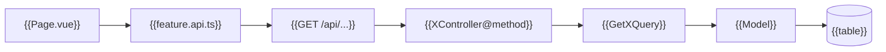

# Dependency Map — {{FEATURE_NAME}}

<!--
TEMPLATE: dependency-map (dependency-map.md — written by /webkit-context; rewritten on every run)

Generic fill rules: .agents/rules/conditional/skill-protocol.md §3.
1. Only the chains this feature touches. Node labels are real class, file, or route names.
2. Every edge has evidence: the file:line where one node calls, imports, or queries the other.
3. Graphify path / affected output is a lead; the evidence column is the source line you confirmed.
-->

| Field | Value |
| --- | --- |
| Ticket | {{T#####}} ({{project}}) |
| Context Run | v{{N}} — {{YYYY-MM-DD}} |

## 1. Chains

## 2. Edges

| From | To | Relation | Evidence |
| --- | --- | --- | --- |
| {{XController@method}} | {{GetXQuery}} | calls | {{file:line}} |

## 3. Callers That Must Keep Working

<!-- From graphify affected (or a targeted search) on each node likely to change. "None found." when empty. -->

| Changed node | Caller | Evidence |
| --- | --- | --- |
| {{GetXQuery}} | {{OtherController@index}} | {{file:line}} |
