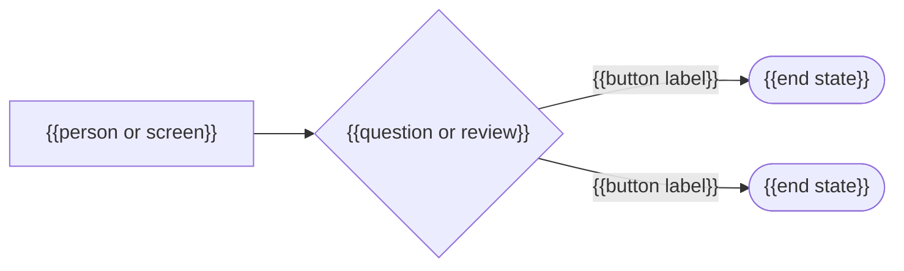
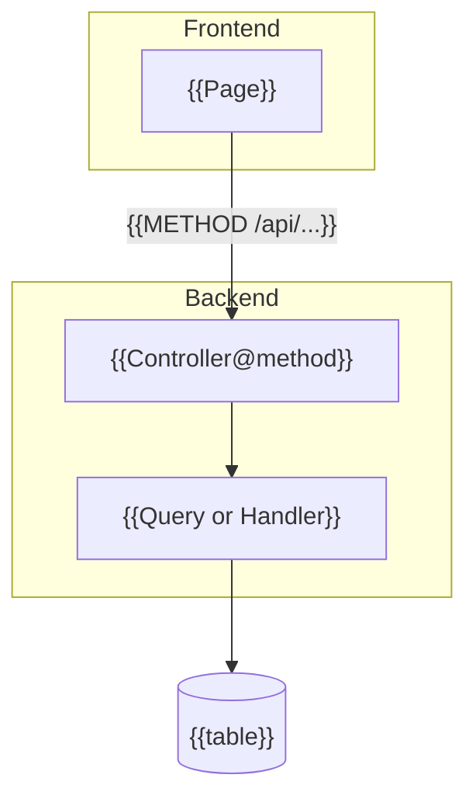

# {{Feature Name}}

<!--
TEMPLATE: feature-guide (used by /webkit-document)

Fill rules. Delete this comment and every other guide comment from the finished guide — except the
"Update history" marker at the bottom, which stays.
1. Follow this structure exactly. Do not create a custom format, add sections, remove sections, or reorder them.
   A block marked "one per …" repeats as often as needed.
2. Replace every {{PLACEHOLDER}}. A finished guide contains no "{{" (so never use mermaid's {{hexagon}} shape).
3. Never leave a field blank. If it does not apply, write "N/A — <reason>". An empty list says "None."
4. Every claim is verified against the code at the branch and commit in "Verified Against": each bold label greps
   to a template, each route to a routes file, each rule to a Query, Handler, or middleware, each link and #L
   anchor resolves, each diagram box names something real. What could not be verified is cut, or stated plainly
   as unverified; it is never written as fact.
5. The code wins over the spec. Describe what the code does, and record every difference from the spec under
   Known Issues and Limitations.
6. Above "Under the Hood": bold is the exact on-screen label copied from the template, italic is an example value;
   one action per numbered step, 25 words maximum; no developer words (endpoint, payload, query, component, store,
   state, hook, API, props) and no file paths, class names, or table names, except the File column of
   "Where to Find It". From "Under the Hood" down: real identifiers, linked relative from .agents/docs/ with #L
   line anchors.

The writer must NOT modify application code, specs, or data. A bug found while writing is recorded under Known
Issues and Limitations for /webkit-investigate; it is never fixed here.
-->

## Metadata

<!-- Ticket(s): every ticket that shaped the feature, newest first (T##### or F####), or "None — <reason>".
     Verified Against: the branch and short commit every claim below was checked on, or "working tree at <commit>". -->

| Field | Value |
| --- | --- |
| Project | {{project}} — resolved via {{evidence, e.g. "vue + pinia in package.json"}} |
| Portal | {{portal(s), or "N/A — project has no portals"}} |
| Feature | {{what the reader calls it; add the on-screen name when the UI brands it differently}} |
| Ticket(s) | {{T#####, F####, …, or "None"}} |
| Verified Against | {{branch}} @ `{{short commit}}` |
| Last Updated | {{YYYY-MM-DD}} |
| Guide Version | v{{N}} — {{what changed since the previous version, or "initial"}} |

---

## What It Is

<!-- 2–4 sentences: the problem it solves, who uses it, and, where confusion is likely, what it is NOT. -->

{{what it is, who uses it, and what it is not}}

---

## The Journey at a Glance

<!-- A mermaid picture of the reader's path or the approval flow. Nodes are people, screens, and button labels;
     7 boxes maximum; every label quoted; branching edges labelled. Required when the feature has a branch, more
     than one person, or more than three steps. Otherwise replace the block with
     "N/A — <n> steps, no branches; Step by Step below is the whole journey." -->

---

## Where to Find It

<!-- One row per page in the feature. Menu Path is copied from the navigation labels, not paraphrased. -->

| Portal | Menu Path | URL | File |
| --- | --- | --- | --- |
| {{portal, or "N/A — no portals"}} | {{**Menu** → **Page**}} | `{{/path}}` | [`{{page file}}`]({{../../resources/views/web/src/...}}) |

---

## Step by Step

<!-- One ### per TASK the reader wants to get done ("Generating payslips for a period"), never per screen region.
     One action per numbered step. Keep the "while you wait" line only when the wait is noticeable; delete it
     otherwise. -->

### {{Task the reader wants to get done}}

1. {{Open **Menu** → **Page**.}}
2. {{One action, naming the exact **Label** and an *example value*.}}
3. {{What the screen does next.}}

**What the page is doing while you wait:** {{what happens behind the screen, in plain words}}

---

## Rules That Decide What You See

<!-- Business rules that change what appears on screen, in plain words, each traced to a Query, Handler, or
     middleware (cited under "Under the Hood", not here). Include who sees what: roles, team or organization scope. -->

| Rule | What It Means on Screen |
| --- | --- |
| {{rule, in plain words}} | {{what the reader sees because of it}} |

---

## When Something Looks Wrong

<!-- One block per symptom a reader will actually hit, taken from the rules above and the empty, error, and disabled
     states in the templates: symptom, cause, what to do. Three real entries beat ten invented ones. -->

**{{The symptom, as the reader would describe it.}}**
{{Why it happens, in plain words.}} {{What to do, naming the exact **Label**.}}

---

## Under the Hood

<!-- From here down the reader is a developer who will edit the feature. Real identifiers; links relative from
     .agents/docs/ (../../app/..., ../../resources/...) with #L line anchors. -->

### The Data Behind It

<!-- Where each thing on screen comes from. If a value is computed rather than stored, say so outright ("there is no
     roster table") and give the resolution order. The Priority table is "N/A — <reason>" when one source supplies
     everything. -->

{{where the data comes from}}

| Priority | Source | Used When |
| --- | --- | --- |
| 1 | {{table.column, or computation}} | {{condition}} |

### Backend

<!-- One row per route the feature calls. Link the controller action and the Query / Handler / Action behind it. -->

| Method | Route | Controller Action | What It Does |
| --- | --- | --- | --- |
| `{{GET}}` | `{{/api/...}}` | [`{{Controller@method}}`]({{../../app/Http/Controllers/...}}#L{{42}}) | {{what it does, and the Query / Handler it calls}} |

### Frontend

<!-- Where the pages live; whether state is a composable or Pinia store, or a hook or React Context; how it is
     scoped. If two implementations of the same page exist, say they are duplicates. -->

- [`{{page or state file}}`]({{../../resources/views/web/...}}) — {{its role}}

### Architecture

<!-- How pages, controllers, Queries / Handlers, and tables connect (flowchart TB with subgraphs), or the request
     path (sequenceDiagram, or a fenced text tree). Real identifiers; every box verified. When "The Data Behind It"
     has a resolution order, add a priority-cascade flowchart here too. -->

---

## Glossary

<!-- Codes and status labels exactly as they appear on screen or in the data, with their meaning. "None." when the
     feature shows no codes. -->

| Term or Code | Meaning |
| --- | --- |
| `{{CODE}}` | {{meaning}} |

---

## Known Issues and Limitations

<!-- REQUIRED, and honest. Verified current behavior, numbered, each saying what actually happens ("Clicking Publish
     reports '0 draft schedules activated'", not "Publish may have issues"), including every difference from the
     spec. Link the investigation when one exists. Write "None found — verified against <branch> @ <commit>." only
     when that is true. -->

1. **{{Short title.}}** {{What actually happens, and when.}} {{Difference from the spec, if any.}} {{Investigation link, or "No investigation yet."}}

---

## Related Features

<!-- The neighbouring features a reader will confuse this with: where each is, the one-line difference, and a link to
     its guide when one exists. "None." if none. -->

- **{{Feature}}** ({{where to find it}}) — {{the one-line difference}}

<!-- Update history -->
